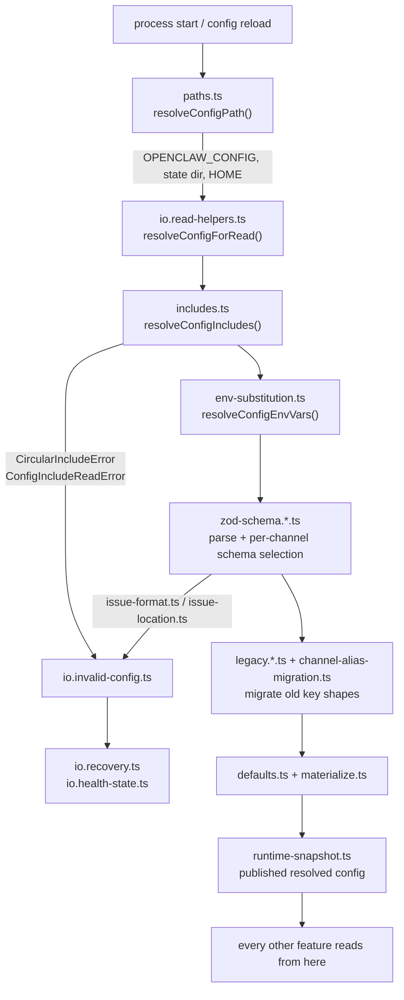
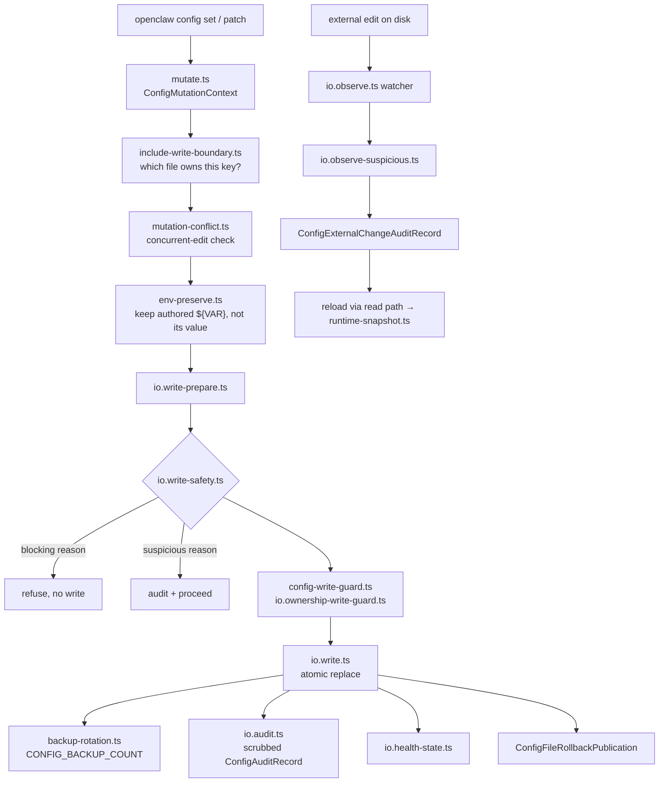

# F01 — config-and-schema

| | |
|---|---|
| describes | openclaw `v2026.10.3` @ `59cb44796b0f1f0daa0e37af8b1495abb45d9bc1` |
| paths | `src/config/`, `config/` |
| size | 1,400 tracked files · 883 code · 500 test · ~309,000 LOC |
| distinct dependents | 73 (second highest in the repo, after `src/infra`) |

## What it is, in plain English

This is the module that decides what openclaw *is* at runtime. Everything else asks it.

It owns four jobs that are usually separate projects:

1. **The file.** Finding `openclaw.json`, expanding its `$include` files, substituting `${ENV_VARS}`, and writing it back without losing the author's formatting or baking a resolved secret into disk.
2. **The schema.** A Zod schema (split across ~20 `zod-schema.*.ts` files) that is the only authority on which keys exist. Plus the human-readable help and label text for every key, which the CLI, the TUI and the web control panel all render from — they do not carry their own copies.
3. **The write safety envelope.** Backup rotation, an audit journal with secret scrubbing, ownership guards, suspicious-write detection, rollback proofs, and a persisted health state.
4. **The session store.** `src/config/sessions/` — 539 of the 883 code files — is the SQLite transcript accessor: reading, writing, compacting and reconciling conversation history.

Job 4 does not belong here. It is 60% of the module and has nothing to do with configuration. This single misplacement is the main reason `core/config` shows 73 dependents and 1,227 import edges into `core/state`: half of those dependents want conversation history, not settings.

## Process flow — read path

## Process flow — write and hot-reload path

The second half of that diagram is the mechanism behind observed hot reloads: an external edit to `openclaw.json` is picked up by the watcher and re-published through `runtime-snapshot.ts` without a process restart. Confirmed in practice for `agents.defaults.heartbeat.model`.

## Entry points worth knowing

| symbol | file | what it does |
|---|---|---|
| `loadConfig()` | `io.runtime.ts:103` | the synchronous front door most callers use |
| `loadConfigFromContextAsync()` | `io.load.ts:49` | same, with an injected IO context (how tests fake the filesystem) |
| `readConfigFileSnapshot()` | `io.runtime.ts:319` | raw file + fingerprint, before validation |
| `readConfigFileSnapshotForWrite()` | `io.runtime.ts:402` | snapshot taken under the write lock |
| `writeConfigFile()` | `io.runtime.ts:432` | the only sanctioned write |
| `resolveConfigIncludes()` | `includes.ts:622` | `$include` expansion with ownership |
| `resolveConfigEnvVars()` | `env-substitution.ts:154` | `${VAR}` substitution |
| `resolveConfigSecretRef()` | `resolution-facts.ts:234` | resolves a secret *reference* rather than a literal |
| `resolveConfigPath()` | `paths.ts:262` | the HOME / state-dir resolution that decides which config is live |

There is no `index.ts`. Callers import the specific file. That is why a wrong-tree grep in this module returns a clean zero instead of an error.

## Dependencies

**Out** — `core/state` (1,227 edges, almost all from `sessions/`), `core/infra` (933), `core/plugins` (221), `core/sessions` (168), `core/agents` (152), `core/shared` (151), `core/routing` (99), `core/gateway` (93).

**In** — `core/gateway` (4,151), `core/agents` (3,030), `core/commands` (1,848), `core/auto-reply` (934), `core/plugins` (766), `core/infra` (714), `core/cli` (707), `core/plugin-sdk` (326).

The `core/config ↔ core/infra` and `core/config ↔ core/state` pairs are both cycles. There is no layering to respect here; the module is entangled with its two biggest neighbours by design.

## Config keys this module owns

All of them. The schema is partitioned by concern, not by channel:

- `zod-schema.core.ts` — streaming, chunking, delivery
- `zod-schema.gateway.ts` — bind, tailscale, portal ingress, control-UI origins
- `zod-schema.agent-runtime.ts` / `zod-schema.agent-defaults-base.ts` / `zod-schema.agent-model.ts` — `agents.*`
- `zod-schema.session.ts` — `session.*`, `commands.*`
- `talk.ts` — `talk.*`, including `resolveConfiguredTalkRealtimeProviderId()` and `resolveConfiguredTalkSpeechProviderId()`
- `mcp-config.ts` / `mcp-config-normalize.ts` — `mcp.servers.*`
- `channel-schema-selection.ts` + `bundled-channel-config-metadata.generated.ts` — per-channel keys, selected dynamically

**This is the layer that rejects an invented key.** A patch naming a key the schema does not declare is refused with `Unrecognized key`, which makes `openclaw config schema` and `config patch --dry-run` the only reliable way to learn a key's real path — guessing from a key's english name fails, as `talk.mode` (invalid) versus `talk.realtime.mode` (valid) shows.

## Risks and traps

1. **`bundled-channel-config-metadata.generated.ts` is 330 KB of generated code.** Hand-editing it is silently reverted by the next generate step.
2. **`future-version-guard.ts` refuses a config written by a newer openclaw.** On a machine carrying two installs from different releases, pointing the older binary at the newer config fails here, not at the schema.
3. **`config-write-guard.ts` and `io.ownership-write-guard.ts` refuse writes when the process does not own the file.** A non-default state dir or config path makes these refuse rather than error loudly — the refusal surfaces as a skipped step somewhere else entirely.
4. **Secrets are references, not values.** `official-external-channel-secret-schema.ts` and `resolveConfigSecretRef()` exist so that credentials can live outside the config file. Writing a literal secret into config defeats a mechanism that is already there.
5. **`env-preserve.ts` is load-bearing.** Without it, any write would replace `${VAR}` with its resolved value and persist a secret to disk. Any new write path must go through `io.write-prepare.ts`, not around it.
6. **The 500 test files encode the real contract** — case-sensitivity of agent directories, surrogate-pair truncation in labels, channel alias migration, delivery-only channels having no streaming aliases. These are the specification; the types are not.

## Verdict

Healthy in its safety machinery — backups, audit scrubbing, rollback proofs and ownership guards are all genuinely implemented, not decorative. Unhealthy in its boundary: the session store should be its own feature. Any future split of `src/config` starts by moving `src/config/sessions/` out, and that move is what would break the 1,227 edges into `core/state`.
