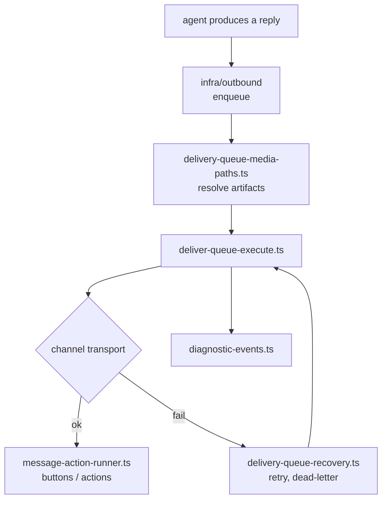
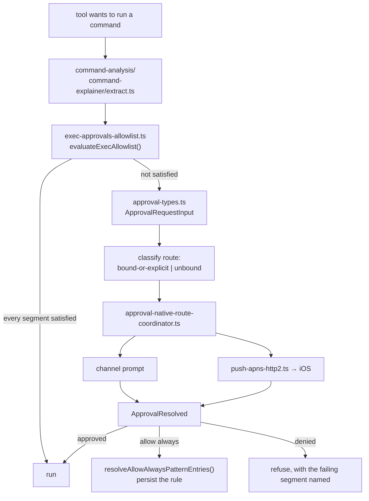
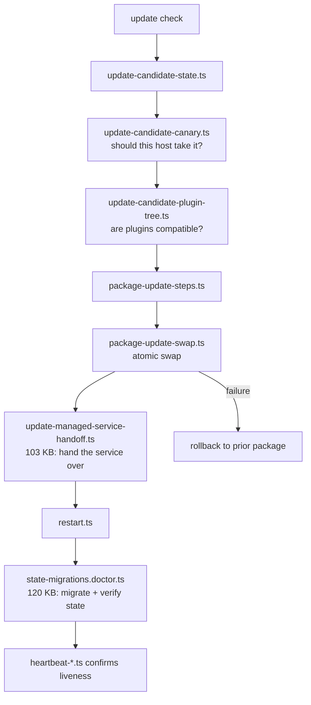

# F02 — infra

| | |
|---|---|
| describes | openclaw `v2026.10.3` @ `59cb44796b0f1f0daa0e37af8b1495abb45d9bc1` |
| paths | `src/infra/`, `src/shared/`, `src/utils/`, `src/types/`, `src/compat/` |
| size | 2,886 tracked files · 1,667 code · 1,215 test · ~659,000 LOC |
| distinct dependents | 78 — the highest in the repo |

## What it is, in plain English

The name is wrong. `src/infra` is not a utility drawer — it is the **operations layer**: everything about keeping a long-lived openclaw process alive, updated, reachable, and safe to run commands through. Generic helpers are a rounding error here (`src/utils` is 32 files, `src/shared` 149, `src/types` 3).

By file count, `src/infra` is really seven subsystems wearing one directory:

| cluster | files | what it actually does |
|---|---|---|
| `update-*`, `package-*`, `install-*`, `npm-*`, `clawhub-*` | ~290 | self-update: candidate selection, canary rollout, managed-service handoff, package swap, git transactions, plugin-tree resolution |
| `outbound/` | 143 | the outbound delivery queue — enqueue, execute, recover, media paths, message actions |
| `state-*`, `sqlite-*`, `backup-*` | ~220 | state migrations with a doctor, a SQLite worker broker, snapshots, backups |
| `exec-*`, `command-*`, `shell-*` | ~60 | command allowlisting, analysis and explanation before anything is run |
| `approval-*`, `question-*` | ~31 | the approval request/resolve protocol |
| `device-*`, `pairing-*`, `push-*`, `tailscale-*`, `ports-*`, `net/` | ~110 | device pairing, APNs push, network reachability, SSRF-guarded fetch |
| `heartbeat-*`, `restart-*`, `diagnostic-*`, `telemetry-*`, `worker-*`, `host-*` | ~90 | liveness, restart coordination, diagnostics |

**221 files are about updating itself.** That is the single largest concern in the module and roughly 13% of all `src/infra` code. Worth knowing before touching anything here: a change in this area is a change to how the installation replaces itself.

## The three mechanisms most worth knowing

### 1. The approval protocol (`approval-types.ts`)

```ts
type ChannelApprovalKind = "exec" | "plugin" | "system-agent";
type ApprovalRequestChannelRouteClass = "bound-or-explicit" | "unbound";
```

That second type is the important one. Every approval request is classified by **how it arrived**: on a route the session is bound to / that the operator named explicitly, or on an unbound route. `approval-native-route-coordinator.ts` routes accordingly, and `push-apns-*.ts` is how an `unbound`-safe prompt reaches a phone.

This is the host-side primitive for the rule "only requests the agent itself started count." The distinction already exists in the type system — it does not need inventing, it needs using.

### 2. Command allowlisting (`exec-approvals-allowlist.ts`, 41 KB)

```ts
resolveSafeBins(entries)                      // the trusted binary set
evaluateExecAllowlist(...)   -> ExecAllowlistEvaluation
evaluateShellAllowlistWithAuthorization(...)  // async, authorization-aware
resolveAllowAlwaysPatternEntries(...)         // persisted "allow always" rules
type ExecSegmentSatisfiedBy = ...             // per-segment provenance
type SkillBinTrustEntry = ...                 // a skill's declared binaries
```

A shell command is split into segments and each segment must be satisfied by something — a safe bin, an explicit allowlist entry, a skill's declared trust, or an authorization. `ExecSegmentSatisfiedBy` means a refusal can say *which segment* failed and *why*, instead of a flat no.

### 3. Guarded fetch (`net/fetch-guard.ts`, 28 KB)

```ts
GUARDED_FETCH_MODE            // the mode enum
withStrictGuardedFetchMode()
withTrustedEnvProxyGuardedFetchMode()
withTrustedExplicitProxyGuardedFetchMode()
isManagedProxyActive()
fetchWithSsrFGuard()
fetchConfiguredLocalOriginWithSsrFGuard()
```

All outbound HTTP is meant to go through `fetchWithSsrFGuard`, which blocks SSRF targets and understands three trust postures for proxies. `fetchConfiguredLocalOriginWithSsrFGuard` is the narrow exception for talking to a configured local service. Any new network call that bypasses this bypasses the only egress control in the process.

## Process flow — outbound delivery (the hot path)



## Process flow — exec approval



## Process flow — self-update and restart



The two largest files in the whole module are `state-migrations.doctor.ts` (120 KB) and `update-managed-service-handoff.ts` (103 KB). Both exist because the hard part of self-updating a resident service is not downloading the new version — it is handing over the running service and proving the state survived.

## Entry points

No `index.ts`. 1,667 files, zero barrel exports — callers import the exact file. This is deliberate (it keeps the CLI's cold start lazy) and it has a consequence: **a grep against a wrong assumption about a file name returns clean nothing rather than an error.** In a module this size, confirm a symbol's home before concluding it does not exist.

## Dependencies

**In** — `core/gateway` (4,408), `core/agents` (2,900), `core/cli` (2,358), `core/commands` (1,578), `core/state` (1,286), `core/config` (1,144), `core/plugins` (788), `core/auto-reply` (621), `core/plugin-sdk` (496), `ui` (317), `core/node-host` (302).

**Out** — `core/state` (1,109), `core/config` (731), `core/plugins` (335), `core/agents` (327), `core/channels` (276), `core/process` (271).

**Package surface it leans on** — `@openclaw/normalization-core/*` (~700 edges: record, string, number, error, JSON coercion, UTF-16 slicing) and `@openclaw/fs-safe/*` (~180: atomic writes, rooted paths, durability). These two packages are the real low-level layer; `src/infra` sits on top of them. If you are looking for "the utilities", they are in `packages/`, not here.

**npm** — `node:fs` (1,199), `node:path` (972), `node:sqlite` (334). It uses Node's built-in SQLite, not a native addon.

## Risks and traps

1. **Highest fan-in in the repo (78 dependents).** Any signature change here ripples further than anywhere else. There is no barrel file to hide behind.
2. **`src/infra` is five modules in a trench coat.** The honest decomposition is `infra/update`, `infra/outbound`, `infra/state`, `infra/exec`, `infra/net`. `outbound/` has already been pulled out and even has its own `AGENTS.md` — it is the template for how the rest should go.
3. **`node:sqlite` plus a worker broker (`sqlite-worker-broker.ts`) means database access is cross-thread.** Reasoning about a state bug without accounting for the broker will mislead.
4. **1,215 test files to 1,667 source files.** Coverage is the specification here. `update-*` carries four dedicated `test-support` files over 30 KB each, which tells you the update path is the part people break.
5. **`windows-*.ts` (11 files) and `bun-*.ts` (3)** mean platform branches exist. A fix verified only on macOS is a fix verified on one of three paths.

## Verdict

The single most important module to understand and the one most in need of being split. Its safety primitives — segment-level exec allowlisting, SSRF-guarded fetch, route-classified approvals — are better than its reputation suggests and are the right hooks for anything that needs to run commands or reach the network on an operator's behalf. Its weakness is organisational, not functional: one directory holding self-update, delivery, persistence, exec safety and networking means every one of the 78 dependents is coupled to all five.
