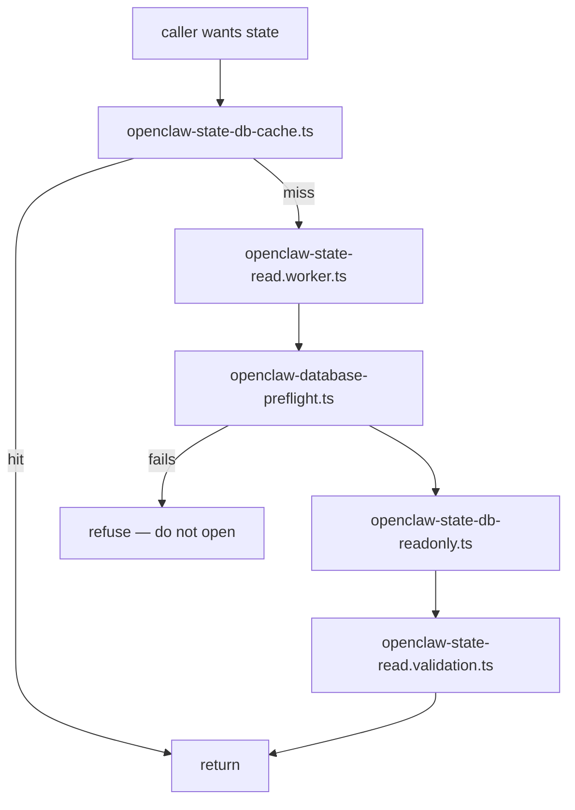
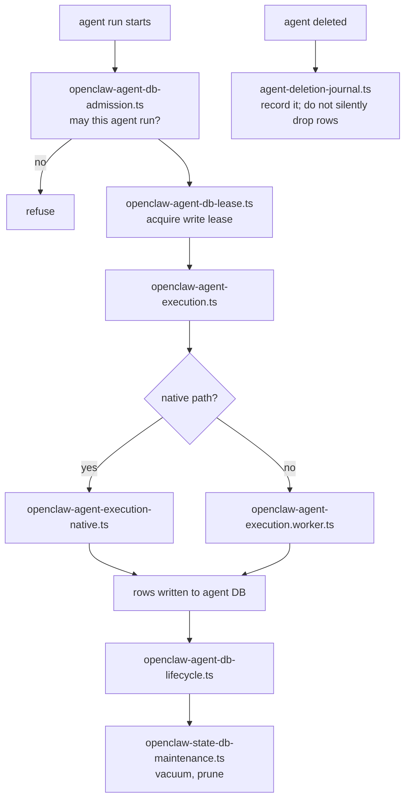
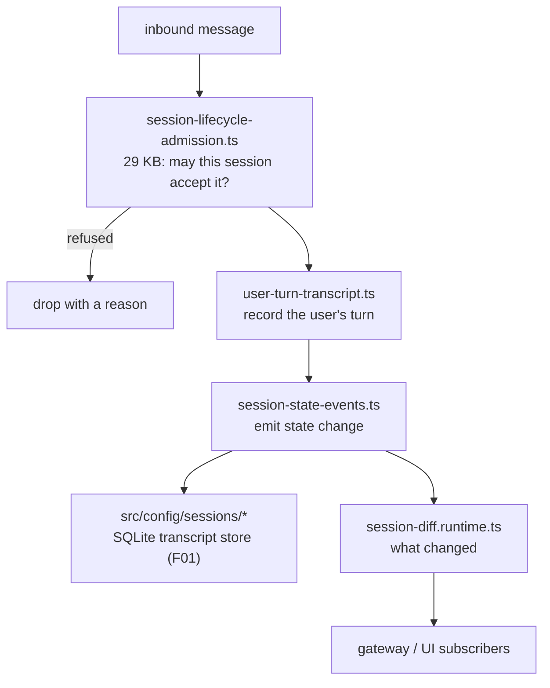

# F03 — state, sessions, storage

| | |
|---|---|
| describes | openclaw `v2026.10.3` @ `59cb44796b0f1f0daa0e37af8b1495abb45d9bc1` |
| paths | `src/state/`, `src/sessions/`, `src/storage/`, `src/snapshot/`, `packages/session-url-contract/` |
| size | 699 tracked files · 429 code · 266 test · ~166,000 LOC |
| distinct dependents | 52 |

## What it is, in plain English

The durable memory of the process. Two SQLite databases, accessed from worker threads under an explicit lease, plus a git-backed snapshot store.

- **The state DB** (`openclaw-state-db*.ts`) — process-wide records: user profiles, model accounts, GitHub identity, caches.
- **The agent DB** (`openclaw-agent-db*.ts`) — per-agent records: registry, schema, admission, execution rows, a deletion journal.
- **Session lifecycle** (`src/sessions/`) — admission control, the user-turn record, state-change events, diffs.
- **Snapshots** (`src/snapshot/`) — `local-repository.ts` (41 KB) plus `git-backup-codec.ts`: snapshots are stored *as a git repository*, which is why history and restore work without a bespoke format.
- **`packages/session-url-contract/`** — the one place in this chunk with an `index.ts`: the shared shape of a session URL, so the gateway, the UI and the CLI agree on it.

## The pattern that governs everything here: owner + lease

Five of the thirty largest files are about this, not about data:

```
openclaw-state-worker-owner.ts     who owns the writer this process
openclaw-state-lease.ts            the lease that makes that exclusive
openclaw-agent-db-lease.ts         same, per agent DB
openclaw-state-read.worker.ts      reads happen off-thread
openclaw-database-preflight.ts     refuse to open a DB that fails checks
```

SQLite is single-writer. openclaw runs multiple threads and sometimes multiple processes against the same files, so it imposes a lease: one owner holds the write lease, everyone else reads through a worker. `openclaw-database-preflight.ts` runs *before* the handle opens and refuses rather than corrupting.

**Consequence for anyone debugging state:** a read you perform outside the worker is a read of a possibly stale snapshot, and a write attempted without the lease does not error in an obvious place — it is refused. A state bug reasoned about as if it were a single-threaded file is reasoned about wrongly.

## Process flow — a state read



## Process flow — an agent execution record



## Process flow — a session turn



## The trap: "session" lives in two modules

| concern | where it lives |
|---|---|
| session lifecycle, admission, events, diff | `src/sessions/` (this chunk, 81 code files) |
| session transcript persistence (SQLite accessor, compaction, reconcile, projections) | `src/config/sessions/` (**F01**, 539 code files) |
| session URL shape | `packages/session-url-contract/` (this chunk) |

The transcript store — the large, interesting part — is not in `src/sessions`. It sits inside the config module. Searching `src/sessions` for transcript handling returns a clean, empty, and completely misleading result. This is the clearest boundary defect found in pass 1, and it is why `core/config → core/state` carries 1,227 import edges.

## Dependencies

**In** — `core/gateway` (2,496), `core/config` (1,395), `core/agents` (1,374), `core/infra` (1,139), `core/commands` (770), `core/cli` (343), `core/cron` (281), `core/auto-reply` (224), `core/claws` (140), `core/skills` (124).

**Out** — `core/infra` (1,256), `core/config` (308), `core/shared` (165), `core/agents` (90), `core/gateway` (68), `core/routing` (44), `core/logging` (44).

`state ↔ infra` and `state ↔ config` are both cycles. `state → gateway` (68) and `state → agents` (90) are the surprising ones: the persistence layer reaches back up into its callers, which means it is not a clean bottom layer.

**Package surface** — only `@openclaw/normalization-core/*` (~72 edges). Almost no external dependency: this module is Node's built-in SQLite and little else.

## Risks and traps

1. **Lease discipline is invisible until violated.** Nothing in a type signature says "you must hold the lease." `openclaw-state-worker-owner.ts` is the only authority.
2. **Two databases, easily confused.** `openclaw-state-db` and `openclaw-agent-db` have parallel file naming (`-cache`, `-lease`, `-lifecycle`, `-maintenance`, `-schema`). Reading the wrong one and finding nothing looks identical to the record not existing.
3. **`openclaw-database-preflight.ts` refuses rather than errors.** A refusal reads as an absence further up the stack. When state appears empty, check preflight before concluding the data is gone.
4. **Snapshots are a git repository.** `git-backup-codec.ts` means a snapshot directory can be inspected with ordinary git — genuinely useful for recovery — but also means git's own locking applies, and a stale `.lock` under a snapshot repo will make snapshot operations fail with `File exists`.
5. **`agent-deletion-journal.ts` exists because deletes used to lose data.** Anything that removes agent rows should write the journal, not bypass it.
6. **266 test files to 429 source files**, heavily concentrated on leases and admission. Those tests are the contract.

## Verdict

The engineering here is careful — leases, preflight, readonly handles, a deletion journal, git-backed snapshots. These are the marks of a team that has lost data once and does not intend to again. The defect is purely one of placement: the biggest piece of session persistence is filed under `config`, and until it moves, "where is session state" has two correct answers and one wrong-looking empty search.
