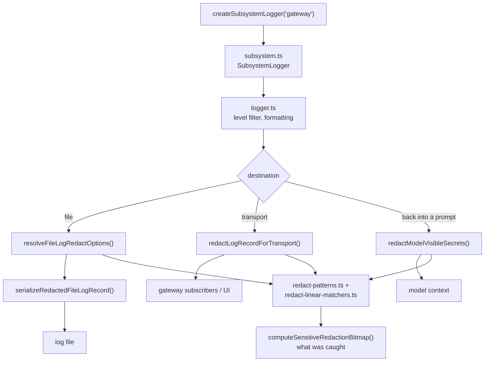
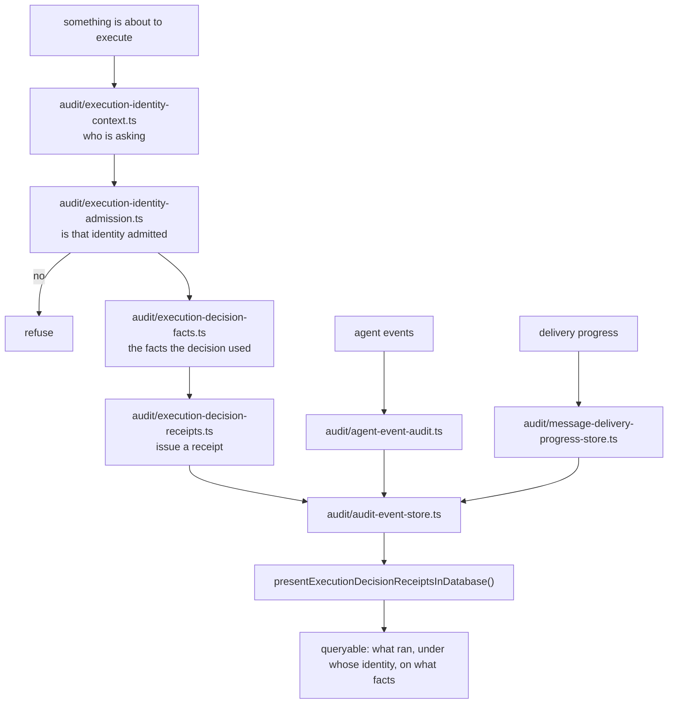
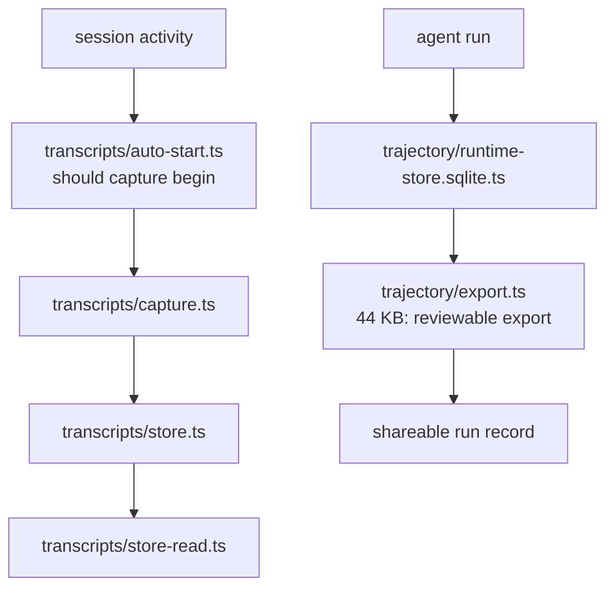

# F04 — logging, audit, transcripts, trajectory

| | |
|---|---|
| describes | openclaw `v2026.10.3` @ `59cb44796b0f1f0daa0e37af8b1495abb45d9bc1` |
| paths | `src/logging/`, `src/audit/`, `src/transcripts/`, `src/trajectory/` |
| size | 284 tracked files · 181 code · 101 test · ~74,000 LOC |
| distinct dependents | 50 (`core/logging` alone) |

## What it is, in plain English

Four related jobs: write logs without leaking secrets, record what the system decided and why, keep conversation transcripts, and export an agent's run as a reviewable trajectory.

The proportions tell the story. Of ~74,000 LOC, roughly **145 KB of source is redaction alone**:

```
logging/redact.ts                 54.7 KB   the engine
logging/redact-patterns.ts        33.3 KB   the pattern library
logging/redact-linear-matchers.ts 22.9 KB   linear-time matchers
logging/redact-json.ts            21.3 KB   structure-aware redaction
logging/redact-pattern-runtime.ts 15.1 KB   runtime pattern compilation
```

This is the largest single concern in the chunk — larger than the logger itself (`logger.ts`, 24 KB). Not an accident: an agent that reads files, runs commands and talks to APIs will put secrets into log lines unless something stops it.

## The redaction API, and why its shape matters

`redact.ts` exposes twenty-five entry points, and they are deliberately not interchangeable:

```ts
redactText(...)                               // generic
redactSensitiveText(text, options)            // sensitive-pattern pass
redactSecrets<T>(value)                       // deep, structure-preserving
redactSensitiveLines(...)                     // line-oriented

redactToolDetail(detail)                      // what a tool reports
redactToolPayloadText(text)                   // a tool's payload
redactModelVisibleToolPayloadText(text)       // ← what the MODEL may see
redactModelVisibleSecrets<T>(value)           // ← same, deep
redactModelVisibleSensitiveFieldValueWithConfig(...)

redactLogRecordForTransport(...)              // leaving the process
serializeRedactedFileLogRecord(...)           // going to a file
resolveFileLogRedactOptions()                 // file-log policy
redactInputTextWithSourcePolicy(...)          // policy by input source

isSensitiveFieldKey(key)                      // key-name heuristic
computeSensitiveRedactionBitmap(...)          // which spans were hit
captureSensitiveTextRedactionSnapshot()       // test seam
createSensitiveTextRedactor(...)              // reusable redactor
getDefaultRedactPatterns()
```

There are **three separate audiences**: the log file, the transport, and *the model*. The `redactModelVisible*` family exists because a secret that is safe to write to a locked-down log file is not safe to put back into a prompt — the model would repeat it. Anything that feeds tool output back into a conversation should be going through the model-visible variants, not the generic ones.

`computeSensitiveRedactionBitmap()` is the piece worth borrowing: it reports *which spans* were redacted, so a redaction can be verified rather than trusted. A redactor that cannot report what it caught is a redactor that cannot be tested — and a guard that cannot go red is decoration.

## Process flow — a log line



## Process flow — an audited decision



The design here is a **receipt**, not a log line. `execution-decision-facts.ts` captures the inputs the decision was made from, and `execution-decision-receipts.ts` issues a cursor-addressable record (`isExecutionDecisionCursor()`). After the fact you can ask not just "did this run" but "what did the system believe when it allowed it" — the difference between an audit trail and a transcript.

## Process flow — transcripts and trajectory



`trajectory/export.ts` is 44 KB — the second largest file in the chunk — because exporting a run means resolving every tool call, every model turn and every artifact into something a human can read, with redaction applied on the way out.

## Diagnostics: the self-repair corner

A cluster that is easy to miss and useful to know about:

```
diagnostic.ts                                  37 KB
diagnostic-stability.ts                        24 KB
diagnostic-stability-bundle.ts                 31 KB
diagnostic-run-activity.ts                     26 KB
diagnostic-stuck-session-recovery.runtime.ts   21 KB
diagnostic-support-export.ts                   24 KB
diagnostic-support-redaction.ts                24 KB
diagnostic-memory.ts                           17 KB
```

`diagnostic-stuck-session-recovery` detects and recovers a session that has stopped making progress. `diagnostic-support-export.ts` + `diagnostic-support-redaction.ts` build a support bundle — a diagnostic archive safe to send to someone else, with its **own** redaction pass separate from the log one.

## Dependencies

**In** — `core/agents` (460), `core/gateway` (401), `core/infra` (190), `core/cli` (96), `core/commands` (77), `core/auto-reply` (72). 50 distinct dependents.

**Out** — `core/infra` (182), `core/state` (112), `core/config` (84), `core/plugins` (45), `core/agents` (42), `pkg/gateway-protocol` (39). Notably light: 10th-highest fan-in in the repo with almost no outbound weight, which is what a well-placed cross-cutting module should look like.

## Risks and traps

1. **Picking the wrong redactor is silent.** `redactSecrets()` where `redactModelVisibleSecrets()` was needed leaks a secret into a prompt and logs nothing unusual. The function name is the only guard.
2. **Redaction is pattern-based, so it is incomplete by construction.** `getDefaultRedactPatterns()` catches known shapes. A novel credential format passes through. Redaction is a safety net, not a boundary — the boundary is not putting the secret in the log line.
3. **`isSensitiveFieldKey()` is a heuristic on key names.** A secret in a field called `value` or `data` is not caught by it.
4. **The audit store is a database, so audit has the lease semantics of F03.** Writing a receipt from outside the owner thread will be refused, and a missing receipt reads as "nothing happened."
5. **Two redaction policies exist** — log redaction and support-bundle redaction (`diagnostic-support-redaction.ts`). A pattern added to one is not added to the other.
6. **101 test files, concentrated on redaction and stuck-session recovery.** `captureSensitiveTextRedactionSnapshot()` exists specifically so redaction can be asserted without a test ever holding a real secret — the right pattern for any test near credentials.

## Verdict

The strongest module in the repo on a per-line basis. Redaction with span-level reporting, decision receipts that capture the facts behind a decision, a separate redaction pass for anything leaving the machine, and a test seam that lets redaction be verified without real secrets. If anything here is a weakness it is that correct use depends entirely on choosing the right function from a set of twenty-five similarly named ones, with no type-level distinction between "safe for the log file" and "safe for the model."
