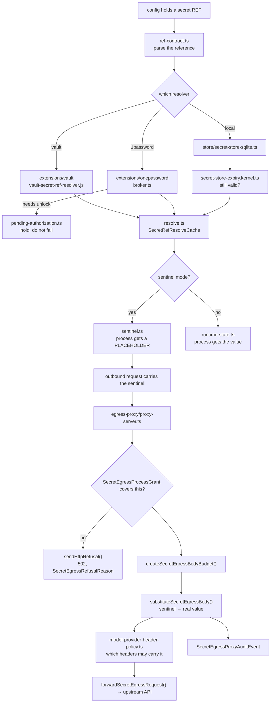

# F05 — secrets and security

| | |
|---|---|
| describes | openclaw `v2026.10.3` @ `59cb44796b0f1f0daa0e37af8b1495abb45d9bc1` |
| paths | `src/secrets/`, `src/security/`, `src/hooks/`, `security/`, `extensions/vault/`, `extensions/onepassword/` |
| size | 460 tracked files · 237 code · 201 test · ~95,000 LOC |

## Headline finding

**openclaw already has a mechanism that lets a process use a credential without ever holding it.** It is `src/secrets/egress-proxy/` plus `src/secrets/sentinel.ts`, and it is not documented anywhere obvious.

The process is handed a **sentinel** — a placeholder string. Outbound HTTP goes through a local TLS proxy that openclaw starts, with certificates it mints itself. At the moment the request leaves, the proxy substitutes the sentinel for the real secret value. If the request is not covered by a grant, the proxy refuses it:

```ts
export const REFUSAL_BODY = "Secret egress proxy refused the request.\n";
```

So "never quote a secret, read it from the store" is not a policy that has to be enforced by discipline — the host can enforce it structurally. Anything running under a sentinel binding *cannot* leak a credential it was never given.

## What the module is, in plain English

Four layers, and they are genuinely separate:

| layer | files | job |
|---|---|---|
| `src/secrets/` | 104 + 12 store + 10 egress-proxy | resolve, store, assign and proxy credentials |
| `src/security/` | 43 | the security audit — a self-inspection that reports findings |
| `src/hooks/` | 33 + 8 bundled | lifecycle hooks, including the bundled ones that ship |
| `security/opengrep/` | 6 | static-analysis rules for openclaw's own past advisories |
| `extensions/vault`, `extensions/onepassword` | 11 + 21 | two secret-store backends |

## 1. Secret resolution — references, not values

```ts
// src/secrets/resolve.ts
resolveSecretRefValue(...)                     // one ref → one value
resolveSecretRefValues(...)                    // batch
resolveSecretRefValuesSettledByProvider(...)   // batch, per-provider failures isolated
resolveSecretRefString(...)                    // inline refs inside a string
type SecretRefResolveCache                     // resolution is cached
```

Config holds a **reference** (`ref-contract.ts`, `config-secret-target.ts`), not a value. A resolver plugin turns the reference into a value at the last possible moment. Both shipped backends are tiny because the contract does the work:

```
extensions/vault/vault-secret-ref-resolver.js        ← the entire Vault integration
extensions/vault/src/cli.ts
extensions/onepassword/src/broker.ts                 ← 1Password, with a broker
extensions/onepassword/src/pending-authorization.ts  ← and an authorization step
extensions/onepassword/src/trusted-node.test-support.ts
```

1Password's extra machinery (`broker.ts`, `pending-authorization.ts`, `trusted-node`) exists because `op` requires interactive unlock: the broker holds the session and a request can be left *pending authorization* rather than failed. That is the right shape for any store that needs a human to approve a read.

**The store itself** is SQLite (`store/secret-store-sqlite.ts`) with validation, metadata, expiry (`secret-store-expiry.kernel.ts`), and a config-ref kernel. Expiry is built in — a stored secret can be given a lifetime.

## 2. The egress proxy

```
egress-proxy/
  certificates.ts        createSecretEgressCertificates() — mints its own TLS CA
  proxy-server.ts        startSecretEgressProxyServer(), SecretEgressProcessGrant,
                         SecretEgressSentinelBinding, SecretEgressProxyAuditEvent
  proxy-worker.ts        runs it off-thread
  proxy-forward.ts       forwardSecretEgressRequest(), sendHttpRefusal(),
                         handleUpgradeRequest(), createSecretEgressBodyBudget()
  stream-substitution.ts substituteSecretEgressBody(), SecretEgressRefusalReason
  registry.ts            publishSecretEgressProxy(), isSecretEgressProxyActive()
  runtime.ts             startGatewaySecretEgressProxy()
  response-headers.ts    toForwardableResponseHeaders()
```

Notable details:

- **`createSecretEgressBodyBudget()`** — substitution is bounded. An unbounded body cannot be streamed through a substituting transform without a memory risk, so there is a budget and a refusal past it.
- **`SecretEgressRefusalReason`** is a typed union — a refusal says *why*, which means the proxy is testable. A guard that can only say no is a guard nobody trusts.
- **`handleUpgradeRequest()`** — WebSocket upgrades are handled explicitly rather than tunnelled blindly.
- **`SecretEgressProxyAuditEvent`** — every substitution is auditable.
- **`model-egress.ts` and `model-provider-header-policy.ts`** sit beside it: per-provider rules for which headers a secret may be placed in.

## Process flow — a secret reaching an API



## 3. The security audit

`src/security/` is a self-inspection that produces findings, not a library:

```
audit.ts                  48.6 KB   the audit itself
audit-extra.sync.ts       41.8 KB   additional synchronous checks
audit-channel.ts          23.4 KB   per-channel exposure
audit-gateway-config.ts   21.2 KB   gateway bind / origin / ingress review
audit-plugins-trust.ts    20.9 KB   plugin trust review
audit-extra.async.ts      18.5 KB
install-policy.ts         18.7 KB   what installs are permitted
```

`audit-gateway-config.ts` is the one to read before changing a gateway bind: it already encodes which exposures count as findings. `audit-plugins-trust.ts` does the same for plugin provenance.

## 4. Static analysis for its own CVEs

```
security/opengrep/rules/ghsa-82g8-464f-2mv7/skill-env.{ts,js,yml}
security/opengrep/rules/ghsa-fv94-qvg8-xqpw/ssh-sandbox-upload.{ts,js,yml}
security/opengrep/rules/openclaw-policy/no-raw-http2-connect.yml
security/opengrep/compile-rules.mjs
security/opengrep/check-rule-metadata.mjs
```

Two rules are named after GitHub advisories — one about skill environment handling, one about SSH sandbox upload. Each ships `.ts` and `.js` fixtures alongside the rule, so the rule itself is tested. The third (`no-raw-http2-connect`) is a house rule: raw HTTP/2 CONNECT is banned, presumably because it would bypass the egress proxy above.

This is worth copying as a practice: a repo that keeps a machine-checkable rule for every security bug it has had does not have that bug twice.

## 5. Hooks

`src/hooks/` — `install.ts` (23 KB), `message-hook-mappers.ts` (21 KB), and `bundled/` (8 files). Hooks map lifecycle and message events to actions. `install.ts` being the largest file says the hard part is installing a hook safely, not running it.

## Dependencies

**Out** — `core/config` (288), `core/agents` (183), `core/plugins` (171), `core/infra` (96), `core/shared` (66), `core/state` (63), `core/proxy-capture` (5).

**In** — `core/gateway` (219), `core/agents` (179), `core/cli` (88), `core/commands` (52). 36 distinct dependents.

Lighter coupling than its importance suggests, which is good: the secret path can be reasoned about without reading the gateway.

## Risks and traps

1. **The egress proxy is opt-in.** `isSecretEgressProxyActive()` exists because it may not be running. A sentinel with no proxy in front of it is a broken credential, and a real value with no proxy is an unprotected one. Check the registry before assuming either posture.
2. **It mints its own TLS CA** (`createSecretEgressCertificates`). That means a trust store somewhere has to accept it. A client that validates strictly and was not told about the CA fails here, and the failure looks like a network error.
3. **`createSecretEgressBodyBudget()` means large bodies are refused, not truncated.** A legitimate large upload through a sentinel-bound process will hit this.
4. **`no-raw-http2-connect.yml` is a policy rule for a reason.** Any new transport that opens a raw CONNECT bypasses the substitution entirely.
5. **`runtime-*.ts` is 40+ files of owner-assignment logic** (`runtime-owner-assignments.ts`, `runtime-*-secret-owner.ts` for media, memory, sandbox, web, TTS). Which component owns which secret is a real, enforced concept, and getting it wrong produces a refusal that reads as a missing credential.
6. **`extensions/vault` is four source files.** Vault integration being thin is by design, but it also means that when a Vault read fails, almost all the diagnostic surface is on the Vault side, not here. A failing `vault` CLI, an expired token, or a stale `~/.vault-token` produces an error that this module can only pass through.
7. **201 test files to 237 source files**, with `credential-matrix.test-support.ts` and per-channel `runtime-*.test-support.ts` fixtures — the test suite never needs a real secret. Any new test near this module should use those fixtures rather than a live value.

## Verdict

The best-designed part of openclaw. Secret *references* in config, pluggable resolvers, a SQLite store with expiry, per-component ownership, a pending-authorization path for stores that need a human, an auditing TLS proxy that substitutes placeholders at the wire so the process never holds the credential, and machine-checkable rules for its own past vulnerabilities.

The gap is not capability, it is adoption: almost none of this is visible from the documentation, so most deployments probably hold real secret values in process memory while a mechanism for not doing that sits unused in the tree.
