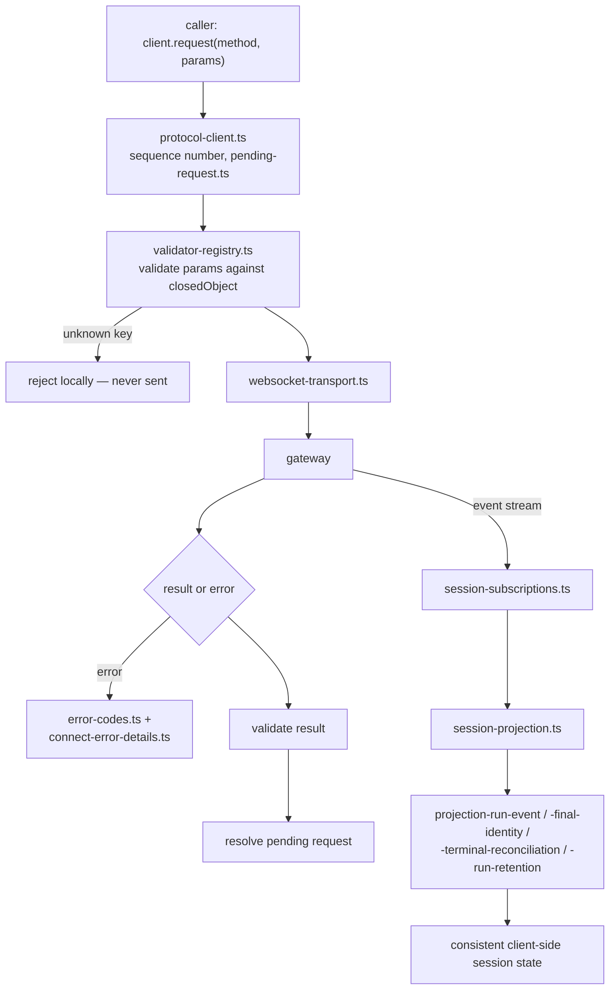
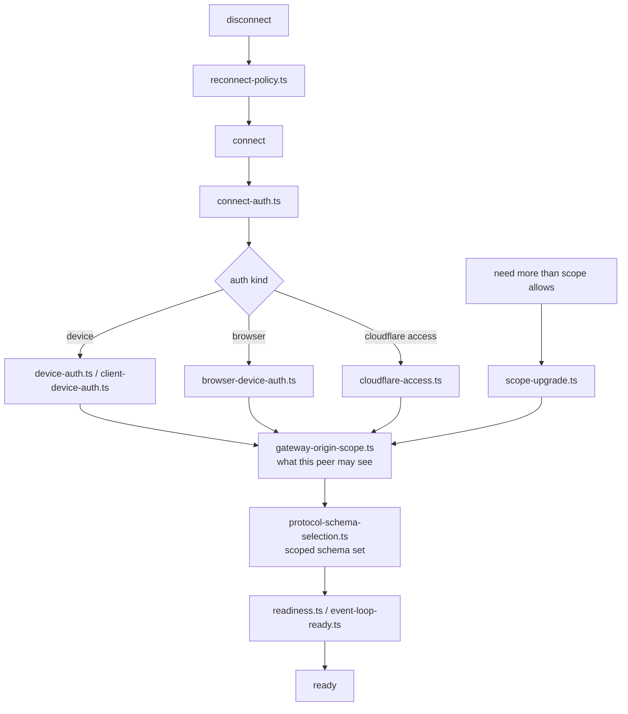

# F06 — gateway protocol and client

| | |
|---|---|
| describes | openclaw `v2026.10.3` @ `59cb44796b0f1f0daa0e37af8b1495abb45d9bc1` |
| paths | `packages/gateway-protocol/`, `packages/gateway-client/`, `packages/net-policy/`, `packages/plugin-package-contract/` |
| size | 367 tracked files · 236 code · 121 test · ~57,000 LOC |
| distinct dependents | 47 |

## What it is, in plain English

This is **the public API of openclaw** — the only honest answer to "what can I ask the gateway to do?". It is 190-odd schema modules, one per subject, plus a client that speaks them.

It matters out of proportion to its size for one reason: every other way of discovering openclaw's capabilities is unreliable. Docs lag. Grepping `src/` finds internal helpers that are not callable. The TypeScript types in `src/` describe implementation, not surface. **The schema directory is the surface.** If a capability is not here, no client can reach it; if it is here, something can.

## The RPC catalogue

`packages/gateway-protocol/src/schema/` — grouped by what they actually govern:

**Sessions (the largest group — 38 modules)**
`sessions`, `sessions-row`, `sessions-list`, `sessions-catalog`, `sessions-create`, `sessions-delete`, `sessions-patch`, `sessions-recover`, `sessions-resolve`, `sessions-search`, `sessions-title`, `sessions-goal`, `sessions-activity-summary`, `sessions-suggestions`, `sessions-reactions`, `sessions-sharing`, `sessions-sharing-values`, `sessions-storage`, `sessions-involvement`, `sessions-provider-review`, `sessions-viewer-presence`, `session-classification`, `session-discussion`, `session-participant`, `session-placement`, `session-placement-state`, `session-github-publication`, `chat-history-constants`, `transcripts`, `since`

**Agents, models, skills**
`agent`, `agents-files`, `agents-workspace`, `agents-models-skills` (45 KB — the biggest schema), `agent-database-admission`, `model-catalog`, `model-account-selection`, `model-runtime-options`, `setup-inference`, `skill-library`, `skill-detail`, `skill-history`, `skill-curator`, `skill-resources`, `tools-catalog`

**Approvals and questions**
`approvals`, `approval-id`, `exec-approvals`, `plugin-approvals`, `questions`, `human-mentions`

**Devices, nodes, computer control**
`devices`, `nodes`, `desktop`, `computer`, `worker-computer`, `channel-pairing`, `push`, `presence`

**Voice**
`talk-voice`, `talk-marks`

**Plugins**
`plugins`, `plugin-credentials`, `plugin-inspection`, `plugin-install-progress`, `plugin-skills`, `plugin-declared-surface-groups`, `clawhub-listing`

**Workers**
`worker-admission`, `worker-protocol-primitives`, `worker-inference`, `worker-session-tools`, `worker-gateway-tool`, `worker-skill-workshop`, `worktrees`, `environments`, `environments-session`, `environments-session-exec`

**Operations**
`config`, `secrets`, `migrations`, `backup`, `snapshot`, `storage`, `fs`, `update-runs`, `runtime-vitals`, `system-info`, `system-event`, `diagnostics`, `audit`, `audit-run`, `audit-activity`, `gateway-suspend`, `portals`, `hooks`, `cron`, `cron-shared`, `cron.types`

**Surfaces**
`channels`, `chat`‑adjacent `logs-chat`, `board`, `canvas`, `projects`, `terminal`, `terminal-constants`, `ui-command`, `ui-appearance-preferences`, `ui-appearance-typefaces`, `themes`, `progress-card`, `artifacts`, `web-search`, `wizard`, `users`, `user-profile-constants`, `commands`, `devices`, `failover-reason`, `error-codes`, `control-ui-link-reader`

## Two findings worth acting on

### 1. Desktop control is already in the protocol

```ts
// packages/gateway-protocol/src/schema/computer.ts
export const ComputerInvokeParamsSchema = closedObject({
  command: Type.Enum(["screen.snapshot", "computer.act"]),
  ...
});
export const ComputerStatusParamsSchema = closedObject({});
```

`computer.act` — not just `screen.snapshot` — is a declared protocol command at this tag, alongside a `computer.status` query and a separate `worker-computer` schema. Anything built on the assumption that the node command set is screenshot-only is built on a stale assumption. The capability gate is elsewhere (node capability declaration and approvals), not in the protocol.

### 2. Voice is two separate concerns

```ts
// schema/talk-voice.ts
TALK_VOICE_CHANGE_TIMEOUT_MS = 60_000
TalkVoiceGetParams / TalkVoiceSetParams { ...target, voice }
TalkVoiceSelection / TalkVoiceSetResult
TalkVoiceCompleteParams
TalkVoiceChangeEvent
```

`talk-voice` is **voice selection** — which voice, for which target, with a change event and a 60-second timeout. `talk-marks` is separate. Neither is the audio path; the streaming session RPCs live under the `talk.*` method namespace implemented in `src/talk` (F16). Two things called "talk" that do different jobs.

## How the protocol is built: closed objects

Every schema is a `closedObject({...})`. There is a dedicated `closed-object.ts` with its own test. Closed means **unknown keys are rejected**, not ignored.

That single decision explains a lot of observed behaviour: an invented parameter or a misremembered key name fails loudly with `Unrecognized key` instead of being silently dropped. It is why guessing a key name never works and why `config patch --dry-run` and the schema dump are the only reliable discovery tools — and it is a good trait, not an obstacle.

Supporting machinery:

```
validator-registry.ts        43 KB  compiled validators, one per schema
protocol-schema-composer.ts         assembles the full schema
protocol-schema-selection.ts        which schemas a given peer gets
protocol-schema-types.ts
public-schema.ts             22 KB  the externally published shape
error-codes.ts                      the error vocabulary
connect-error-details.ts     24 KB  why a connection was refused
primitives.ts / closed-object.ts
theme.ts                     14 KB
```

`protocol-schema-selection.ts` is notable: not every peer sees the whole protocol. The surface is scoped.

## The client

`packages/gateway-client/src/` — `client.ts` is 48 KB, the largest file in the chunk. Its concerns, read off the file names:

| area | files |
|---|---|
| handshake and auth | `connect-auth.ts`, `device-auth.ts`, `client-device-auth.ts`, `browser-device-auth.ts`, `cloudflare-access.ts`, `scope-upgrade.ts`, `gateway-origin-scope.ts` |
| transport | `websocket.ts`, `websocket-transport.ts`, `websocket-data.ts`, `protocol-client.ts` |
| resilience | `reconnect-policy.ts`, `readiness.ts`, `event-loop-ready.ts`, `timeouts.ts`, `pending-request.ts`, `client-upgrade-error.ts`, `request-error.ts` |
| session state | `session-projection.ts` (28 KB) and seven `session-projection-*.ts` modules, `session-subscriptions.ts` (20 KB), `chat-stream-projection.ts` |

**`session-projection*` is the interesting part.** A client does not get session state handed to it; it *projects* it from a stream of events, and there are dedicated modules for final-message identity, duplicate finals, run events, run retention, terminal reconciliation, and receipts — each with a conformance test. That is the shape of a system where events can arrive twice, out of order, or be cut off mid-run, and the client is responsible for arriving at the right answer anyway.

There are also `client.tls.test.ts`, `client.watchdog.test.ts`, `client.cloudflare-access.test.ts`, `client.request-timeout.test.ts` — the failure modes are tested, not assumed.

## `packages/net-policy` — small and load-bearing

```
ip.ts, ipv4.ts            address classification (private, loopback, link-local)
url-protocol.ts           which protocols are permitted
url-userinfo.ts           user:pass in URLs
redact-sensitive-url.ts   17 KB — redacting credentials out of a URL
ip-test-fixtures.ts
```

Seven source files, every one with a test. This is the primitive layer under `src/infra/net/fetch-guard.ts` (F02) and the egress proxy (F05). `redact-sensitive-url.ts` being 17 KB is a reminder that URLs carry secrets in query strings, userinfo and fragments, and that stripping them correctly is not a one-liner.

## Process flow — a client call



## Process flow — connect and scope



## Dependencies

**In** — `core/gateway` (1,214), `ui` (545), `core/agents`, `core/daemon` (101), `core/infra` (98), `core/tui` (24). 47 distinct dependents.

**Out** — almost nothing: `support/test` (9), `support/scripts` (3), `core/config` (2), `pkg/normalization-core` (2). **This is the only module in the repo that is genuinely a leaf.** It depends on nothing and 47 things depend on it — exactly what a protocol package should look like.

## Risks and traps

1. **The protocol is scoped per peer** (`protocol-schema-selection.ts`, `gateway-origin-scope.ts`). A method existing in the schema does not mean *this* client may call it. A refusal may be a scope problem, not a capability problem; `scope-upgrade.ts` is the remedy.
2. **`closedObject` rejects, it does not warn.** Good for correctness; it means a client written against a newer protocol fails against an older gateway on the extra key, not on the missing feature.
3. **`validator-registry.ts` is 43 KB of compiled validators.** Adding a schema means regenerating; a hand-added schema that is not registered is invisible.
4. **Session state is a projection, not a fetch.** Reading `session-projection.ts` as if it were a getter will mislead. Duplicate finals and terminal reconciliation exist because the stream is not clean.
5. **190 schemas is the real documentation, and it is not published as prose.** Any statement about "openclaw cannot do X" should be checked against this directory first. Several capabilities found here — `computer.act`, `questions`, `push`, `worker-computer`, `portals`, `environments-session-exec` — are not obvious from the docs.

## Verdict

The best entry point into the whole codebase. One leaf package, 190 subject schemas, closed objects that refuse what they do not know, per-peer scoping, a client that reconciles an unreliable event stream into consistent state, and a tiny net-policy package that every network guard in the repo stands on. Read this before reading the gateway; it is one twenty-fourth the size and tells you more.
