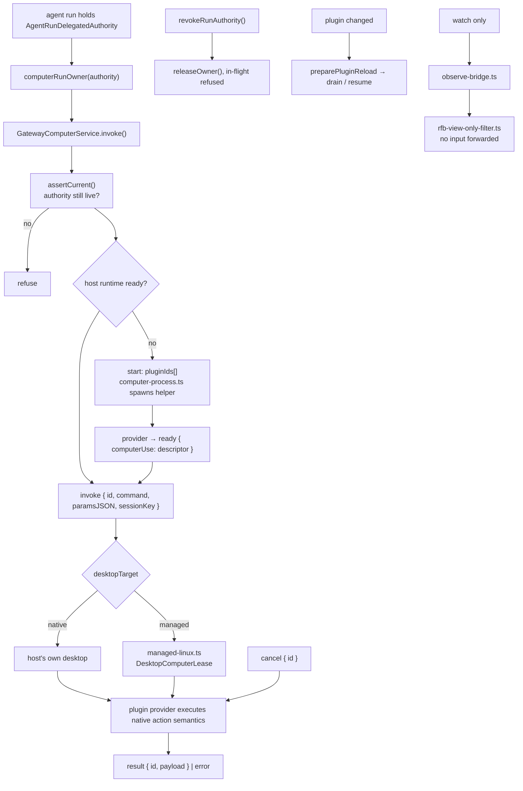
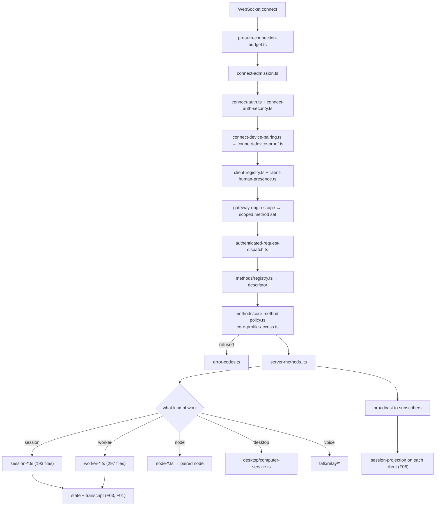

# F07 — gateway

| | |
|---|---|
| describes | openclaw `v2026.10.3` @ `59cb44796b0f1f0daa0e37af8b1495abb45d9bc1` |
| paths | `src/gateway/` |
| size | 4,253 tracked files · ~1,346,000 LOC — **the largest feature in the repo** |
| distinct dependents | 41 |
| depth of read | structural across the whole tree; deep on `desktop/`, `talk/`, `server/`, `methods/`. The 454 `server-methods*` files were surveyed by name and policy layer, not read individually. |

## What it is, in plain English

The resident process. Everything that is not a one-shot CLI invocation happens here: the WebSocket server, the RPC method implementations, worker orchestration, session hosting, node and device management, the voice relay, and the computer-use host.

It is one directory holding roughly seven services:

| cluster | files | what it is |
|---|---|---|
| `server-methods*` | **454** | the RPC method implementations — one module per method family |
| `server-*` (rest) | ~180 | startup, reload, restart, shutdown, HTTP, TLS, tailscale, broadcast, discovery, sidecar, kernel, recovery |
| `worker-*` | 297 | worker lifecycle, admission, ingress, inference |
| `session-*` | 193 | session hosting inside the gateway |
| `server/` | 74 | connection, auth, presence, readiness, plugin HTTP routing |
| `control-*`, `operator-*` | 79 | the control UI surface and operator actions |
| `talk/` | 39 | the voice relay |
| `desktop/` | 21 | computer use and remote desktop |
| `node-*`, `device-*` | 55 | paired nodes and devices |
| `github-*` | 44 | GitHub integration |
| `methods/` | 6 | the method registry and policy |
| `health/` | 5 | health collectors |

454 files implementing RPC methods against 190 protocol schemas (F06) is the right ratio: each schema gets a handler plus its policy, validation and runtime variants.

## 1. The method registry — the spine

```
methods/registry.ts                 the method table
methods/descriptor.ts               what a method declares
methods/core-descriptors.ts         the built-in set
methods/core-descriptor-types.ts
methods/core-method-policy.ts       who may call it
methods/core-profile-access.ts      access by profile
```

A method is a **descriptor**, not a function: it carries its own policy and access profile. That is how `protocol-schema-selection.ts` (F06) can scope the surface per peer — the gateway side of the same decision lives here.

Dispatch runs through `server/ws-connection/authenticated-request-dispatch.ts` with a separate `.server-methods.runtime.ts` companion, so dispatch and the method table are decoupled.

## 2. Connection and admission — five gates before a request runs

```
server/ws-connection/connect-admission.ts        may this connection be attempted
server/ws-connection/connect-auth.ts             authenticate
server/ws-connection/connect-auth-security.ts    security posture of that auth
server/ws-connection/connect-device-pairing.ts   is the device paired
server/ws-connection/connect-device-proof.ts     can it prove it
server/ws-connection/connect-device-metadata.ts
server/preauth-connection-budget.ts              bounded unauthenticated connections
server/http-work-admission.ts                    bounded HTTP work
server/client-registry.ts                        who is connected
server/client-presence.ts / client-human-presence.ts
server/readiness.ts / event-loop-health.ts / process-vitals.ts
```

`preauth-connection-budget.ts` is the detail worth copying: unauthenticated connections get a *budget*, so a flood of half-open connections cannot exhaust the process before auth. And `client-human-presence.ts` is distinct from `client-presence.ts` — the gateway tracks whether a **human** is attached separately from whether a client is attached. That distinction is what an unattended-operation decision should be reading.

Plugin HTTP routes get their own gate chain:

```
server/plugins-http/route-match.ts
server/plugins-http/route-auth.ts
server/plugins-http/route-capability.ts
server/plugin-node-capability-auth.ts
server/plugin-route-runtime-scopes.ts
```

## 3. `desktop/` — the computer-use subsystem (the headline finding)

```
desktop/computer-protocol.ts    the host wire protocol
desktop/computer-service.ts     createGatewayComputerService()
desktop/computer-owner.ts       computerRunOwner(authority)
desktop/computer-process.ts     the helper process
desktop/computer.worker.ts      off-thread
desktop/managed-linux.ts        DesktopComputerLease
desktop/managed-linux-audio.ts
desktop/audio-bridge.ts
desktop/host-source.ts / node-source.ts / node-source-context.ts
desktop/node-stream-broker.ts
desktop/observe-bridge.ts / observe-requester.ts
desktop/rfb-probe.ts / rfb-preauth.ts / rfb-view-only-filter.ts
desktop/session-registry.ts
desktop/host-guidance.ts / host-source-errors.ts
```

The protocol is small and tells you everything:

```ts
const command = z.enum(["screen.snapshot", "computer.act"]);

const inputSchema = z.discriminatedUnion("type", [
  { type: "start",  pluginIds: string[] },
  { type: "invoke", id, command, paramsJSON: string, sessionKey? },
  { type: "cancel", id },
  { type: "stop",   execution?: { executionId, reason } },
]);
const outputSchema = z.discriminatedUnion("type", [
  { type: "ready",  computerUse: unknown },
  { type: "result", id, payload: string },
  { type: "error",  id?, message },
]);
```

Four facts follow from this, and they settle how desktop control actually works:

**(a) The gateway does not define any actions.** `paramsJSON` is an opaque string. The source comment is explicit: *"Owns the Gateway transport, while registered providers retain native action semantics."* A `start` message names `pluginIds`. So clicking, typing, scrolling and dragging are **a plugin's** vocabulary, registered as a `PluginNodeHostCommandRegistration`. A host with no such plugin registered has a node command catalogue with no mouse or keyboard — not because the capability is missing from the gateway, but because nothing supplied the semantics.

**(b) There are two desktop targets.** `desktopTarget: "native" | "managed"` — the host's own desktop, or a managed Linux desktop acquired as a `DesktopComputerLease`. The managed path has its own audio bridge.

**(c) Authority is per agent run and revocable.**

```ts
computerRunOwner(authority: AgentRunDelegatedAuthority): string
// GatewayComputerService:
revokeRunAuthority(authority: AgentRunDelegatedAuthority): void
```

Every invocation has an owner derived from a *delegated authority* for one agent run, and that authority can be revoked mid-flight. The service also carries `assertCurrent()` on each request and both a `signal` and an `ownerSignal`. This is the structural answer to "only requests the agent itself started count": an action without a live delegated authority has no owner and does not run.

**(d) Observation and control are separate paths.** `rfb-view-only-filter.ts` filters an RFB (VNC) stream to view-only; `observe-bridge.ts` / `observe-requester.ts` are a watch channel. So "let me see the screen" and "let me act on the screen" are different grants, already.

Also present: `preparePluginReload({ changedPluginIds }) → { drain, resume }`. A computer-use plugin can be reloaded by draining in-flight executions and resuming, instead of restarting the gateway.

## Process flow — computer use



## 4. `talk/` — the voice relay

```
talk/relay/index.ts, operations.ts, state.ts, session-create.ts
talk/relay/provider-results.ts
talk/relay/tool-call-ledger.ts        ← tool calls made mid-conversation
talk/relay/forced-consults.ts         ← force a model consult
talk/relay/cancellation-deadline.ts   ← how long a cancel may take
talk/relay/agent-consult.ts / voice.ts / issues.ts
talk/agent-consult.ts, agent-consult-transcript.ts
talk/handlers/{client,client-create,session,session-mark,voice,mode}.ts
talk/handlers/client-legacy-voice-bindings.ts
talk/realtime-run-control.ts
talk/relay-audio-base64.ts
talk/relay-session-lifecycle.ts
talk/run-ownership.ts
talk/session-config.ts / session-history.ts / session-registry.ts / session-target.ts
talk/handoff.ts
talk/nodes.ts
```

The architecture is a **relay**: the gateway sits between a node's audio and a realtime provider, and `agent-consult` is how a voice turn reaches the agent brain rather than being answered by the voice model alone. `tool-call-ledger.ts` and `forced-consults.ts` are the machinery that lets a spoken turn perform a tool call. `cancellation-deadline.ts` plus `realtime-run-control.ts` are the barge-in path — interrupting a run has a bounded deadline. `handoff.ts` moves a live session between targets. Covered in depth in **F16**.

## 5. Lifecycle

```
server-startup.*     (23)   staged startup
server-reload.*      (11)   config hot reload — no restart
server-restart.*      (6)
server-shutdown.*     (2)
server-recovery.*     (1)
server-maintenance.*  (2)
server-tls / -tailscale / -public / -http / -transport
server-discovery.*    (2)
server-sidecar.*      (2)
server-broadcast.*    (6)
health/collector.ts, health/delivery-queue.ts, health/context-engine.ts
```

`server-reload` having 11 modules and `server-restart` only 6 reflects a real design preference: reload in place, restart as a last resort. This is why a config change to an `agents.defaults.*` key takes effect without bouncing the process.

## Process flow — a request end to end



## Dependencies

**Out** — `core/config` (4,151), `core/agents` (3,338), `core/infra` (3,110), `core/state` (1,906), `core/plugins` (1,802), `pkg/gateway-protocol` (1,214), `core/shared` (1,095), `core/sessions` (585).

**In** — `core/agents` (787), `core/cli`, `core/tui` (58), `ui` (211), `core/state` (68), `core/node-host` (79). 41 distinct dependents.

`gateway ↔ agents` is a real two-way cycle: 3,338 edges out, 787 back. The gateway hosts agent runs and agent code calls back into gateway services. Neither can be understood alone, and neither can be extracted without the other.

## Risks and traps

1. **4,253 files, no barrel.** Everything is imported by exact path. A wrong guess at a filename yields a clean empty result, which in a tree this size is indistinguishable from "the feature does not exist." Confirm against `git ls-files` before concluding anything is absent.
2. **`paramsJSON` is unvalidated at this layer.** The gateway's strict schemas stop at the envelope; the action payload is a string the provider parses. Do not expect `closedObject` protection inside a `computer.act` call.
3. **Authority revocation is cooperative.** `assertCurrent()` and the abort signals only work if the provider honours them. A provider that ignores `signal` keeps acting after revocation.
4. **Two presence concepts.** `client-presence` ≠ `client-human-presence`. Code that treats a connected client as a watching human will make the wrong call about whether to ask a question.
5. **454 method files means policy is distributed.** There is no single file listing who may call what; it is `core-method-policy.ts` plus each descriptor. Auditing the surface means walking the registry, not reading one table.
6. **`server-reload` is the supported path; `server-restart` is not equivalent.** A change applied by reload leaves in-flight work alone; a restart does not. For a resident gateway with live sessions, prefer reload and treat restart as a scheduled event.
7. **RFB support means a VNC surface may exist.** `rfb-probe.ts` and `rfb-preauth.ts` imply a listening or dialling path. Worth auditing on any host where exposure matters — `src/security/audit-gateway-config.ts` (F05) already knows how.

## Verdict

The gateway is where openclaw's ambition lives, and it is better structured internally than its size suggests: descriptor-based methods with per-method policy, a five-gate connection chain with a pre-auth budget, reload preferred over restart, and a computer-use subsystem that separates transport from action semantics, scopes authority to a single agent run, makes it revocable, and keeps observation and control on different grants.

Its two real problems are size and the `agents` cycle. 1.35 M LOC in one directory with 454 method files and no index means nobody holds it in their head, and the honest decomposition — `gateway/server`, `gateway/methods`, `gateway/workers`, `gateway/sessions`, `gateway/desktop`, `gateway/talk` — is already visible in the file naming and simply has not been made structural.
