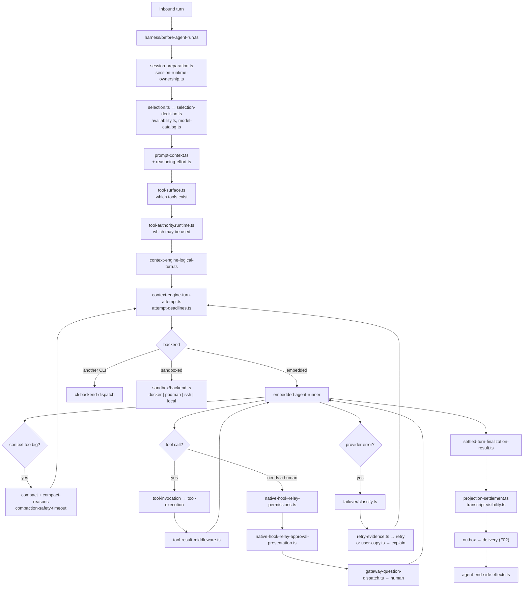
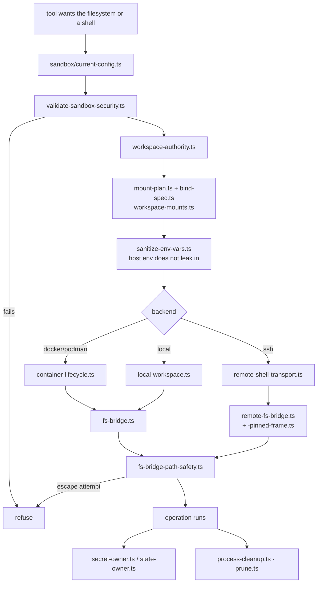

# F08 — agents

| | |
|---|---|
| describes | openclaw `v2026.10.3` @ `59cb44796b0f1f0daa0e37af8b1495abb45d9bc1` |
| paths | `src/agents/`, `packages/agent-core/` |
| size | 4,797 tracked files · ~1,336,000 LOC — second largest feature |
| distinct dependents | 63 |
| depth of read | structural across the whole tree; deep on `harness/`, `sandbox/`, `failover/`, `embedded-agent-runner/`. The 363 `embedded-*` files and 193 `subagents/` files were surveyed by name, not read individually. |

## What it is, in plain English

The brain. Everything between "a message arrived" and "the model produced a result that was safely delivered": the harness that prepares a turn, the runner that executes it, the tool surface, the sandbox, subagents, worktrees, and the failover logic for when a provider breaks.

The decomposition:

| cluster | files | what it is |
|---|---|---|
| `embedded-*` | 363 | the in-process agent — runner, compaction, messaging, payloads |
| `subagents/` | 193 | spawning and managing child agents |
| `tools/` | 191 | the built-in tool implementations |
| `sessions/` | 123 | agent-side session handling |
| `harness/` | 120 | **the contract between host and model** — the most important directory here |
| `agent-*` | 107 | agent identity, roster, directories |
| `auth-*` | 96 | provider auth and profiles |
| `cli-*` | 81 | CLI-backend agents (running another coding CLI as the brain) |
| `sandbox/` | 77 | container / remote sandboxing |
| `worktrees/` | 65 | git worktree isolation per run |
| `model-*`, `prepared-*`, `mcp-*` | 171 | model selection, prepared inputs, MCP clients |
| `failover/` | 25 | provider failure classification |

## The architectural through-line: explicit, revocable authority

One pattern recurs across the whole module, and once seen it explains the design:

```
harness/tool-authority.runtime.ts              may this tool run in this turn
harness/node-execution-authority.ts            may this run execute on a node
harness/host-source-authority.ts               which host source is authoritative
harness/host-capability.ts / -private-capabilities.ts / -capability-workspace.ts
harness/native-session/binding-authority.ts
harness/native-session/binding-generation-authority.ts
harness/native-session/binding-leases.ts
sandbox/workspace-authority.ts
sandbox/state-owner.ts
sandbox/secret-owner.ts
harness/session-runtime-ownership.ts
```

Nothing in openclaw is permitted because it is reachable. Each capability is granted to a named holder, for a scope, under a lease that can lapse or be revoked. The same vocabulary appears in the gateway's `AgentRunDelegatedAuthority` (F07) and in `src/secrets`' per-component secret owners (F05).

**Practical consequence:** when something "does nothing", the most likely cause is a missing or expired authority, not a bug. The failure mode is a refusal, and refusals here are quiet by design.

## 1. `harness/` — the host↔model contract

### Turn preparation and the outbox

```
context-engine-lifecycle.ts
context-engine-logical-turn.ts
context-engine-turn-attempt.ts
context-engine-turn-outbox.ts  + .worker.ts + -store.ts
prompt-context.ts / prompt-tool-policy.ts / prompt-compaction-hook-helpers.ts
reasoning-effort.ts
selection.ts / selection-decision.ts / auto-selection.ts / availability.ts
model-catalog.ts
execution-environment.ts
```

A turn is a **logical turn** made of one or more **attempts**, and outbound work goes through an **outbox** backed by a store and a worker. That is the shape you build when an attempt can fail halfway and must not deliver twice. `attempt-deadlines.ts`, `attempt-cancellation.ts` and `attempt-events.ts` complete it.

### Tools

```
tool-surface.ts / tool-surface-bridge.ts     what tools exist this turn
tool-authority.runtime.ts                   which of them may be used
tool-invocation.ts / tool-execution.ts
tool-result-facts.ts / tool-result-middleware.ts
host-bound-tool.ts                          a tool bound to the host, not the model
projection-tool-output.ts
structured-input{,-schema,-field,-rich,-execution,-boundary}.ts
```

`tool-result-middleware.ts` is the interception point for anything that must happen to every tool result — redaction, truncation, policy. `structured-input-*` is a six-file subsystem for giving the model typed input rather than text.

### The native hook relay (~30 files)

```
native-hook-relay.ts, -bridge.ts, -bridge-query.ts, -bridge-record.ts
native-hook-relay-client{,-read,-store,.worker}.ts
native-hook-relay-permissions.ts
native-hook-relay-approval-presentation.ts
native-hook-relay-plan.ts / -work.ts / -state.ts / -events.ts
native-hook-relay-codec.ts / -response-codec.ts
native-hook-relay-store{,.kernel,.worker,.worker-contract}.ts
```

This is how a running agent reaches a **native** client to ask permission. `native-hook-relay-approval-presentation.ts` formats the ask; `native-hook-relay-permissions.ts` decides what may be asked for; the store is durable and off-thread so a pending approval survives.

Together with `gateway-question-dispatch.ts` / `gateway-question.ts`, this is the complete "agent asks a human and waits" path. It is the mechanism to build an approval loop on — it exists, it is durable, and the presentation layer is already separated from the policy layer.

### Lifecycle and hooks

```
lifecycle.ts / before-agent-run.ts / agent-end-side-effects.ts
hook-context.ts / hook-helpers.ts / hook-history.ts
lifecycle-hook-helpers.ts / lifecycle-hook-messages.ts
runtime-plugin.ts / runtime-plugin-load-plan.ts
result-classification.ts
settled-turn-finalization-outcome.ts / -result.ts
projection-messages.ts / projection-settlement.ts
transcript-visibility.ts
```

`transcript-visibility.ts` is worth noting: what is in the transcript and what the model sees are different sets, decided here.

## 2. `embedded-*` — the in-process runner, and compaction

363 files. The runner's own sub-tree is the interesting part:

```
embedded-agent-runner/abort
embedded-agent-runner/active-run-projections
embedded-agent-runner/cache-ttl
embedded-agent-runner/cli-backend-dispatch{,-eligibility,-transcript}
embedded-agent-runner/compact
embedded-agent-runner/compact-reasons
embedded-agent-runner/compaction-diagnostics
embedded-agent-runner/compaction-duplicate-user-messages
embedded-agent-runner/compaction-hooks
embedded-agent-runner/compaction-runtime-context
embedded-agent-runner/compaction-runtime-preparation
embedded-agent-runner/compaction-safety-timeout
```

**Eleven modules on context compaction alone**, including a *safety timeout* and a dedicated fix for duplicate user messages. Compaction is where long-running agents break, and this is a module that has been broken by it repeatedly and now instruments it (`compact-reasons`, `compaction-diagnostics`).

`embedded-agent-helpers/` carries per-provider adapters (`anthropic-api`, `openai`, `google`) plus the hard-won edge cases: `assistant-message-failures`, `context-overflow-observation`, `image-errors`, `messaging-dedupe`, `sanitize-user-facing-text`, `provider-runtime-failure`, `thinking`, `turns`.

## 3. `sandbox/` — a real container sandbox

```
backend.ts / backend.types.ts / backend-handle.types.ts
docker-backend.ts / docker.ts / docker-user.ts / docker-mount-source.ts
  docker-partial-cleanup.ts / container-engine.ts / container-lifecycle.ts
  container-inspect.ts / podman-runtime.ts
ssh-backend.ts / ssh.ts / remote-shell-{backend,command,transport}.ts
  remote-shell-bootstrap-python.ts
local-workspace.ts / local-workspace-quiescence.ts
fs-bridge.ts + fs-bridge-path-safety.ts + fs-bridge-mutation-helper.ts
  fs-bridge-rename-targets.ts / fs-bridge-shell-command-plans.ts / fs-bridge-stat-parse.ts
remote-fs-bridge.ts + remote-fs-bridge-canonical-path.ts + -pinned-frame.ts
mount-plan.ts / workspace-mounts.ts / bind-spec.ts / network-mode.ts
validate-sandbox-security.ts
sanitize-env-vars.ts / secret-owner.ts / state-owner.ts / workspace-authority.ts
browser.ts / browser-bridges.ts / browser-network.ts / novnc-auth.ts
registry.ts / registry.kernel.ts / registry-{import,write}.worker.ts
prune.ts / process-cleanup.ts / config-hash.ts / current-config.ts
```

Four backends (Docker, Podman, SSH/remote shell, local workspace), a filesystem bridge with explicit path-safety and canonical-path handling, `validate-sandbox-security.ts` as a gate, `sanitize-env-vars.ts` so the sandbox does not inherit the host's environment, and a browser inside the sandbox with its own network mode and noVNC auth.

`remote-fs-bridge-pinned-frame.ts` is a nice detail: a remote filesystem view pinned to a frame, so a path resolved in one step cannot be swapped underneath a later step.

## 4. `failover/` — corpus-tested provider failure classification

```
classify.ts / classify-core.ts / classification-rules.ts
provider-patterns.ts / message-patterns.ts
request-error-facts.ts / request-error-facets.ts
signal.ts / signal-details.ts / probe-status.ts / retry-evidence.ts
context-overflow.ts / context-overflow-tables.ts
user-copy.ts / assistant-request-failure-copy.ts

cases: auth-format · billing · legacy-billing-a · legacy-billing-b
       legacy-provider-matchers · rate-limit-overload · overflow
       overflow-server-misc · structured-misc · corpus
```

This takes an opaque provider error and decides what *kind* of failure it is — auth, billing, rate limit, context overflow, structured error — and what to do about it, with `retry-evidence.ts` recording why a retry was justified and `user-copy.ts` producing the human explanation.

**It is validated against a corpus of real error strings**, maintained as case files including legacy ones. Anything building provider self-heal should extend this classifier rather than writing a new one; a fresh regex set will be wrong about the cases these files already encode.

## Process flow — one agent turn



## Process flow — a sandboxed tool call



## Dependencies

**Out** — `core/config` (3,030), `core/plugins` (2,049), `core/infra` (1,978), `core/state` (968), `core/gateway` (787), `core/shared` (723), `core/auto-reply` (525).

**In** — `core/gateway` (3,338), `core/auto-reply` (1,172), `core/commands` (881), `core/cron` (663), `core/logging`, `core/skills` (268). 63 distinct dependents.

Three cycles: `agents ↔ gateway` (3,338 / 787), `agents ↔ auto-reply` (525 / 1,172), `agents ↔ config`. The first two are structural — the gateway hosts runs and runs call back into it; auto-reply decides whether to run an agent and the agent produces the reply.

## Risks and traps

1. **Authority failures are silent.** A missing lease or expired authority produces a refusal, not an exception. Before debugging logic, check the authority.
2. **Compaction is the known failure surface.** Eleven modules, a safety timeout and a duplicate-message fix say so. Any change to prompt assembly should be tested against a context that actually overflows.
3. **`transcript-visibility.ts` means the transcript is not the prompt.** Reading a transcript to work out what the model saw will mislead.
4. **Four sandbox backends means four behaviours.** A tool verified under `local-workspace` is not verified under Docker or SSH. `fs-bridge-path-safety.ts` and `remote-fs-bridge-canonical-path.ts` are separate implementations of the same guard.
5. **`cli-backend-dispatch` means the brain may be another CLI.** An agent run may not be a model call at all; `cli-backend-dispatch-eligibility` decides. Debugging a run without knowing which backend served it wastes time.
6. **363 `embedded-*` files and no barrel.** Same trap as the gateway: a wrong filename guess returns clean nothing.
7. **The failover corpus is load-bearing.** Those `.cases.ts` files, including the legacy-billing ones, encode provider error strings that no longer appear in current docs. Do not regenerate them from scratch.

## Verdict

The most sophisticated module in the repo and the one with the most scars. The authority model is genuinely good — every capability named, scoped, leased and revocable, consistently with the gateway and the secrets layer. The sandbox is real, not nominal. The failover classifier, validated against a corpus of real provider errors, is the kind of asset you cannot rebuild quickly.

The cost is comprehensibility: 4,797 files, eleven compaction modules, thirty hook-relay modules, four sandbox backends and two agent backends, with no index anywhere. The honest decomposition — `agents/harness`, `agents/runner`, `agents/tools`, `agents/sandbox`, `agents/subagents`, `agents/failover` — is already visible in the naming and is the obvious next structural move.
