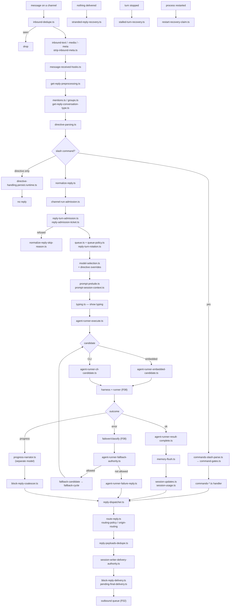

# F09 — auto-reply

| | |
|---|---|
| describes | openclaw `v2026.10.3` @ `59cb44796b0f1f0daa0e37af8b1495abb45d9bc1` |
| paths | `src/auto-reply/` |
| size | 985 tracked files · 982 code · ~288,000 LOC |
| distinct dependents | 35 |
| shape | 459 of those files are in one directory: `src/auto-reply/reply/` |

## What it is, in plain English

The orchestrator. Between "a message arrived on a channel" and "a reply was delivered", this module decides: should we reply at all, who should reply, with which model, under what directives, through which route, and what to do when any of that fails.

It is misnamed. "Auto-reply" sounds like an out-of-office responder. It is in fact the brain stem — and it owns **the entire user-facing command surface**.

## 1. The slash-command surface lives here

About 60 `commands-*.ts` files. This is the real command list, in one place, nowhere documented together:

| area | commands |
|---|---|
| session | `session`, `session-abort`, `session-cost`, `session-store`, `reset`, `reset-mode`, `reset-hooks`, `compact`, `goal`, `name`, `whoami` |
| models | `models`, `models-menu`, `models-catalog`, `steer`, `loop` |
| context | `context`, `context-command`, `context-report` |
| export | `export-session`, `export-session-file`, `export-trajectory` |
| plugins & MCP | `plugin`, `plugins`, `plugins-install`, `mcp` |
| ops | `status`, `status-subagents`, `diagnostics`, `dashboard`, `info`, `update`, `config`, `setunset` |
| execution | `bash`, `approve`, `allowlist`, `private-route`, `system-agent`, `system-prompt`, `openclaw-cli`, `acp` |
| other | `learn`, `login`, `btw`, `tts`, `subagents` |

Parsing is `commands-slash-parse.ts`; gating is `command-gates.ts`; `get-reply-native-slash-fast-path.ts` short-circuits a slash command so it never reaches a model.

## 2. Directives — inline control of a turn

Eighteen `directive-handling.*` modules:

```
directive-parsing.ts / directive-handling.parse.ts
directive-handling.model.ts / .model-selection.ts / .model-runtime.ts
directive-handling.auth-profile.ts
directive-handling.levels.ts / .arguments.ts / .params.ts
directive-handling.directive-only.ts / .mixed-inline.test-helpers.ts
directive-handling.queue-validation.ts
directive-handling.persist.runtime.ts / .defaults.ts / .shared.ts
streaming-directives.ts
get-reply-directives{,-apply,-routing,-utils,-aliases}.ts
```

A message can carry directives that change the model, the auth profile, the reasoning level or the routing *for that turn*, inline, with aliases, and optionally persisted. A message can also be directive-only — configuration with no reply.

## 3. Admission — four gates before a run

```
channel-run-admission.ts       may this channel start a run
reply-turn-admission.ts        may this turn run
reply-admission-ticket.ts      the ticket it runs under
followup-turn-admission.ts     may a follow-up turn run
queue.ts + queue-policy.ts + queue/ (14 files)
reply-turn-rotation.ts         whose turn is next
inbound-dedupe.ts              has this message already been seen
```

`reply-admission-ticket.ts` is the same authority pattern as F08: a run holds a ticket, and work without one does not proceed.

## 4. The fallback cycle — failover *execution*

F08's `failover/` classifies an error. This module acts on it:

```
agent-runner-auto-fallback.ts
agent-runner-fallback-candidate.ts      who else could serve this
agent-runner-fallback-authority.ts      are we allowed to switch
agent-runner-fallback-cycle.ts          the retry loop
agent-runner-fallback-settlement.ts     how the cycle ends
agent-runner-cli-candidate.ts           a CLI backend as a candidate
agent-runner-embedded-candidate.ts      the embedded runner as a candidate
agent-runner-error-handler.ts / -failure-reply.ts
agent-runner-context-recovery.ts
agent-runner-compaction-accounting.ts
```

So "fall back to another provider or backend when this one fails" is a **complete, existing cycle** with candidate selection, an authority check on switching, and a settlement step. Anything building self-heal extends this; it does not need writing.

## 5. Seven recovery paths

Worth listing because each one is a different failure that actually happened:

| module | the failure it recovers from |
|---|---|
| `stalled-turn-recovery.ts` | a turn that stopped making progress |
| `stranded-reply-recovery.ts` | a reply produced but never delivered |
| `restart-recovery-claim.ts` | work in flight when the process restarted |
| `reply-turn-recovery-notice.ts` / `-wait.ts` | telling the user, and waiting |
| `session-init-conflict-retry.ts` | two initialisations racing |
| `agent-runner-context-recovery.ts` | context lost mid-run |
| `pending-tool-task-drain.ts` | tool tasks outstanding at the end |

## 6. Delivery

```
reply-dispatcher.ts / reply-dispatcher-observers.ts / dispatcher-registry.ts
provider-dispatcher.ts
route-reply.ts / routing-policy.ts / origin-routing.ts / effective-reply-route.ts
  explicit-steer-routing.ts / routed-delivery-thread.ts / reply-threading.ts
block-reply-pipeline.ts / block-reply-coalescer.ts / block-reply-delivery.ts
  block-streaming.ts
pending-final-delivery.ts / pending-final-delivery-state.ts
  dispatch-from-config.deferred-final.ts / .pending-final.ts
reply-payloads-dedupe.ts
completion-delivery-policy.ts / reply-dispatch-delay.ts
session-writer-delivery-authority.ts
followup-runner.ts / followup-delivery.ts / followup-presentation.ts
typing.ts / typing-policy.ts / typing-mode.ts / waiting-status.ts
```

`block-reply-coalescer.ts` merges streamed blocks so a channel is not flooded; `pending-final-delivery` handles the case where the final message is not ready when the run settles. `dispatch-from-config.*` is a 40-module pipeline — gather, choose-route, prepare-context, prepare-execution, prepare-delivery, execute, finalize, turn-ledger, audit.

## 7. Two details worth stealing

**A progress narrator on its own model.** `progress-narrator.ts` + `progress-narrator-model.ts` + `commentary-progress-owner.ts`. Progress commentary during a long run is generated by a *separate, cheaper* model, with an owner so two narrators cannot talk at once.

**`context-treemap.ts`.** A treemap of what is occupying the context window — the tool behind `/context`. Context pressure is made visible rather than inferred.

## 8. Authority, again

```
message-injection-authority.ts            may something inject a message into this session
reply-tool-authority.ts
reply-run-registry.tool-authority.ts
session-writer-delivery-authority.ts
config-write-authorization.ts
agent-runner-fallback-authority.ts
reply-run-finalization-lease.ts
elevated-allowlist-matcher.ts / reply-elevated.ts / elevated-unavailable.ts
```

`message-injection-authority.ts` is the one to note: injecting a message into a live session is itself an authority-gated act. That is the correct place to enforce that instructions found in a web page or a file cannot become a turn.

## Process flow — inbound message to delivered reply



## Dependencies

**Out** — `core/agents` (1,172), `core/config` (934), `core/infra` (402), `core/plugins` (307), `core/channels` (229), `core/sessions` (160).

**In** — `core/agents` (525), `core/gateway`, `core/channels` (145), `core/commands`, `core/infra` (182). 35 distinct dependents.

`auto-reply ↔ agents` is a genuine cycle (1,172 out, 525 back) and the right one: auto-reply decides whether and how to run an agent; the agent calls back to produce the reply.

## Risks and traps

1. **459 files in one directory, no barrel.** The largest flat directory in the repo.
2. **A refusal is not an error.** `normalize-reply-skip-reason.ts` exists because "we chose not to reply" is a first-class outcome with many causes. "The bot did not answer" is usually a skip reason, not a crash, and that reason is recorded.
3. **Directives mutate the turn and can persist.** A model change applied by directive in one message may outlive that message (`directive-handling.persist.runtime.ts`). Diagnosing "why did it use that model" means checking stored overrides (`stored-model-override.ts`) as well as config.
4. **The fallback cycle can silently change the backend.** A run may be served by a different provider, or by a CLI backend instead of the embedded runner, with no user-visible difference except the usage line. `agent-runner-trace.ts` is where to look.
5. **Delivery is not the end.** `pending-final-delivery`, `deferred-final` and `followup-runner` mean a reply may be delivered in several pieces over time. Code that assumes one run means one message is wrong.
6. **Seven recovery paths means seven ways a turn can look finished and not be.** Any new orchestration must say which recovery path owns it.
7. **`message-injection-authority.ts` is the right gate and must not be bypassed.** Anything that turns external content — a fetched page, a file, a tool result — into a new turn should go through it.

## Verdict

The hardest-working module in openclaw and the least well named. It holds the whole command surface, the directive language, four admission gates, a complete provider-fallback cycle, seven recovery paths and a multi-stage delivery pipeline — and two ideas worth copying outright: a cheap separate model narrating progress, and a treemap that makes context pressure visible.

Its weakness is that none of this is discoverable. 459 files in one directory with 60 undocumented commands means the product's actual feature set is only knowable by reading the filenames.
