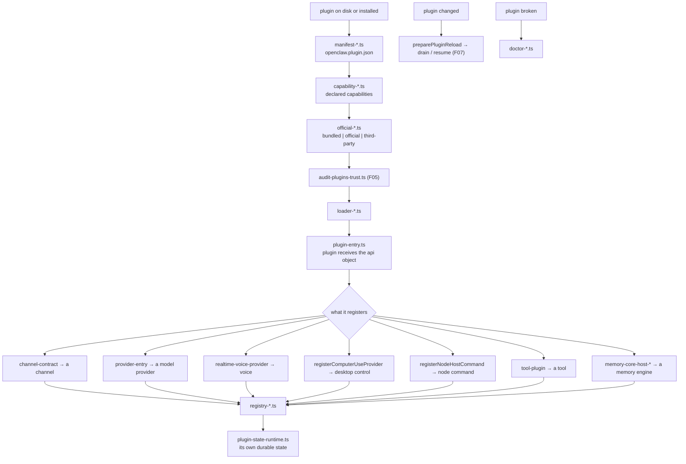
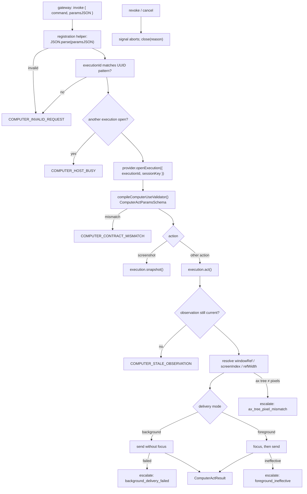

# F10 — plugin system

| | |
|---|---|
| describes | openclaw `v2026.10.3` @ `59cb44796b0f1f0daa0e37af8b1495abb45d9bc1` |
| paths | `src/plugins/`, `src/plugin-sdk/`, `src/plugin-state/`, `packages/plugin-sdk/` |
| size | 2,293 tracked files · ~483,000 LOC |
| distinct dependents | 63 (`core/plugins`) + 45 (`core/plugin-sdk`) |

## What it is, in plain English

Two halves that must not be confused:

- **`src/plugin-sdk/`** — the **published contract**. 346 export subpaths in `package.json`, each a module a plugin may import as `openclaw/plugin-sdk/<name>`. This is what third-party code is allowed to use.
- **`src/plugins/`** — the **host implementation**. Discovery, manifests, loading, registry, install/uninstall/update, trust, capabilities, doctor.

Pass 1 showed why this matters: the whole of `extensions/` (175 directories) resolves to only ~90 relative import edges into `src/`, against **6,351 edges through the `openclaw/plugin-sdk/*` and `@openclaw/*` surface**. Extensions do not reach into the source tree. **The SDK surface is the architecture.** Anything written as an openclaw plugin targets these 346 subpaths and nothing else.

## The SDK surface, by area

346 subpaths, grouped:

| area | representative subpaths |
|---|---|
| **channels** (39) | `channel-contract`, `channel-core`, `channel-inbound`, `channel-outbound`, `channel-route`, `channel-policy`, `channel-targets`, `channel-pairing`, `channel-mention-gating`, `channel-replay-guard`, `channel-inbound-debounce`, `channel-config-schema`, `channel-secret-owner-runtime` |
| **providers** (44) | `provider-entry`, `provider-auth`, `provider-oauth-runtime`, `provider-stream`, `provider-stream-event-normalization`, `provider-catalog-runtime`, `provider-model-metadata`, `provider-usage`, `provider-tools`, `provider-web-search`, `provider-web-fetch`, `provider-thinking-runtime`, `provider-transport-runtime` |
| **approvals** (20) | `approval-runtime`, `approval-native-runtime`, `approval-native-controls`, `approval-gateway-runtime`, `approval-delivery-runtime`, `approval-reaction-binding`, `approval-renderers`, `approval-terminal`, `approval-approvers` |
| **memory** (23) | `memory-core-host-engine-{foundation,embeddings,indexing,knn,schema,storage,sessions,fs,curated}`, `memory-host-search`, `memory-host-markdown`, `memory-host-events`, `embedding-providers` |
| **agent harness** (15) | `agent-harness`, `agent-harness-registration`, `agent-harness-tool-runtime`, `agent-harness-attempt-runtime`, `agent-harness-session-runtime`, `agent-runtime`, `agent-scope-runtime`, `agent-workspace-runtime` |
| **voice / speech** (11) | `realtime-voice`, `realtime-voice-provider`, `realtime-voice-audio-queue`, `realtime-voice-playback`, `realtime-voice-activation`, `realtime-transcription`, `realtime-transcription-session`, `speech`, `speech-core`, `speech-provider`, `speech-settings`, `tts-runtime` |
| **computer use** | `computer-use` — see below |
| **node host** | `node-host`, `node-cli-runtime`, `node-selection-runtime`, `native-command-registry`, `native-command-config-runtime`, `device-bootstrap`, `pairing-access` |
| **security** | `secret-ref-runtime`, `secret-ref-readonly`, `secret-file`, `secret-input-schema`, `secret-egress-runtime`, `ssrf-policy`, `ssrf-dispatcher`, `ssrf-runtime`, `security-runtime`, `exec-approvals-runtime`, `webhook-request-guards`, `webhook-memory-guards` |
| **media** | `media-runtime`, `media-store`, `media-ffmpeg`, `media-mime`, `media-understanding`, `image-generation`, `video-generation`, `music-generation`, `outbound-media`, `web-media` |
| **storage / state** | `runtime-store`, `runtime-store-registry`, `json-store`, `sqlite-runtime`, `sqlite-worker-runtime`, `plugin-state-runtime`, `persistent-dedupe`, `file-lock`, `session-store-runtime`, `session-transcript-runtime`, `state-paths` |
| **browser** | `browser-cdp`, `browser-config`, `browser-bridge`, `browser-profiles`, `browser-control-auth`, `browser-maintenance`, `web-content-extractor` |
| **testing** (78 files) | `plugin-test-api`, `plugin-test-contracts`, `plugin-test-runtime`, `channel-contract-testing`, `provider-test-contracts`, `test-live`, `test-live-auth`, `expect-runtime`, `sqlite-runtime-testing` |

### API stability is enforced, not hoped for

```
src/plugin-sdk/api-baseline.ts
src/plugin-sdk/api-baseline-normalization.ts
src/plugin-sdk/api-baseline-declaration-closure.ts
src/plugin-sdk/api-baseline-declaration-print.ts
src/plugin-sdk/api-diff.ts
```

The SDK keeps a **recorded baseline of its own public API** and diffs against it. A 346-subpath surface with 45 internal dependents and an unknown number of external plugins cannot be maintained by review alone, so it is machine-checked. `declaration-closure` means the baseline covers the transitive type closure, not just the top-level names — a type leaking in from a private module is caught.

There is also a `plugin-sdk/AGENTS.md`, one of very few in the repo — this directory has written rules.

## The computer-use contract (the headline finding)

`openclaw/plugin-sdk/computer-use` re-exports from `src/plugins/computer-use-contract.ts` and `computer-use-registration.ts`:

```ts
export {
  COMPUTER_USE_V2_ACTION_NAMES,
  ComputerActParamsSchema, ComputerActResultSchema,
  ComputerUseCapabilityDescriptorSchema,
  ScreenSnapshotParamsSchema, ScreenSnapshotResultSchema,
  compileComputerUseValidator,
  parseComputerActParamsJSON, parseScreenSnapshotParamsJSON,
};
export { registerComputerUseProvider };
export type { ComputerUseProvider, ComputerActParams, ComputerActResult,
              ComputerUseCapabilityDescriptor, ComputerUseV2ActionName, ... };
```

### The action vocabulary is fully specified

```ts
COMPUTER_USE_V2_ACTION_NAMES = [
  "screenshot",
  "left_click", "right_click", "middle_click", "double_click", "triple_click",
  "mouse_move", "left_click_drag", "left_mouse_down", "left_mouse_up",
  "scroll", "type", "key", "hold_key", "wait",
  "list_apps", "list_windows", "get_accessibility_tree",
  "get_cursor_position", "get_window_state",
  "launch_app", "kill_app", "bring_to_front", "set_value", "zoom",
  "get_browser_state", "browser_prepare", "browser_navigate",
  "browser_click", "browser_type", ...
];
COMPUTER_USE_V1_ACTION_NAMES  = V2.slice(0, 15);
COMPUTER_ACT_V1_ACTION_NAMES  = V2.slice(1, 14);
```

So mouse, keyboard, window management, app launching, accessibility-tree reading and browser driving are all **named, versioned actions in a shipped contract**, with a V1/V2 split for compatibility. This is the specification a provider implements — not something to be designed.

### The contract already knows how this fails in the real world

```ts
COMPUTER_CONTRACT_MISMATCH
COMPUTER_STALE_OBSERVATION
COMPUTER_SCROLL_DIRECTIONS = ["up","down","left","right"]
DELIVERY_MODES = ["background", "foreground"]
COMPUTER_ESCALATION_REASONS = [
  "ax_tree_pixel_mismatch",      // accessibility tree disagrees with the pixels
  "background_delivery_failed",  // the event did not land without focus
  "foreground_ineffective",      // focusing did not help either
  "no_window_target",
  "other",
];
COMPUTER_RESOURCE_HANDLE_PATTERN =
  "^openclaw:computer-resource:v1:<uuid>$"
```

`COMPUTER_STALE_OBSERVATION` is the important one: acting on an out-of-date screenshot is a **named, returnable error**, not a silent misclick. And `COMPUTER_ESCALATION_REASONS` enumerates exactly the failures that make desktop automation unreliable — whoever wrote this had already lost those fights.

Parameters also carry `screenIndex`, `refWidth`, and an optional `windowRef`, so coordinates are resolvable across displays and scaling factors.

### The provider interface

```ts
type ComputerUseExecution = {
  snapshot(paramsJSON, signal?): Promise<string>;
  act(paramsJSON, signal?): Promise<string>;
  close(reason: string): Promise<void>;
};

export type ComputerUseProvider = {
  id: string;
  label: string;
  capabilities(): ComputerUseCapabilityDescriptor;
  isAvailable(): boolean;
  prepare?(ctx: OpenClawPluginNodeHostCommandAvailabilityContext): Promise<void> | void;
  watchAvailability?: OpenClawPluginNodeHostCommand["watchAvailability"];
  openExecution(ctx: { executionId: string; sessionKey?: string }):
    Promise<ComputerUseExecution>;
};

export function registerComputerUseProvider(
  api: { registerNodeHostCommand(cmd: OpenClawPluginNodeHostCommand): void },
  provider: ComputerUseProvider,
): void
```

Seven members. The registration helper handles the rest: it enforces one execution at a time (`COMPUTER_HOST_BUSY: another provider execution owns this computer`), validates the execution id against a UUID pattern, rejects non-JSON params (`COMPUTER_INVALID_REQUEST`), and serialises close against in-flight acquisition with a barrier loop.

**`capabilities()` is the gate.** A provider declares which of the ~40 actions it supports, so a snapshot-only provider and a full-control provider are the same interface with different descriptors. Staged rollout — look now, click later — is a change to one returned descriptor, not a code path.

## `src/plugins/` — the host side

```
plugin-*            (110)  entry, contracts, lifecycle, api surface
provider-*           (79)  provider plugin specialisation
runtime/             (43)
install-*            (30)  install
manifest-*           (27)  openclaw.plugin.json
registry-*           (25)  the live registry
installed-*          (25)  what is installed
hook-*               (20)
loader-*             (16)
bundled-*            (16)  plugins that ship in-tree
official-*           (14)  official vs third-party
capability-*         (11)  declared capabilities
doctor-*             (10)  diagnose a broken plugin
update-* / uninstall-* (18)
compat/ contracts/   (21)
```

Four trust tiers are visible in the naming: **bundled** (in-tree), **official**, third-party, and local. `src/security/audit-plugins-trust.ts` (F05) reviews the result, and `capability-*` is where a plugin's declared capabilities are checked against what it asks to do.

## Process flow — loading a plugin



## Process flow — one computer-use action



## Dependencies

**Out** — `core/config` (1,109), `core/infra` (965), `core/agents` (824), `core/channels` (429), `core/shared` (306), `core/state` (268).

**In** — `core/agents` (2,049), `core/gateway` (1,802), `core/commands` (960), `core/config` (766), `core/auto-reply` (307). `core/plugins` has 63 distinct dependents and `core/plugin-sdk` 45.

## Risks and traps

1. **Do not import from `src/` in a plugin.** Only the 346 `openclaw/plugin-sdk/*` subpaths are contract. A relative import into `src/` works until it does not, and `api-diff` will not protect it. This is the single most important rule in the repo for anyone writing an extension.
2. **`capabilities()` is the staging mechanism, and it is advisory.** The host validates parameters against the contract, but a provider that declares an action it implements badly still gets called. Declare only what is implemented and tested.
3. **One execution owns the computer.** `COMPUTER_HOST_BUSY` means two agents cannot drive the same desktop concurrently. Any design assuming parallel desktop work is wrong.
4. **`COMPUTER_STALE_OBSERVATION` must be honoured by the provider.** The host offers the error; nothing forces a provider to detect staleness. A provider that does not check will click where the button used to be. This is the one place where the contract's safety depends entirely on the implementer.
5. **Abort is cooperative.** `snapshot`/`act` take a `signal`. A provider that ignores it keeps acting after cancellation or authority revocation (F07).
6. **Four trust tiers, one loader.** A third-party plugin gets the same `api` object as a bundled one; the difference is what the manifest declared and what trust review allows. Auditing "what can this plugin do" means reading its manifest and its capability declarations, not its imports.
7. **346 subpaths is a large surface to keep stable.** `api-baseline` exists because it is hard. Adding an export is a contract change; it should go through the baseline, not around it.

## Verdict

The best-engineered boundary in openclaw, and the reason the 175 extensions can exist without entangling the core: a published 346-subpath SDK, a machine-checked API baseline with transitive declaration closure, four trust tiers, declared capabilities, per-plugin durable state, and drain/resume reload.

The computer-use contract in particular is further along than its documentation suggests. Forty named actions, a V1/V2 compatibility split, multi-display coordinate resolution, background-versus-foreground delivery, named escalation reasons for the exact ways desktop automation fails, and a seven-member provider interface with the concurrency and validation already handled by the registration helper. Desktop control on a given host is not a feature to build — it is a provider to implement against a specification that already exists.
