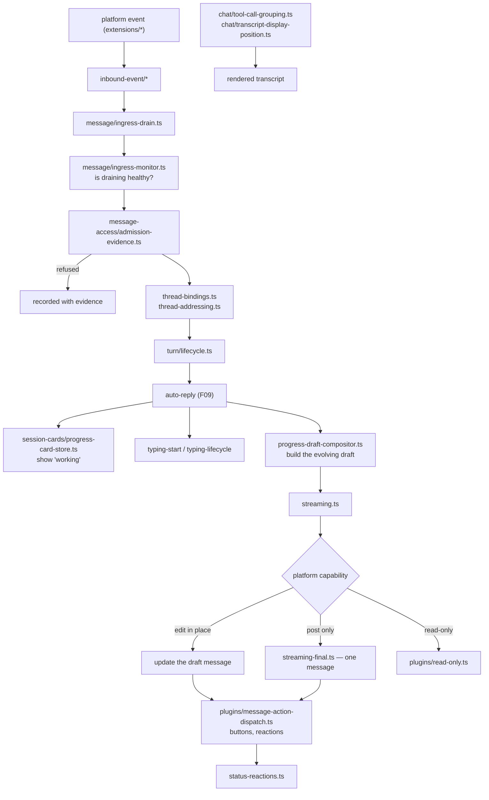

# F11 — channels and chat

| | |
|---|---|
| describes | openclaw `v2026.10.3` @ `59cb44796b0f1f0daa0e37af8b1495abb45d9bc1` |
| paths | `src/channels/`, `src/chat/`, `src/session-cards/` |
| size | 554 tracked files · 282 non-test in `channels` · ~98,000 LOC |
| distinct dependents | 34 |

## What it is, in plain English

The host side of "a channel" — the abstraction that makes Discord, Telegram, Slack, iMessage, Matrix, WhatsApp and twenty-odd others interchangeable. The channels themselves live in `extensions/` (F27); this is the contract they fill and the machinery that drives them.

Three parts, very different sizes:

| path | non-test files | job |
|---|---|---|
| `src/channels/` | 282 | the channel contract, ingress, turn lifecycle, streaming, access |
| `src/chat/` | 7 | how a transcript is *rendered* — grouping, positioning, identity |
| `src/session-cards/` | 4 | the progress card shown while a run is in flight |

## Structure of `src/channels/`

```
plugins/        121   the adapter contract itself
message/         41   inbound message handling
message-access/  19   who may say what, where
turn/            16   turn lifecycle
inbound-event/    7
status/ join-intro/ transport/ allowlists/
```

The largest files tell you where the difficulty is:

```
streaming.ts                        47 KB
plugins/types.core.ts               32 KB
message/ingress-drain.ts            29 KB
plugins/setup-wizard-helpers.ts     29 KB
turn/lifecycle.ts                   28 KB
progress-draft-compositor.ts        27 KB
plugins/message-action-dispatch.ts  27 KB
message/ingress-monitor.ts          27 KB
plugins/read-only.ts                25 KB
plugins/types.adapters.ts           24 KB
plugins/setup-wizard.ts             23 KB
message-access/admission-evidence.ts 23 KB
```

### Streaming is the hard problem

`streaming.ts` (47 KB) plus `streaming-config.ts`, `streaming-final.ts`, `draft-stream*.ts` and `progress-draft-compositor.ts` (27 KB). Different chat platforms stream differently or not at all — some let you edit a message in place, some only let you post, some rate-limit edits. The **progress-draft compositor** builds a single evolving draft and the streaming layer decides how to realise it on a given platform.

`plugins/read-only.ts` (25 KB) is the counterpart: a channel that cannot be written to still has to behave coherently.

### Ingress is monitored, not just handled

```
message/ingress-drain.ts     29 KB   drain the inbound queue
message/ingress-monitor.ts   27 KB   watch that draining is happening
```

A dedicated monitor for the inbound path means inbound stalls have happened and are now observable — the same instinct as the `stalled-turn-recovery` and `stranded-reply-recovery` modules in F09.

### Access control carries evidence

`message-access/admission-evidence.ts` (23 KB). Not a boolean — **evidence**. When a message is admitted or refused, the reasons are recorded. This is the same pattern as `execution-decision-facts.ts` in F04 and `retry-evidence.ts` in F08: openclaw consistently records *why* a decision was made, not just the decision.

Alongside it: `direct-dm-*.ts`, `allowlists/`, `thread-bindings.ts`, `thread-addressing.ts`, `implicit-mentions` (via F01's schema), `status-reactions.ts`.

### The setup wizard is part of the contract

`plugins/setup-wizard.ts` + `setup-wizard-helpers.ts` (52 KB together). A channel plugin does not just declare config keys — it declares how to *walk a human through* configuring them. That is why adding a channel is largely declarative.

## `src/chat/` — seven files, all presentation

```
canvas-render.ts                 9.3 KB
work-context.ts                  5.6 KB
transcript-display-position.ts   5.0 KB
tool-content.ts                  3.5 KB
tool-call-grouping.ts            2.2 KB
message-client-source.ts         1.8 KB
sender-identity.ts               0.9 KB
```

Small and worth knowing exists: `tool-call-grouping.ts` collapses a run of tool calls into one display unit, and `transcript-display-position.ts` decides where a message lands when messages arrive out of order.

## `src/session-cards/` — the progress card

```
progress-card-store.ts            8.3 KB
progress-card-input.ts            3.5 KB
progress-card-store.worker.ts     2.6 KB
progress-card-channel-summary.ts  1.3 KB
```

A durable, off-thread store for the "working on it" card. Durable because the card must survive a restart mid-run, otherwise a user is left looking at a card that will never update.

## Process flow — a message in, a reply out



## Dependencies

**Out** — `core/config` (193), `core/plugins` (187), `core/infra` (162), `core/auto-reply` (145), `core/state` (71), `core/routing` (47).

**In** — `core/auto-reply` (229), `core/infra` (276), `core/plugins` (429), `core/gateway`, `core/agents`. 34 distinct dependents.

The `plugins` relationship runs both ways and is the heaviest: the plugin system owns the registration, this module owns the behaviour.

## Risks and traps

1. **`streaming.ts` is the most platform-dependent file in the repo.** A streaming change verified on one channel is verified on one channel. The capability matrix (`resolveChannelCapabilities`, F01) decides behaviour per platform and per account.
2. **Read-only channels are a first-class case.** Code that assumes a reply can always be sent will fail on them, and `plugins/read-only.ts` being 25 KB says that assumption has been made before.
3. **A refusal carries evidence, which means it is quiet.** "The bot ignored me in that group" is usually an admission decision with a recorded reason, not a bug.
4. **The progress card store is durable and off-thread.** Writing to it from the wrong thread fails the way F03's leases fail — silently.
5. **121 files in `plugins/` are the contract surface**, mirrored in the 39 `channel-*` SDK subpaths (F10). A channel plugin should only ever see the SDK side.

## Verdict

A clean abstraction carrying a genuinely nasty problem: every chat platform streams, edits, threads and rate-limits differently, and this module absorbs all of it so that the orchestrator above does not care. The declarative setup wizard and the capability matrix are why openclaw can ship twenty-plus channels without twenty-plus orchestrators. The evidence-carrying access layer is the same good instinct found in the audit and failover modules.
