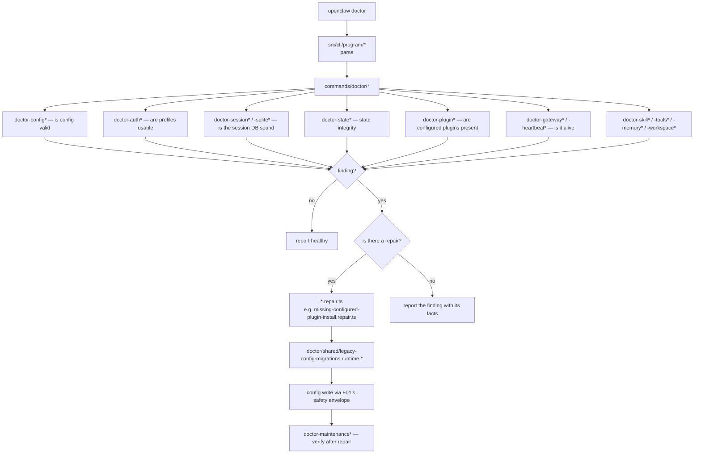
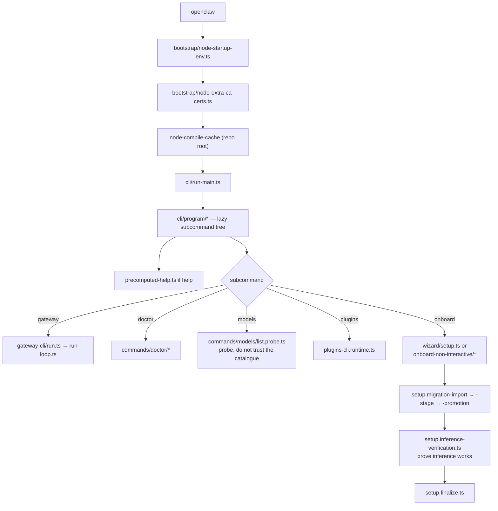

# F12 — CLI and commands

| | |
|---|---|
| describes | openclaw `v2026.10.3` @ `59cb44796b0f1f0daa0e37af8b1495abb45d9bc1` |
| paths | `src/cli/`, `src/commands/`, `src/interactive/`, `src/wizard/`, `src/bootstrap/` |
| size | 2,796 tracked files · ~780,000 LOC |

## What it is, in plain English

Two different things with confusingly similar names:

- **`src/cli/`** (532 non-test files) — argument parsing, subcommand wiring, the `openclaw` binary's own plumbing.
- **`src/commands/`** (654 non-test files) — what those subcommands actually *do*. Dominated by one subsystem: **`doctor`, 173 files.**

Plus `src/wizard/` (37 files + three 76 KB locale files), `src/interactive/` (one 40 KB file), and `src/bootstrap/` (three tiny files that run before anything else).

## Headline finding: `doctor` is a 173-file diagnose-and-repair system

Not a health check. A repair engine. The clusters:

```
doctor-session*       36 files    doctor-session-sqlite.ts is 53 KB
doctor-config*        13
doctor-maintenance*    9
doctor-gateway*        9
doctor-update*         8
doctor-skill*          8
doctor-plugin*         6
doctor-lint*           6
doctor-auth*           6    doctor-auth-flat-profiles.ts is 79 KB — largest file in the chunk
doctor-agent*          6
doctor-heartbeat*      5
doctor-workspace*      4
doctor-tools*          4
doctor-state*          4    doctor-state-integrity.ts is 53 KB
doctor-sqlite*         4
doctor-memory*         4
doctor/shared/         — legacy-config-core-normalizers.ts (33 KB)
                          legacy-config-migrations.runtime.agents.ts (30 KB)
                          missing-configured-plugin-install.repair.ts (29 KB)
```

The `.repair.ts` suffix is the point. `missing-configured-plugin-install.repair.ts` does not report that a configured plugin is missing — **it installs it**. The pattern is diagnose, then repair, with the repair as a separate named module so it can be reviewed and tested apart from the diagnosis.

`doctor-auth-flat-profiles.ts` at 79 KB is the single largest file in this chunk, which says auth profile migration has been the most painful recurring repair.

**Consequence:** anything that wants openclaw to recover from a broken auth profile, a corrupt session database, a missing plugin or a stale state record should extend `doctor`, not build beside it. There is already a `doctor-heartbeat` cluster and a `doctor-auth` cluster — the two things a provider self-heal story is about.

## `src/cli/` structure

```
update-cli/     121   self-update as a command surface
program/         47   the command tree
daemon-cli/      47
gateway-cli/     31   run.ts (41 KB), run-loop.ts (56 KB), register.ts (33 KB)
nodes-cli/       15
cron-cli/        14
capability-cli/  14
node-cli/ fleet-cli/ send-runtime/
```

Largest files:

```
run-main.ts                  57 KB   the entry point
gateway-cli/run-loop.ts      56 KB   running the gateway from the CLI
exec-approvals-cli.ts        51 KB   approving commands from the CLI
mcp-cli.ts                   51 KB
skills-cli.ts                42 KB
devices-cli.runtime.ts       39 KB
plugins-cli.runtime.ts       33 KB
command-secret-gateway.ts    30 KB
plugins-authoring-command.ts 30 KB   scaffolding for writing a plugin
```

`plugins-authoring-command.ts` is worth knowing exists: there is a built-in command for scaffolding a plugin, which is the right starting point for any new provider rather than copying an extension by hand.

`precomputed-help.ts` and `root-help.ts` indicate help text is precomputed — part of keeping cold start fast, alongside the no-barrel-files rule.

## `src/commands/` beyond doctor

```
models/          36   list.status-command.ts (65 KB), auth.ts (42 KB), list.probe.ts (37 KB)
channels/        17
onboard-non-interactive/ 13
status-all/      10
migrate/          9
channel-setup/    7
gateway-status/   4
agent-via-gateway.ts  46 KB
onboarding-plugin-install.ts 40 KB
onboard-guided.ts     30 KB
```

`models/list.probe.ts` (37 KB) **probes** providers rather than trusting a catalogue — it asks what is actually reachable with the current credentials. That is the honest version of a model list and the right thing to read before reasoning about "which models are available".

`onboard-non-interactive/` (13 files) matters for automation: onboarding has a path that needs no human at a prompt.

## `src/wizard/` — setup, and 230 KB of translations

```
i18n/locales/en.ts       76 KB
i18n/locales/zh-CN.ts     77 KB
i18n/locales/zh-TW.ts     77 KB
setup.finalize.ts         39 KB
setup.ts                  28 KB
clack-navigation-prompts.ts 25 KB
setup.migration-import.ts 23 KB
setup.migration-stage.ts  20 KB
setup.migration-promotion.ts 17 KB
setup.inference-verification.ts 16 KB
setup.model-auth.ts       13 KB
plus setup.{workspace,service,security,secret,post,plugin,official,
            model,memory,inference,gateway,completion,app}.ts
```

Three observations:

1. **Migration is a three-stage pipeline** — import, stage, promote. A migration is staged and only then promoted, so a half-finished import does not become live config.
2. **`setup.inference-verification.ts`** — setup does not just record a model choice, it verifies inference actually works before finishing.
3. **Full Chinese localisation** (simplified and traditional) of the setup wizard, at the same size as English. Whoever maintains this is maintaining three complete copies.

## `src/bootstrap/` — three files that run first

```
node-startup-env.ts         1.6 KB
node-exit-safe-compilers.ts 1.5 KB
node-extra-ca-certs.ts      1.4 KB
```

Tiny and load-bearing. `node-extra-ca-certs.ts` is how an extra CA is trusted at startup — relevant to anything that mints its own certificates (F05's secret egress proxy does exactly that).

## Process flow — `openclaw doctor`



## Process flow — cold start



## Dependencies

**Out** — `core/infra` (3,632), `core/config` (2,631), `core/plugins` (1,533), `core/state` (1,096), `core/agents` (1,058), `core/daemon` (879).

The heaviest outbound weight of any chunk, which is expected: the CLI is the surface that drives everything else.

**In** — `core/infra` (143), `core/daemon`, `core/commands ↔ core/cli`. `core/cli` has 37 distinct dependents, `core/commands` 24.

## Risks and traps

1. **`cli` and `commands` are different modules.** Searching one for a command's behaviour will find only the wiring or only the implementation.
2. **Doctor repairs mutate config.** They go through F01's write envelope (backup, audit, rollback proof), but they are writes. Running `doctor` is not read-only, and nothing in the name says so.
3. **Help is precomputed.** A new subcommand that does not regenerate help is invisible in `--help` while still working.
4. **`models list` without the probe is a catalogue, not reality.** `list.probe.ts` is what reflects actual credential state.
5. **Three locale files of 76 KB each.** A user-facing string change is three changes, or an inconsistency.
6. **`update-cli/` is 121 files.** The CLI half of F02's 221 update files. Self-update spans both and is the largest single concern in the codebase when counted together — roughly 340 files.
7. **`src/interactive/` is one 40 KB file** (`payload.ts`). Easy to miss; it is the interactive payload shape.

## Verdict

The doctor subsystem is the find here, and it reframes a whole class of work: openclaw already diagnoses and *repairs* broken auth profiles, corrupt session databases, missing plugins, failing heartbeats and stale state, with repairs as separately named and testable modules going through the config write envelope. Self-healing is not a feature to design — it is a 173-file subsystem to extend, with `doctor-auth` and `doctor-heartbeat` already sitting exactly where a provider-failover self-heal story would want to live.

The rest is a competently built CLI whose main cost is the `cli` / `commands` split and 340 files spread across two modules all doing self-update.
