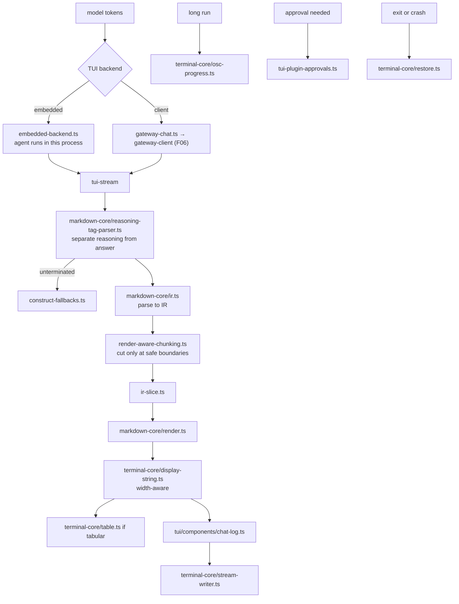

# F13 — TUI, terminal-core, markdown-core

| | |
|---|---|
| describes | openclaw `v2026.10.3` @ `59cb44796b0f1f0daa0e37af8b1495abb45d9bc1` |
| paths | `src/tui/`, `packages/terminal-core/`, `packages/markdown-core/` |
| size | 258 tracked files · ~65,000 LOC |

## What it is, in plain English

The terminal interface, and the two packages that make a terminal interface possible: one for ANSI and tables, one for turning markdown into something that can be streamed into a scrolling log without breaking.

## 1. `src/tui/` — 69 non-test files

```
tui.ts                        60 KB   the application
embedded-backend.ts           50 KB   ← see below
tui-command-handlers.ts       36 KB
tui-event-handlers.ts         28 KB
gateway-chat.ts               28 KB
tui-session-actions.ts        26 KB
components/chat-log.ts        21 KB
tui-formatters.ts             19 KB
tui-session-run-coordinator.ts 17 KB
tui-plugin-approvals.ts       16 KB
tui-run-lifecycle.ts          14 KB
tui-task-suggestions.ts       14 KB
plus: tui-{autocomplete,auth,browser,images,overlays,questions,
           status,stream,tool,waiting,shutdown,launch,process}.ts
components/ (13)  theme/ (1)
```

### The TUI has two backends

`embedded-backend.ts` (50 KB) and `gateway-chat.ts` (28 KB) are alternatives, not layers. The TUI can **run the agent itself in-process**, or it can connect to a gateway and be a client. That is why it is 60 KB of application rather than a thin view, and it means a TUI session may not involve the gateway at all — worth knowing before debugging "why is nothing showing in the gateway logs".

`tui-plugin-approvals.ts` means approvals are answerable from the terminal, matching `approval-terminal` on the SDK surface (F10) — the fourth approval surface after channel, native client and gateway.

`tui-task-suggestions.ts` corresponds to the `task-suggestions` protocol schema (F06): suggestions are a protocol concept, not a TUI invention.

## 2. `packages/terminal-core/` — 22 files, all small

```
table.ts            20 KB   terminal tables
ansi.ts             11 KB
ansi-sequences.ts    9 KB
note.ts              5.7 KB
display-string.ts    3.4 KB   width-aware strings
decorative-emoji.ts  2.8 KB
restore.ts           2.3 KB   put the terminal back as it was
osc-progress.ts      1.8 KB   OSC 9;4 — native terminal progress bar
stream-writer.ts     1.6 KB
theme.ts             1.3 KB
health-style.ts      1.3 KB
terminal-link.ts     0.9 KB   OSC 8 hyperlinks
```

`display-string.ts` exists because terminal width is not string length — wide CJK characters, combining marks and emoji all break naive alignment, which is also why `table.ts` is 20 KB. `restore.ts` is the discipline of leaving the terminal usable after a crash. `osc-progress.ts` and `terminal-link.ts` use modern terminal escape sequences for real progress bars and clickable links.

## 3. `packages/markdown-core/` — the interesting one

```
ir.ts                         47 KB   a markdown intermediate representation
reasoning-tag-parser.ts       21 KB
reasoning-tags.ts             19 KB
render-aware-chunking.ts      14 KB
render.ts                     12 KB
assistant-transcript.ts       11 KB
frontmatter.ts                9.8 KB
html-scanner.ts               8.3 KB
ir-slice.ts                   7.2 KB
ir-metadata.ts                5.6 KB
construct-fallbacks.ts        5.4 KB
assistant-transcript-headers.ts 5.2 KB
```

Three ideas here are worth taking:

**(a) Markdown is parsed to an IR, and the IR can be sliced.** `ir.ts` plus `ir-slice.ts` plus `ir-metadata.ts`. Markdown is not rendered directly from text — it becomes a structure that can be cut at safe points.

**(b) `render-aware-chunking.ts` is why streamed markdown does not break.** When a model streams text, naive chunking splits a code fence, a table row or a link in half, and every downstream renderer shows garbage. Chunking here is aware of what the chunk will render as, so a boundary lands where it is safe. This is the single most reusable thing in the chunk, and it applies anywhere streamed markdown reaches a renderer — terminal, chat channel or web.

**(c) Reasoning tags are a first-class parse target.** 40 KB across `reasoning-tag-parser.ts` and `reasoning-tags.ts`. Models emit reasoning in tagged blocks, in several dialects, sometimes unterminated when a stream is cut. `construct-fallbacks.ts` handles what to do when a construct never closes.

`assistant-transcript.ts` and `-headers.ts` are the canonical transcript format; `frontmatter.ts` and `html-scanner.ts` round it out.

## Process flow — streaming a model reply into the terminal



## Dependencies

**Out** — `core/gateway` (58), `core/agents` (50), `core/infra` (48), `core/config` (33), `pkg/gateway-protocol` (24), `core/auto-reply` (20).

**In** — `core/cli` (the `tui-cli` entry), and `pkg/terminal-core` has 28 distinct dependents across the repo. `core/tui` has only 9.

Low coupling in both directions. `terminal-core` and `markdown-core` are proper leaf packages, usable independently.

## Risks and traps

1. **Two backends means two code paths.** A TUI bug reproduced with the embedded backend may not exist against the gateway, and vice versa.
2. **Terminal width ≠ string length.** Anything formatting output should use `display-string.ts`, not `.length`. Misalignment with CJK or emoji input is the symptom.
3. **`restore.ts` must run on every exit path.** A missed restore leaves the user's terminal in raw mode with a hidden cursor.
4. **Chunk markdown through `render-aware-chunking.ts`, not by character count.** Splitting a stream naively is how a code fence ends up half-rendered in a chat channel.
5. **Reasoning-tag dialects vary and streams get cut.** Treat `construct-fallbacks.ts` as required, not optional.
6. **`core/tui` has 9 dependents; `pkg/terminal-core` has 28.** The reusable value is in the packages, not the TUI.

## Verdict

A good terminal client, and two packages worth more than the client. `markdown-core`'s IR with slicing and render-aware chunking is the correct solution to streaming markdown and is reusable anywhere; `terminal-core` quietly handles the things that make terminal output wrong — display width, restoration, native progress and hyperlinks. The dual-backend TUI is a real capability (a full agent in one terminal process, no gateway) that is easy to forget exists.
