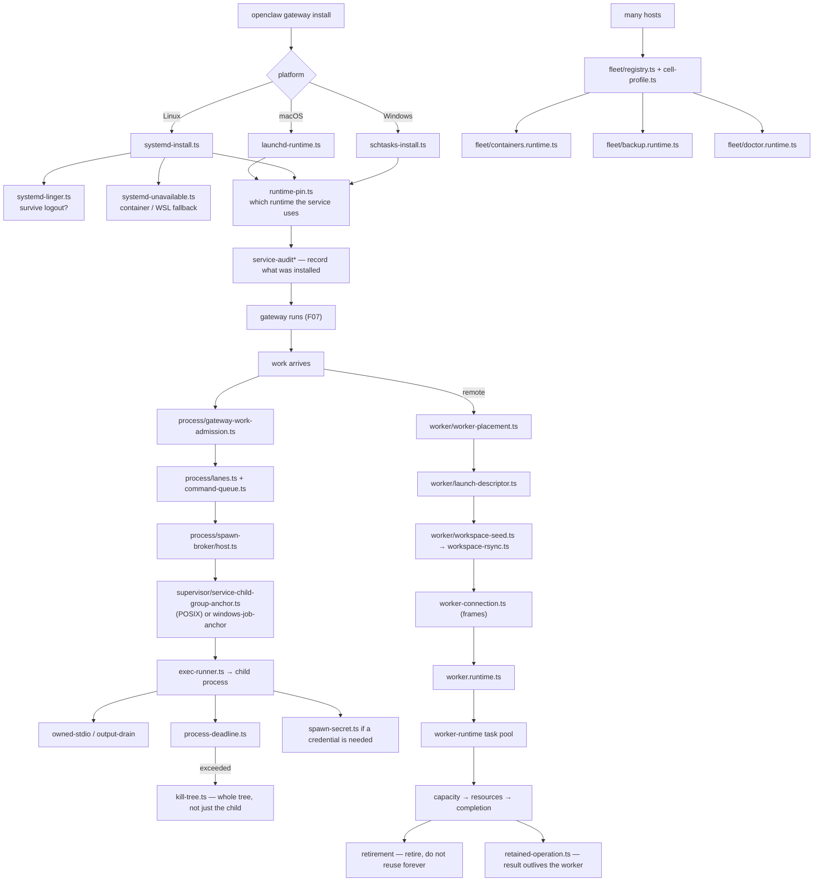

# F14 — daemon, process, worker, fleet

| | |
|---|---|
| describes | openclaw `v2026.10.3` @ `59cb44796b0f1f0daa0e37af8b1495abb45d9bc1` |
| paths | `src/daemon/`, `src/process/`, `src/worker/`, `src/fleet/`, `packages/worker-runtime/` |
| size | 617 tracked files · ~151,000 LOC |

## What it is, in plain English

How openclaw installs itself as a background service, spawns and supervises child processes, runs work on remote workers, and — in `src/fleet/` — manages more than one host.

## 1. `src/daemon/` — three service managers behind one interface (121 non-test files)

```
macOS:    launchd-runtime.ts (23 KB) + launchd-* files
Linux:    systemd-* — ~25 modules: service-files (26 KB),
          definition-mutation (23 KB), scope (22 KB), install (22 KB),
          plus peer, environment, loaded, user, linger, time, system,
          runtime, maintenance, hints, exec, lifecycle, command, unavailable
Windows:  schtasks-* — ~10 modules: process (27 KB), control (26 KB),
          layout (24 KB), runtime (24 KB), install (21 KB)
shared:   inspect.ts (25 KB), runtime-paths.ts (21 KB),
          service-audit* (7), service-env* (4), service-process*,
          service-inspection*, runtime-pin*, hosted-stop*
```

Three genuinely different service systems, each with twenty-plus kilobytes of install logic, behind one `daemon` interface.

`systemd-linger.ts` is the kind of detail that only exists after a bug report: a user service does not survive logout unless lingering is enabled. `systemd-unavailable.ts` handles the case where systemd is not there at all — containers, WSL.

`runtime-pin.ts` pins which runtime the service uses. Relevant to any host with more than one Node version installed: the service's pinned runtime, not the shell's `PATH`, decides what actually runs.

`service-audit*` (7 files) means the installed service definition is auditable — you can ask what was installed and compare it with what should be.

## 2. `src/process/` — spawning done carefully (93 non-test files)

```
supervisor/ (30)
  supervisor.ts                          27 KB
  service-child-relay-host.ts            27 KB
  service-child-group-anchor.ts          25 KB
  adapters/child.ts                      26 KB
  service-child-windows-job-anchor.ts    20 KB
  service-child-windows-job-native.ts    17 KB
spawn-broker/ (22)
  host.ts                                23 KB
  resource-server.ts                     18 KB
  worker.ts                              16 KB
exec-runner.ts                           28 KB
command-queue.ts                         26 KB
gateway-work-admission.ts                25 KB
plus: kill-tree, linux-oom, lanes, command-lane, process-deadline,
      owned-stdio, output-drain, pipe-output, decoded-output,
      exec-{spawn,output,result,termination}, scoped-child, respawn-child,
      spawn-secret, spawn-diagnostics, spawn-utils,
      terminal-pty*, pty-terminal, windows-command*
```

Four things worth naming:

**Process group anchors.** `service-child-group-anchor.ts` on POSIX and `service-child-windows-job-anchor.ts` / `-job-native.ts` on Windows, plus `kill-tree.ts`. Killing a child that spawned its own children is the classic leak; an anchor (process group, or a Windows job object) makes the whole tree killable. Three implementations because there is no portable way to do it.

**A spawn broker.** `spawn-broker/host.ts` + `worker.ts` + `resource-server.ts`. Processes are not spawned ad hoc from wherever — they go through a broker that owns the resources. That is what makes cleanup and accounting possible.

**Lanes and a command queue.** `lanes.ts`, `command-lane.ts`, `command-queue.ts`, `gateway-work-admission.ts`, `process-deadline.ts`. Concurrent command execution is lane-limited and deadline-bounded, with admission control, rather than unbounded.

**`spawn-secret.ts`.** Passing a secret to a child process is its own module, which is the right instinct — argv is world-readable on most systems. Pairs with `sanitize-env-vars.ts` in F08's sandbox.

`linux-oom.ts` adjusts OOM behaviour; `owned-stdio.ts`, `output-drain.ts`, `pipe-output.ts` and `decoded-output.ts` are four modules on not losing or deadlocking on child output, which is the other classic bug.

## 3. `src/worker/` — remote execution (55 non-test files)

```
worker-connection.ts            18 KB    + worker-connection-frames.ts (11 KB)
embedded-agent.runtime.ts       18 KB    + embedded-agent-live.runtime.ts (12 KB)
worker.runtime.ts               15 KB
inference-stream.runtime.ts     14 KB
worker-command.runtime.ts       13 KB
launch-descriptor.ts            13 KB
node-workspace-protocol.ts      11 KB
worker-deploy* (6) · worker-rpc* (4) · node-workspace* (5)
workspace-rsync.ts · workspace-seed.ts · workspace-inspection* (2)
node-computer.ts · node-desktop.ts · node-bundle.ts · node-supervisor.ts
skills-worker.ts · memory-worker.ts · repro-worker.ts · replay-message.ts
protocol-record.ts · transcript-message.ts · worker-placement.ts
suites: worker-runtime-background-exec (24 KB),
        worker-runtime-gateway-tools (12 KB),
        worker-runtime-permissions (11 KB)
```

`workspace-rsync.ts` and `workspace-seed.ts`: a worker's workspace is seeded and then synced rather than mounted. `worker-placement.ts` chooses which worker gets a job. `repro-worker.ts` and `replay-message.ts` reproduce and replay a run — debugging infrastructure, not production path.

The three `*.suite.ts` files are notable: background exec, gateway tools and **permissions** are tested as suites against a real worker runtime. A permissions suite means worker permissions are a contract with a red control, not a convention.

## 4. `src/fleet/` — more than one host (11 non-test files)

```
backup.runtime.ts        30 KB
service.runtime.ts       30 KB
containers.runtime.ts    25 KB
service-support.runtime.ts 24 KB
doctor.runtime.ts        14 KB
cell-profile.ts          11 KB
registry.ts / registry.kernel.ts / registry.worker.ts / .types / .worker-contract
```

Small but significant. A **registry of cells** with per-cell profiles, container management, fleet-wide backup, and its own doctor. `cell-profile.ts` is the unit: a cell is a host or container with a profile. This is openclaw stating that one installation may manage several machines — and `fleet-cli/` exists in F12 to drive it.

## 5. `packages/worker-runtime/` — a task pool (19 files)

```
worker-task-pool-core.ts        26 KB
worker-task-pool-retirement.ts  11 KB
worker-task-pool-owned.ts       8.6 KB
worker-task-server.ts           7.9 KB
retained-operation.ts           6.7 KB
worker-task-pool-resources.ts   6.6 KB
worker-task-pool-completion.ts  5.3 KB
worker-task-native-sections.ts  4.7 KB
worker-task-capacity.ts         2.4 KB
worker-task-pool{.types,-worker}.ts · worker-task-host.ts
```

A worker-thread pool with explicit **capacity**, **resources**, **completion** and **retirement** — a worker is retired rather than reused forever, which is how you survive a leaking native module. `retained-operation.ts` keeps an operation's result after the worker that produced it is gone. `worker-task-native-sections.ts` marks sections that enter native code, which cannot be interrupted.

This is the package that `src/infra`'s sqlite worker broker, `src/config`'s transcript worker and `src/state`'s read worker all stand on (19 edges from `infra` alone).

## Process flow — install the service and run work



## Dependencies

**Out** — `core/infra` (338), `core/shared` (106), `pkg/gateway-protocol` (101), `core/agents` (84), `core/state` (45), `core/gateway` (37).

**In** — `core/cli` (879 into `daemon` alone), `core/gateway`, `core/infra` (148 into `process`). `core/process` has 42 distinct dependents; `pkg/worker-runtime` is imported by `infra`, `config` and `state`.

Light outbound weight for how much it does — a sign these are genuinely low-level modules rather than orchestration pretending to be infrastructure.

## Risks and traps

1. **`runtime-pin.ts` beats your shell.** On a host with several runtimes installed, the service runs the pinned one. Checking `PATH` or `which` tells you nothing about what the installed service executes. Inspect the service definition.
2. **Three service managers, three failure modes.** A fix verified on launchd is verified on one of three. `systemd-unavailable.ts` and `systemd-linger.ts` exist because Linux has two extra ways to fail.
3. **Never spawn around the broker.** A process spawned outside `spawn-broker` has no anchor, so `kill-tree` cannot reach its children, and no resource accounting.
4. **Deadlines and lanes mean work can be refused.** `gateway-work-admission.ts` refusing looks like nothing happening.
5. **Workers are retired.** State held in a worker between tasks is not guaranteed to survive; `retained-operation.ts` is the sanctioned way to keep a result.
6. **Native sections cannot be interrupted.** `worker-task-native-sections.ts` marks them; a cancel during one will not take effect until it returns.
7. **`src/fleet` is small and easy to overlook**, but `fleet-cli` can act on several hosts. Any destructive fleet operation has a wider blast radius than the local equivalent.

## Verdict

Unglamorous and well made. Three service managers behind one interface, process group and job-object anchors so a kill actually kills, a spawn broker that owns resources, four modules on not losing child output, lane-limited and deadline-bounded execution, a worker pool that retires workers instead of trusting them forever, and a secret-passing module because argv leaks.

`src/fleet` is the quiet surprise: a cell registry with per-cell profiles, fleet backup and a fleet doctor. openclaw is built on the assumption that it may one day run a fleet, and most of the scaffolding for that is already here.
