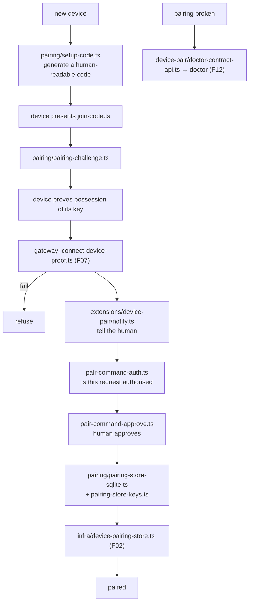
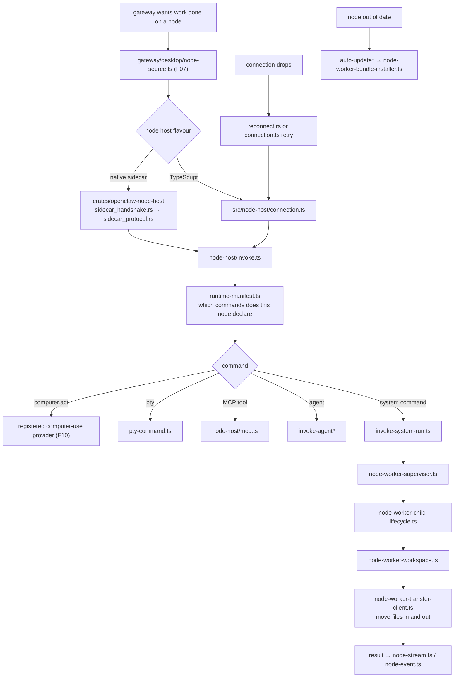

# F15 — node host and pairing

| | |
|---|---|
| describes | openclaw `v2026.10.3` @ `59cb44796b0f1f0daa0e37af8b1495abb45d9bc1` |
| paths | `src/node-host/`, `src/pairing/`, `extensions/device-pair/`, `extensions/linux-node/`, `crates/openclaw-node-host/`, `crates/openclaw-gateway-client/` |
| size | 270 tracked files · ~65,000 LOC TypeScript + ~460 KB of Rust |

## What it is, in plain English

How a **node** — a separate machine or app that offers capabilities to the gateway — gets paired, trusted, supervised and invoked. This is the subsystem behind "my laptop can take screenshots for the agent" and "my phone is a node".

## Headline finding: there is a Rust node host

`crates/` is not a toy. It is a second, native implementation:

```
crates/openclaw-node-host/src/
  sidecar_runtime.rs      82 KB    ← largest Rust file in the repo
  runtime.rs              78 KB
  node.rs                 49 KB
  sidecar_protocol.rs     43 KB
  host.rs                 34 KB
  sidecar_handshake.rs    31 KB
  reconnect.rs            24 KB
  lifecycle.rs            18 KB
  tests/node_session.rs   45 KB

crates/openclaw-gateway-client/src/
  session.rs              60 KB
  tests/session.rs        45 KB
  tests/tls_policy.rs     13 KB
```

Two things follow:

1. **A node host can run as a native sidecar**, speaking a dedicated `sidecar_protocol` over a `sidecar_handshake`, with its own `reconnect` logic. That is how a node runs where shipping Node.js is impractical — inside a native app, on a constrained device.
2. **There is a Rust gateway client** with its own session implementation and a dedicated `tls_policy` test. Anything that needs to speak to the gateway without Node has a maintained path.

`reconnect.rs` at 24 KB, plus a 45 KB session test, says the hard part is not connecting but staying connected across sleep, network changes and gateway restarts.

## 1. `src/node-host/` — 97 non-test files

```
node-worker* (46 files)             the worker side of a node
  node-worker-workspace.ts          30 KB
  node-worker-launch-store.kernel.ts 28 KB
  node-worker-supervisor.ts         27 KB
  node-worker-transfer-client.ts    25 KB
  node-worker-child-lifecycle.ts    25 KB
  node-worker-bundle-installer.ts   22 KB
invoke-system-run.ts                38 KB   ← running a system command on a node
invoke.ts                           25 KB
invoke-{types,run,agent}* · node-invoke*
runtime.ts                          30 KB
runner.ts                           21 KB
mcp.ts                              23 KB   ← a node can host MCP servers
connection.ts                       18 KB
auto-update* (3) · runtime-update · runtime-manifest · runtime-skill · skills
launcher-client · launcher-bootstrap · local-id · startup-state
portal-stream · node-stream · node-event · pty-command
plugin-node · plugin-exec · mac-worker · with-timeout
```

Three capabilities worth knowing a node has:

- **`invoke-system-run.ts` (38 KB)** — running a system command on the node. The largest file here. This is the capability that makes a node powerful and the one that needs the most care.
- **`mcp.ts` (23 KB)** — a node can host MCP servers, so a tool that only exists on one machine can be reached from anywhere via that node.
- **`node-worker-bundle-installer.ts` + `auto-update*`** — a node installs and updates its own bundle. Nodes are not static.

`mac-worker.ts` is a macOS-specific worker path. `pty-command.ts` gives a node a real terminal. `portal-stream.ts` connects to the `portals` protocol schema (F06).

## 2. `src/pairing/` — 10 non-test files, all of them load-bearing

```
setup-code.ts            20 KB
pairing-store.ts         16 KB
pairing-store-sqlite.ts  6.9 KB
pairing-challenge.ts     2.5 KB
pairing-store-keys.ts     2.2 KB
command-owner.ts          1.4 KB
join-code.ts              0.8 KB
pairing-messages.ts / pairing-labels.ts / pairing-store.types.ts
```

A **challenge** plus a **join code** plus a **key store**. `pairing-challenge.ts` being only 2.5 KB is a good sign: a challenge-response should be small and obvious. `pairing-store-keys.ts` means pairing is key-based, not token-based — the device proves possession of a key, which lines up with `connect-device-proof.ts` in the gateway (F07).

`setup-code.ts` at 20 KB is the human-facing part: generating, formatting and validating a code a person can read off one screen and type into another.

`command-owner.ts` is tiny and important: which paired device owns a command.

## 3. The two node extensions

**`extensions/device-pair/`** (11 non-test files) — pairing as a user-facing feature:
```
index.ts                 24 KB
notify.ts                13 KB   notify the user a device wants to pair
pair-command-auth.ts     3.6 KB
pair-command-approve.ts  3.2 KB
notify-state.ts          2.1 KB
doctor-contract-api.ts
```
Note `pair-command-auth.ts` and `pair-command-approve.ts` as separate modules: authorising a pairing request and approving it are different acts. And it ships a `doctor-contract-api.ts`, so a broken pairing is diagnosable by `doctor` (F12).

**`extensions/linux-node/`** (11 non-test files) — a Linux machine as a node:
```
src/commands.ts     14 KB   the commands it offers
src/location.ts     6.7 KB  location as a node capability
src/executables.ts
src/command-utils.ts / src/config.ts
```
Small — which is the point. A platform node is a thin plugin declaring commands, because the node host does the work. This is the template for any new platform node.

## Process flow — pairing a device



## Process flow — invoking a capability on a node



## Dependencies

**Out** — `core/infra` (262), `core/state` (81), `core/gateway` (79), `core/worker` (77), `core/plugins` (54), `core/shared` (48), `core/process` (42).

**In** — `core/gateway`, `core/cli` (`nodes-cli/`, `node-cli/`), `core/infra`. `core/node-host` has 13 distinct dependents.

The `node-host → gateway` edge (79) is the notable one: a node host reaches back into gateway code rather than only speaking the protocol, which is why the two have to be understood together.

## Risks and traps

1. **Two node host implementations.** TypeScript in `src/node-host/`, Rust in `crates/`. A behaviour confirmed in one is not confirmed in the other, and `sidecar_protocol.rs` is the contract between them.
2. **`invoke-system-run.ts` is the sharpest edge in this chunk.** A paired node that declares a system-run command can execute commands on that machine. What a node declares in its `runtime-manifest` is the whole of what it will do — audit the manifest, not the code.
3. **Pairing is key-based and the keys are stored.** `pairing-store-keys.ts` plus `infra/device-pairing-store.ts`. Unpairing must remove the key, not just the record.
4. **Authorise and approve are separate.** `pair-command-auth.ts` (is this request allowed to be made) versus `pair-command-approve.ts` (a human said yes). Conflating them turns a pairing prompt into a formality.
5. **Nodes auto-update themselves.** `auto-update*` plus `node-worker-bundle-installer.ts`. A node's version may drift from the gateway's without anyone acting.
6. **`reconnect` is where the bugs live.** 24 KB of Rust and a 45 KB session test. Sleep, network change and gateway restart are the cases.
7. **A node can host MCP servers.** That widens what reaching a node means: not just its own commands but any MCP tool it hosts.

## Verdict

The subsystem that makes openclaw a distributed system rather than a single process, and it is better provisioned than expected. Key-based pairing with a challenge and a readable setup code; authorisation and human approval kept separate; a diagnosable pairing path; self-updating node bundles; a node able to host MCP servers and offer a real terminal; and a maintained native Rust node host and gateway client with their own sidecar protocol, handshake, reconnect logic and TLS policy tests.

The risk is concentrated in one file. `invoke-system-run.ts` is what turns a paired device into a machine that will run commands for an agent, and the only honest control on it is what the node's manifest declares.
