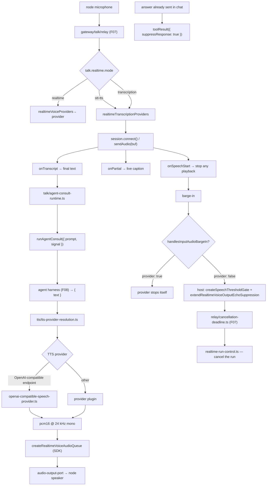

# F16 — voice: talk, TTS, transcription

| | |
|---|---|
| describes | openclaw `v2026.10.3` @ `59cb44796b0f1f0daa0e37af8b1495abb45d9bc1` |
| paths | `src/talk/`, `src/tts/`, `src/realtime-transcription/`, `src/media/`, `extensions/talk-voice/`, `extensions/voice-call/`, plus `src/gateway/talk/` (covered in F07) |
| size | 538 tracked files · ~108,000 LOC |

## What it is, in plain English

Voice in openclaw is **three independent provider contracts**, not one. Confusing them is the main source of wasted effort here.

| contract | capability key | what a provider does | contract size |
|---|---|---|---|
| **realtime voice** | `realtimeVoiceProviders` | owns a full duplex speech session — audio in, audio out, barge-in, tool calls | large |
| **realtime transcription** | `realtimeTranscriptionProviders` | audio in, text out. Nothing else. | **4 methods, 4 callbacks** |
| **speech / TTS** | speech + TTS provider registry | text in, audio out | medium |

And a fourth thing that is not a provider at all: `src/gateway/talk/` (F07), the **relay** that sits between a node's microphone and whichever of the above is configured.

## 1. Realtime transcription — the smallest contract in the repo

`src/realtime-transcription/` is three source files. The whole contract:

```ts
export type RealtimeTranscriptionSession = {
  connect(): Promise<void>;
  sendAudio(audio: Buffer): void;
  close(): void;
  isConnected(): boolean;
};

export type RealtimeTranscriptionSessionCallbacks = {
  onPartial?:     (partial: string) => void;
  onTranscript?:  (transcript: string) => void;
  onSpeechStart?: () => void;
  onError?:       (error: Error) => void;
};

export type RealtimeTranscriptionSessionCreateRequest =
  RealtimeTranscriptionSessionCallbacks & {
    cfg?: OpenClawConfig;
    providerConfig: RealtimeTranscriptionProviderConfig;  // Record<string, unknown>
  };
```

The header comment states the division cleanly: *"Providers own config resolution; core owns session lifecycle shape."*

Registration is a targeted lookup rather than broad capability discovery:

```ts
export const { listProviders, getProvider } =
  createMediaProviderRegistry("realtimeTranscriptionProviders", { directLookup: true });
```

`websocket-session.ts` (20 KB) is the reference implementation of a WebSocket-based provider — the obvious starting point for wrapping any streaming STT server.

**Four methods and four callbacks.** Wrapping a local Whisper server to this contract is a small, well-bounded piece of work.

## 2. Realtime voice — the full duplex contract

`src/talk/provider-types.ts` (14 KB) is the contract. The parts that matter:

### Audio formats are closed, and there are exactly two

```ts
export type RealtimeVoiceAudioFormat =
  | { encoding: "g711_ulaw"; sampleRateHz: 8000;  channels: 1 }   // telephony
  | { encoding: "pcm16";     sampleRateHz: 24000; channels: 1 };  // everything else

REALTIME_VOICE_AUDIO_FORMAT_G711_ULAW_8KHZ
REALTIME_VOICE_AUDIO_FORMAT_PCM16_24KHZ
realtimeVoiceAudioDurationMs(format, byteLength)
toOpenAICompatibleRealtimeAudioFormat(format)
```

PCM16 at 24 kHz mono, or G.711 μ-law at 8 kHz for phone calls. Nothing else. A local TTS or STT engine producing anything else must resample before it reaches this boundary.

### Capabilities are declared, including who owns barge-in

```ts
export type RealtimeVoiceProviderCapabilities = {
  transports: TalkTransport[];
  inputAudioFormats:  RealtimeVoiceAudioFormat[];
  outputAudioFormats: RealtimeVoiceAudioFormat[];
  supportsBrowserSession?: boolean;
  supportsBargeIn?: boolean;
  /** True when the provider owns interruption from incoming audio. */
  handlesInputAudioBargeIn?: boolean;
  supportsToolCalls?: boolean;
  /** True when user transcripts are reliable enough to gate responses on a leading wake name. */
  supportsActivationNameGating?: boolean;
  supportsVideoFrames?: boolean;
  supportsSessionResumption?: boolean;
};
```

`supportsBargeIn` versus `handlesInputAudioBargeIn` is the crucial distinction. The first says interruption is possible; the second says **the provider, not the host, decides when to stop talking**. A provider that sets only the first leaves the host to run the speech-threshold gate. A provider built from separate STT and TTS pieces almost certainly wants the host to own it — the host already ships `createSpeechThresholdGate`, `extendRealtimeVoiceOutputEchoSuppression` and `createRealtimeVoiceAudioQueue` on the SDK surface for exactly that.

`supportsActivationNameGating` is notable: wake-name gating is only switched on when the provider's transcripts are good enough to trust a leading name. That is an honest capability flag, not a feature toggle.

### The host injects the brain

```ts
export type RealtimeVoiceAgentConsultRunner = (params: {
  prompt: string;
  signal?: AbortSignal;
}) => Promise<{ text: string }>;
```

Passed in on both `RealtimeVoiceBridgeCreateRequest` and `RealtimeVoiceBrowserSessionCreateRequest` as *"Host-injected agent delegation runner for provider-owned realtime control channels."*

**This is the hinge.** A realtime voice provider does not have to be a speech-to-speech model that also thinks. It can be a thin voice shell that calls `runAgentConsult` and speaks the answer. That is how a local brain gets to be the thing answering, while the provider only handles audio.

### Session creation parameters

```ts
RealtimeVoiceBridgeCreateRequest = callbacks & {
  cfg?, agentId?, providerConfig,
  audioFormat?, instructions?, language?,
  autoRespondToAudio?,                  // false = host controls when to answer
  interruptResponseOnInputAudio?,
  tools?: RealtimeVoiceTool[],
  runAgentConsult?,
}

RealtimeVoiceBrowserSessionCreateRequest = {
  cfg?, providerConfig, instructions?, tools?, model?, voice?,
  vadThreshold?, silenceDurationMs?, prefixPaddingMs?, reasoningEffort?,
  runAgentConsult?,
}
```

Those four tuning knobs — `vadThreshold`, `silenceDurationMs`, `prefixPaddingMs`, `reasoningEffort` — are the same keys exposed under `talk.realtime.*` in config (F01). Conversational feel is tuned through config, not code.

`RealtimeVoiceToolResultOptions.suppressResponse` is a thoughtful detail: submit a tool result **without** prompting the voice model to speak, *"when another channel has already delivered the user-visible answer"* — so a spoken request whose answer arrives in chat does not get read aloud as well.

### Config resolution is provider-owned and surface-aware

```ts
RealtimeVoiceProviderResolveConfigContext = {
  cfg, rawConfig, agentId?,
  surface?: "browser-session" | "gateway-relay" | "bridge",
  autoRespondToAudio?,
  requiredCapabilities?: Pick<Capabilities, "supportsVideoFrames">,
}
```

Three surfaces, and a provider may resolve different defaults for each. `requiredCapabilities` lets the host ask for a model that supports video frames.

### Registration goes through the generic capability registry

```ts
listRealtimeVoiceProviders(cfg?, additionalProviderIds?)
getRealtimeVoiceProvider(providerId, cfg?)
canonicalizeRealtimeVoiceProviderId(providerId, cfg?)   // aliases → canonical
```

Backed by `resolvePluginCapabilityProviders({ key: "realtimeVoiceProviders" })`. Unknown ids stay normalized *"so validation can report the same operator-facing value"* — a misconfigured provider id is echoed back as typed, not silently mangled.

## 3. The rest of `src/talk/` — the session machinery

```
client-voice-session.ts                 27 KB
client-voice-confirmation.ts            24 KB
agent-consult-runtime.ts                23 KB
realtime-session-harness.ts             17 KB
agent-run-control-shared.ts             14 KB
audio-codec.ts                          14 KB
forced-consult-coordinator.ts           13 KB
session-runtime.ts                      12 KB
agent-run-control.ts                    12 KB
agent-consult-tool.ts                   12 KB
client-voice-mutation-digest-owner.ts   12 KB
plus: voice-selection, voice-transcript, turn-context, talk-events,
      output-activity, observability, event-metrics, diagnostics,
      exact-speech, fast-context, describe-view, consult-question,
      audio-output(-port)
```

`agent-consult-*` is four modules — runtime, tool, transcript, question — because "ask the agent mid-conversation" is the central mechanism, not an add-on. `forced-consult-coordinator.ts` handles forcing a consult when the voice layer would otherwise answer on its own.

`exact-speech.ts` and `describe-view.ts` are worth noting: say something verbatim, and describe what is on screen.

## 4. `src/tts/` — text to speech

```
tts-synthesis-support.ts            20 KB
tts-provider-resolution.ts          18 KB
openai-compatible-speech-provider.ts 15 KB
tts-settings.ts                     13 KB
tts-payload.ts                      10 KB
directives.ts                       9.6 KB   inline TTS directives in text
tts-synthesis.ts / tts-core.ts / tts-config.ts / tts-streaming-resources.ts
voice-models.ts / speaker.ts / speech-text.ts / captioned-final.ts
tts-telephony.ts / tts-auto.ts / runtime-availability.ts
```

`openai-compatible-speech-provider.ts` is the shortcut that matters: **any TTS server exposing an OpenAI-compatible speech endpoint is already supported**, with no new provider code — only configuration. Worth checking before writing an adapter.

`captioned-final.ts` pairs spoken output with text; `tts-telephony.ts` is the 8 kHz μ-law path; `directives.ts` lets text carry inline TTS instructions.

## 5. `extensions/voice-call/` — the reference implementation

82 non-test files, and the single largest file in this chunk:

```
src/webhook/realtime-handler.ts   80 KB   ← a complete realtime voice integration
src/webhook.ts                    39 KB
src/config.ts                     29 KB
src/media-stream.ts               29 KB
src/providers/twilio.ts           26 KB
src/webhook-security.ts           24 KB
src/providers/plivo.ts            18 KB
src/manager.ts / manager/outbound.ts
state-retention.ts / doctor-contract.ts / cli.ts
```

It is phone calls (Twilio, Plivo), so it is the G.711 path — but `realtime-handler.ts` is the most complete worked example of the realtime voice contract in the tree. Anyone implementing a provider should read it before writing anything.

`extensions/talk-voice/` by contrast is 6 files, ~11 KB — just voice *selection* exposed as a tool, matching the `talk-voice` protocol schema from F06.

## Process flow — a spoken turn, with a split STT/TTS provider



## Dependencies

**Out** — `core/config` (96), `core/plugins` (95), `core/infra` (94), `core/agents` (64), `core/shared` (35), `core/state` (27). Strikingly light for a subsystem this capable.

**In** — `core/gateway` via `gateway/talk/`, `core/meeting-bot` (34 edges into `core/talk`), `core/auto-reply` (TTS directives).

## Risks and traps

1. **Three contracts, three registries, similar names.** `realtimeVoiceProviders` ≠ `realtimeTranscriptionProviders` ≠ the speech/TTS registry. Registering against the wrong key produces a provider that is never found, and "provider not found" is indistinguishable from "not registered".
2. **Only two audio formats exist at the boundary.** Anything else must be resampled before it gets here. A local engine at 16 kHz or 22.05 kHz needs conversion, and getting it wrong yields audio that plays at the wrong speed rather than an error.
3. **Barge-in ownership must be declared honestly.** Claiming `handlesInputAudioBargeIn: true` without implementing it produces a voice that talks over the user with no host-side gate to save it. Claiming `false` when the provider does handle it produces double-cancellation.
4. **`supportsActivationNameGating` depends on transcript quality.** Enabling it with a weak STT means the assistant stops responding to its own name intermittently — one of the worst failure modes to diagnose.
5. **`autoRespondToAudio: false` shifts control to the host.** A provider that answers anyway breaks the host's turn-taking.
6. **Check `openai-compatible-speech-provider.ts` before writing a TTS adapter.** If the local engine speaks that protocol, the work is configuration.
7. **`src/talk` and `src/gateway/talk` are different modules.** The contracts are here; the relay, the tool-call ledger and the cancellation deadline are there (F07). Searching only one finds half the story — and finds it cleanly, which is the trap.
8. **`extensions/voice-call` is telephony-shaped.** Copy its structure, not its 8 kHz assumptions.

## Verdict

Better than it looks from outside. The transcription contract is four methods. The realtime voice contract declares capabilities honestly — including the one thing that actually determines whether a voice assistant feels natural, namely who owns interruption — and the host ships the gate, the echo suppression and the audio queue for providers that do not. The `runAgentConsult` injection means a voice provider can be a thin shell around whatever brain the operator wants, and `suppressResponse` shows someone thought about the case where the answer already went out another way.

The gap is discoverability, again: three registries with confusable names, the contracts split across `src/talk` and `src/gateway/talk`, the best worked example buried in an 80 KB file inside a telephony extension, and an OpenAI-compatible TTS shortcut that saves an adapter if you happen to notice it.
