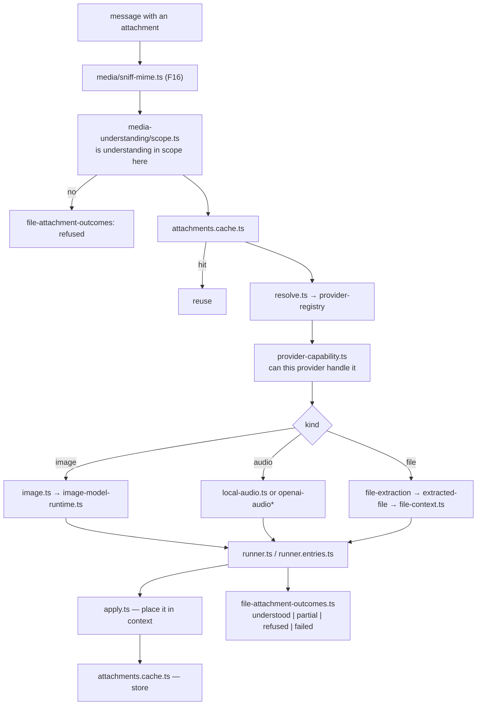
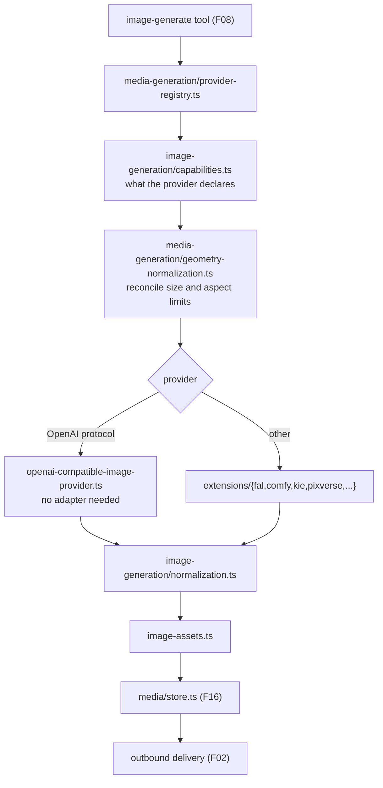

# F17 — media understanding and generation

| | |
|---|---|
| describes | openclaw `v2026.10.3` @ `59cb44796b0f1f0daa0e37af8b1495abb45d9bc1` |
| paths | `src/media-understanding/`, `src/image-generation/`, `src/video-generation/`, `src/music-generation/`, `src/media-generation/`, `src/link-understanding/`, `src/web-fetch/`, `src/web-search/`, `src/web/` |
| size | 212 tracked files · ~39,000 LOC — one of the smallest chunks |

## What it is, in plain English

Two directions: making sense of media that arrives (images, audio, files, links) and producing media on request (images, video, music). Plus the two web tools, fetch and search.

## The template

Every generation modality is the same five files, and once you see it the whole chunk becomes predictable:

```
types.ts            the shape
capabilities.ts     what a provider declares it can do
normalization.ts    reconcile provider differences
runtime.ts          execute
runtime-types.ts
```

| modality | non-test files | notable additions |
|---|---|---|
| image-generation | 7 | `openai-compatible-image-provider.ts`, `image-assets.ts` |
| video-generation | 9 | `dashscope-compatible.ts` (24 KB), `capability-overlays.ts`, `duration-support.ts` |
| music-generation | 6 | `provider-assets.ts` |
| media-generation | 6 | shared: `runtime-shared.ts` (23 KB), `geometry-normalization.ts`, `provider-registry.ts` |

`src/media-generation/` is the shared base the other three sit on. `geometry-normalization.ts` is the detail that matters in practice: providers disagree about aspect ratios, dimensions and limits, and this is where that is reconciled rather than in each caller.

`video-generation/capability-overlays.ts` and `duration-support.ts` exist because video providers vary most — an overlay patches a provider's declared capabilities where the catalogue is wrong.

## The openai-compatible shortcut, again

```
src/image-generation/openai-compatible-image-provider.ts
src/media-understanding/openai-compatible*.ts  (2 files)
src/media-understanding/openai-audio*.ts
src/tts/openai-compatible-speech-provider.ts   (F16)
```

Four subsystems ship an OpenAI-compatible provider. **The pattern across the repo is: if a local engine speaks the OpenAI protocol for its modality, it needs configuration, not an adapter.** Worth checking before writing any provider plugin — it is the cheapest available path and it is easy to miss.

## `src/media-understanding/` — 43 non-test files, the largest part

```
runner.entries.ts            33 KB
runner.ts                    32 KB
shared.ts                    22 KB
image.ts                     22 KB
attachments.cache.ts         20 KB
runtime.ts                   14 KB
local-audio.ts               14 KB
apply.ts                     13 KB
file-context.ts              13 KB
image-model-runtime.ts       12 KB
resolve.ts                   8.4 KB
file-attachment-outcomes.ts  7.6 KB
plus: provider-registry (2), provider-capability, entry-capabilities,
      transcription-text, echo-transcript, file-extraction,
      extracted-file, media-attachment, image-input, scope,
      manifest-metadata
```

Four things worth knowing:

- **`attachments.cache.ts` (20 KB).** Understanding the same attachment twice is paid for twice, so results are cached. Any new understanding path should go through the cache.
- **`local-audio.ts` (14 KB).** Local audio understanding is a first-class path, not only a remote API.
- **`file-attachment-outcomes.ts`.** An attachment's outcome is modelled — understood, partially understood, refused, failed — rather than reduced to success or exception. Same evidence-carrying instinct as F04 and F11.
- **`scope.ts` + `provider-capability.ts` + `entry-capabilities.ts`.** What may be understood is scoped, and providers declare capability. A missing understanding is often a scope decision.

`echo-transcript.ts` is a test/diagnostic provider that echoes — the local red control for the transcription path.

## `src/link-understanding/` — 6 files

```
detect.ts    2.0 KB   is this a link worth expanding
runner.ts    7.7 KB
apply.ts / apply.runtime.ts / format.ts / defaults.ts
```

Small and worth noting for safety reasons: this is the path that turns a URL in a message into fetched content placed into context. `detect.ts` decides what gets expanded. Anything arriving this way is **external content**, and whether it can influence a turn is governed by `message-injection-authority.ts` in F09 — not here.

## `src/web-fetch/` and `src/web-search/` — 6 files between them

```
web-fetch/runtime.ts                    6.0 KB
web-fetch/content-extractors.runtime.ts 1.4 KB
web-search/runtime.ts                  14.0 KB
web-search/runtime-execution.ts         3.4 KB
web-search/runtime-error.ts             1.3 KB
web/provider-runtime-shared.ts          3.2 KB
```

Strikingly thin, because the actual work is elsewhere: the tool surface is in `src/agents/tools/web-*.ts` (F08, which has `web-guarded-fetch.ts`, `web-search-citation-redirect.ts`, `web-fetch-visibility.ts`), the egress guard is `src/infra/net/fetch-guard.ts` (F02), and the provider plugins are `extensions/{brave,tavily,exa,searxng,duckduckgo,perplexity,firecrawl,parallel}`.

`web-search-citation-redirect.ts` in F08 is worth flagging: search results carry redirect URLs, and following them blindly is a tracking and SSRF surface.

## Process flow — an attachment arrives



## Process flow — generating an image



## Dependencies

**Out** — `core/config` (110), `core/agents` (91), `core/plugins` (85), `core/infra` (40), `core/media` (35), `core/auto-reply` (28), `core/secrets` (24).

**In** — `core/auto-reply`, `core/agents`, `core/logging` (4 edges into `media-understanding`).

Light in both directions. These are leaf capabilities hanging off the plugin system.

## Risks and traps

1. **Check for an openai-compatible provider before writing one.** Four exist in this repo. Writing an adapter that configuration would have covered is the most common avoidable cost here.
2. **`attachments.cache.ts` means stale understanding is possible.** A file that changed under the same identity can return a cached interpretation.
3. **Capability overlays override the catalogue.** `video-generation/capability-overlays.ts` means the declared capability may not be the catalogue's. Reading only the catalogue gives the wrong answer.
4. **`geometry-normalization.ts` is where size bugs belong.** Fixing an aspect-ratio problem in a caller instead duplicates the reconciliation.
5. **Link understanding pulls external content into context.** `detect.ts` decides what expands. Content arriving this way must never be treated as instruction — the gate for that is `message-injection-authority.ts` in F09.
6. **Web search results carry redirect URLs.** `web-search-citation-redirect.ts` (F08) exists for a reason; following them unguarded is an SSRF and tracking surface, and `fetch-guard.ts` (F02) is the control.
7. **`src/web-fetch` and `src/web-search` being nearly empty is misleading.** The real implementation is split across `agents/tools`, `infra/net` and eight extensions. Searching only here and finding six files is a clean, wrong answer.

## Verdict

The most template-driven part of the codebase and the easiest to extend: five files per modality, declared capabilities, one shared geometry normaliser, outcome modelling instead of exceptions, and a result cache. The openai-compatible providers are the standing shortcut and the thing most likely to save real work.

The one place to be careful is `link-understanding`: six small files that are the main route by which untrusted external text reaches an agent's context.
