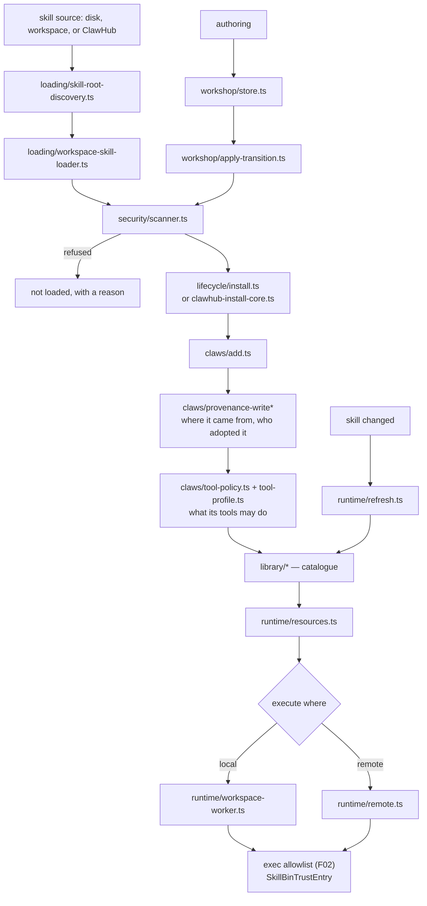
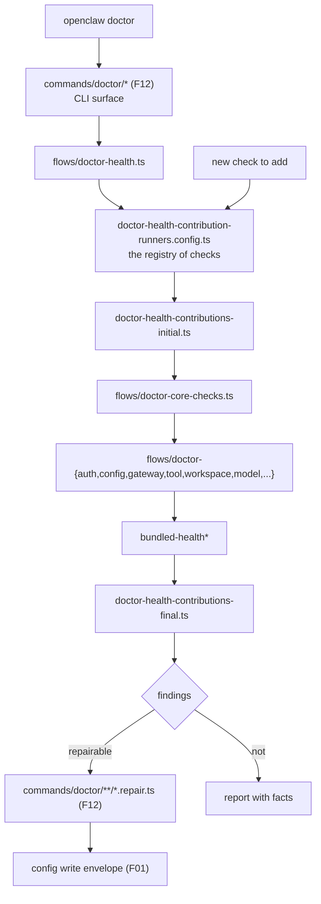

# F18 — skills, claws, flows, decisions

| | |
|---|---|
| describes | openclaw `v2026.10.3` @ `59cb44796b0f1f0daa0e37af8b1495abb45d9bc1` |
| paths | `src/skills/`, `src/claws/`, `src/flows/`, `src/decisions/`, `skills/`, `custodian-skills/` |
| size | 669 tracked files · ~150,000 LOC |

## What it is, in plain English

Four related but distinct things, filed together because they are all about *what the agent knows how to do*:

| path | non-test files | what it is |
|---|---|---|
| `src/skills/` | 183 | the skill system — discovery, loading, install, security scan, authoring workshop |
| `src/claws/` | 91 | a package manager for capability bundles, built around **provenance** |
| `src/flows/` | 50 | health-contribution and setup flows — the pluggable half of `doctor` |
| `src/decisions/` | 6 | a decision registry |
| `skills/` | 72 | the twelve bundled skills |
| `custodian-skills/` | 4 | maintenance skills |

## 1. `src/skills/` — 183 non-test files

```
workshop/   56   authoring and editing skills
lifecycle/  30   install, update, remove, ClawHub
loading/    29   finding and loading from disk
runtime/    28   executing, refreshing, resources
library/    18   the catalogue
discovery/  13
security/    4   ← scanner.ts is 23 KB
config/      1
```

Largest files:

```
runtime/refresh.ts                   28 KB
security/scanner.ts                  23 KB
loading/skill-root-discovery.ts      22 KB
loading/workspace-skill-loader.ts    22 KB
lifecycle/install.ts                 21 KB
lifecycle/clawhub-install-core.ts    21 KB
runtime/remote.ts                    21 KB
lifecycle/clawhub-status.ts          20 KB
workshop/apply-transition.ts         19 KB
workshop/store.ts                    18 KB
runtime/resources.ts                 18 KB
runtime/workspace-worker.ts          17 KB
```

Three things stand out:

**A skill security scanner.** `security/scanner.ts`, 23 KB. Skills are code and instructions from outside the trust boundary, so they are scanned before use. This pairs with `security/opengrep/rules/ghsa-82g8-464f-2mv7/skill-env.*` in F05 — a real advisory about skill environment handling, now a machine-checked rule. **A skill is an attack surface, and this repo treats it as one.**

**A 56-file workshop.** `workshop/store.ts` and `workshop/apply-transition.ts` are the largest parts. Skills are authored and edited *in the system*, with transitions applied to a stored draft, rather than hand-written and dropped in. The `worker-skill-workshop` protocol schema (F06) exposes this remotely.

**ClawHub.** `lifecycle/clawhub-install-core.ts` and `clawhub-status.ts`: a remote skill registry with install and status. `runtime/remote.ts` (21 KB) means a skill can execute remotely.

`runtime/refresh.ts` at 28 KB being the largest file says keeping loaded skills current is the hard part — a skill changed on disk or upstream has to be picked up without restarting.

### The twelve bundled skills

```
skill-creator   model-usage   tmux        meme-maker
himalaya        diagram-maker control-ui  1password
sherpa-onnx-tts openai-whisper-api        weather     xurl
```

Two are directly relevant to any local voice work: **`sherpa-onnx-tts`** and **`openai-whisper-api`** ship as bundled skills. Worth reading before building a voice path — they show the sanctioned shape for wiring a local speech engine in as a skill rather than as a provider plugin, which is a different and sometimes cheaper option than the provider contracts in F16.

`himalaya` is email, `xurl` is authenticated HTTP, `control-ui` drives the web panel, `1password` pairs with the secret resolver in F05.

### `custodian-skills/` — four maintenance skills

```
diagnose-gateway   configure-channel   cloud-image-bake   add-model-provider
```

These are skills for operating openclaw itself. `add-model-provider` is effectively executable documentation for F10's provider contract.

## 2. `src/claws/` — a package manager defined by provenance

```
packages.ts                  27 KB
update-plan.ts               26 KB
lifecycle-state.ts           26 KB
package-remove.ts            25 KB
lifecycle.ts                 24 KB
update-capability-changes.ts 23 KB
export.ts                    23 KB
update-apply.ts              23 KB
migrate.ts                   22 KB
add.ts                       21 KB
schema.ts                    21 KB
provenance.ts                20 KB
```

**Thirteen provenance modules:**

```
provenance.ts            provenance-types     provenance-schema
provenance-read (x1)     provenance-write (x3)
provenance-runtime (x2)  provenance-async
provenance-agent         provenance-adopted
provenance-bootstrap     provenance-secondary
```

That is the defining feature. For every installed capability, `claws` records **where it came from and who adopted it** — including `provenance-agent.ts` (an agent added this) and `provenance-adopted.ts` (something pre-existing was taken under management). `provenance-bootstrap.ts` handles the chicken-and-egg of the first record.

The update path is a three-stage design with a rollback:

```
update-plan.ts              what would change
update-capability-changes.ts which capabilities that affects
update-apply.ts             do it
update-rollback.ts          undo it
```

A plan that names the capability changes before applying is exactly what makes an update reviewable rather than a leap. `schema-portability.ts` and `export.ts` mean a claws set can be exported and moved between hosts.

`tool-policy.ts` and `tool-profile.ts` tie an installed package to what its tools are allowed to do; `source-limits.ts` bounds what a source may contribute.

## 3. `src/flows/` — the pluggable half of doctor

```
model-picker.ts                             42 KB
doctor-core-checks.ts                       36 KB
channel-setup.ts                            35 KB
doctor-health.ts                             31 KB
doctor-health-contribution-runners.config.ts 29 KB
doctor-health-contributions.ts               26 KB
search-setup.ts                              23 KB
doctor-health-contributions-initial.ts        22 KB
doctor-health-contributions-final.ts          18 KB
doctor-tool-schema-runtime.ts                 20 KB
plus doctor-{gateway,config,tool,workspace,update,startup,repair,
            removed,model,lint,external,error,auth,acp}* and bundled-health
```

The word is **contributions**. Health is not one function — it is a set of contributions, run by configured runners, in initial and final phases. `doctor-health-contribution-runners.config.ts` is the registry.

**This is the seam to extend.** A new health check is a contribution registered in that config, which then appears in `openclaw doctor` and in the gateway's health surface automatically. Writing a check outside this framework gets none of that.

`src/flows/doctor-*` versus `src/commands/doctor/*` (F12, 173 files): flows owns the *framework and the checks*, commands owns the *CLI surface and the repairs*. Both exist; neither is redundant; searching one finds half.

`model-picker.ts` (42 KB) is the largest file — interactive model selection, matching the `model-picker` protocol schema.

## 4. `src/decisions/` — six files

```
provider-host.ts      16 KB
runtime.ts            7.8 KB
validation.ts         7.7 KB
types.ts              5.0 KB
diagnostics.ts        2.4 KB
registry-adoption.ts  1.9 KB
```

Small, and the fourth place in the repo where decisions are first-class objects (after `audit/execution-decision-receipts.ts` in F04, `failover/classify.ts` in F08 and `admission-evidence.ts` in F11). A *provider* can host decisions, they are validated, and `registry-adoption.ts` adopts them into a registry. The `decisions` SDK subpath (F10) exposes this to plugins.

## Process flow — installing and running a skill



## Process flow — `doctor`, across both modules



## Dependencies

**Out** — `core/infra` (418), `core/config` (359), `core/state` (348), `core/agents` (268), `core/commands` (251), `core/plugins` (217).

**In** — `core/agents` (268 into `skills`), `core/gateway`, `core/cli` (`skills-cli.ts` is 42 KB), `core/commands`. `core/skills` has 23 distinct dependents, `core/claws` 8, `core/flows` 10.

`skills → commands` (251) is unusual — the skill system reaches into the command layer, because skills can define commands.

## Risks and traps

1. **Skills are an attack surface and the scanner is the control.** `security/scanner.ts` plus the GHSA rule in `security/opengrep/`. A skill loaded around the scanner has no control at all. Anything that loads skills from a new source must run it.
2. **Doctor is split across two modules.** `src/flows` = framework and checks; `src/commands/doctor` = CLI and repairs. Searching one finds half, cleanly.
3. **Register new health checks as contributions.** Written outside `doctor-health-contribution-runners.config.ts`, a check will not appear in `doctor` or in the gateway health surface.
4. **Provenance is the point of `claws`, so bypassing it loses the audit.** Adding a capability without a provenance record leaves something installed that nobody can account for — and `provenance-adopted.ts` exists specifically so pre-existing things can be brought under management rather than left unrecorded.
5. **Updates have a plan, a capability diff and a rollback.** Applying without the plan discards the review step that makes capability changes visible.
6. **`runtime/remote.ts` means a skill may not execute locally.** A skill verified locally is not verified remotely.
7. **Read `sherpa-onnx-tts` and `openai-whisper-api` before building a local voice path.** Two bundled skills already wire local speech engines in. The skill route and the provider route (F16) are different designs with different costs, and the bundled ones show what the project considers sanctioned.

## Verdict

The part of openclaw most concerned with trust. Skills get scanned before loading because they are outside code the project controls. Installed capabilities carry provenance — thirteen modules of it — so there is always an answer to "where did this come from and who adopted it". Updates produce a plan naming the capability changes, and a rollback. Health is a registry of contributions rather than a hard-coded list, so it can be extended without touching the framework.

The cost is the split: doctor across two modules, skills across six subdirectories, and two legitimate ways to add a local engine (skill or provider) with nothing saying which to choose.
