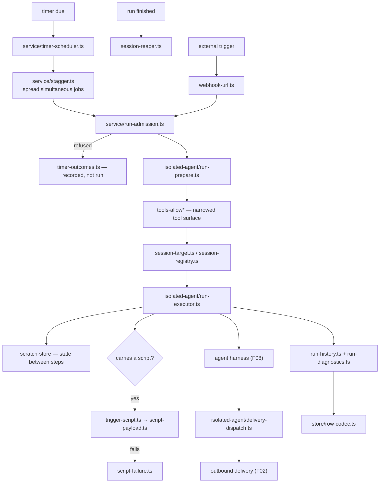
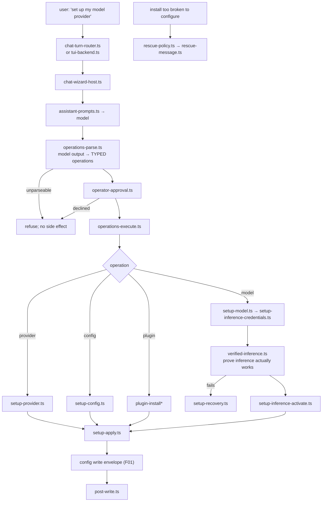

# F19 — cron, system agent, status

| | |
|---|---|
| describes | openclaw `v2026.10.3` @ `59cb44796b0f1f0daa0e37af8b1495abb45d9bc1` |
| paths | `src/cron/`, `src/system-agent/`, `src/status/` |
| size | 738 tracked files · ~182,000 LOC |

## What it is, in plain English

Three things that run without a human watching: scheduled work, the agent that configures openclaw by talking to you, and the status surface.

## 1. `src/cron/` — 265 non-test files, and it is not a timer

```
service/        66   scheduling, admission, timers, operations
store/          57   persistence
isolated-agent/ 56   ← a job runs as its own agent
```

Largest files:

```
isolated-agent/run-executor.ts      37 KB
isolated-agent/delivery-dispatch.ts 31 KB
service/timer-outcomes.ts           29 KB
store/row-codec.ts                  28 KB
isolated-agent/run-prepare.ts       27 KB
trigger-script.ts                   26 KB
service/jobs.ts                     26 KB
service/jobs-scheduling.ts          25 KB
service/timer-scheduler.ts          24 KB
service/ops-mutations.ts            23 KB
service/run-admission.ts            23 KB
```

Plus, as individual modules: `scheduled-tool`, `trigger-script`, `webhook-url`, `stagger`, `session-reaper`, `session-target`, `session-registry`, `run-history`, `run-diagnostics`, `tools-allow` (×2), `system-owned`, `system-monitor`, `skill-collection`, `validate-timestamp`, `script-payload`, `script-failure`, `stream-schedule`, and a four-module **scratch** subsystem (`scratch-store`, `scratch-read`, `scratch-write`, `scratch-contract`).

### The design, and why it is unusual

A scheduled job is **an isolated agent run**, not a callback. `isolated-agent/run-prepare.ts` → `run-executor.ts` → `delivery-dispatch.ts`. The job gets:

- its own **tool allowlist** (`tools-allow*`) — a scheduled run does not inherit the full tool surface
- its own **scratch store** (four modules, with a contract) — somewhere to keep state between steps without touching session state
- **run admission** (`service/run-admission.ts`, 23 KB) — a due job may still be refused
- **stagger** (`stagger.ts`) — jobs due at the same moment are spread out
- **run history and diagnostics** — so a failing schedule is visible
- **a session reaper** — sessions created by scheduled runs get cleaned up

`service/timer-outcomes.ts` (29 KB) is the honest part: the outcome of a timer firing is a modelled thing with many cases, not "it ran".

`system-owned.ts` distinguishes schedules openclaw created for itself from ones a user created — which matters when deciding what may be changed or deleted automatically.

`trigger-script.ts` (26 KB) plus `script-payload.ts` and `script-failure.ts`: a schedule can carry a script, and script failure is modelled separately from job failure.

`webhook-url.ts` means a schedule can also be triggered from outside, not only by time.

**Practical consequence:** a scheduled run's capabilities are deliberately narrower than an interactive run's. If scheduled work "cannot do" something an interactive session can, check `tools-allow` before assuming a bug.

## 2. `src/system-agent/` — 60 non-test files: an agent that configures openclaw

```
verified-inference.ts              36 KB
operations-execution-helpers.ts    32 KB
setup-inference-turn.ts            29 KB
operations-execute.ts              28 KB
setup-inference-credentials.ts     25 KB
chat-turn-router.ts                25 KB
setup-apply.ts                     25 KB
operations-parse.ts                25 KB
setup-inference-activate.ts        25 KB
setup-inference-core.ts            25 KB
assistant-prompts.ts               23 KB
chat-wizard-host.ts                22 KB
plus: setup-{provider,model,native,config,app,recovery}.ts,
      operations{,-internal,-execution}.ts, operation-types.ts,
      operator-approval.ts, rescue-policy.ts, rescue-message.ts,
      probes.ts, overview.ts, new-agent.ts, plugin-install*, plugin-artifact,
      transcript-store.ts, tui-backend.ts, post-write.ts,
      onboarding-welcome.ts
```

### What it actually is

A conversational setup assistant with a **parsed operations language**. `operations-parse.ts` (25 KB) reads intended operations; `operations-execute.ts` (28 KB) carries them out; `operation-types.ts` defines them. So the system agent does not call config functions directly from model output — it produces operations that are parsed, typed, and then executed.

That indirection is the safety property. Model output becomes a **typed operation** before anything happens, and `operator-approval.ts` sits in between.

**`verified-inference.ts` (36 KB)** is the largest file: setup does not accept that a model is configured until inference has been verified to work. Thirteen `setup-inference*` modules — core, turn, credentials, activate — because the thing users most often get wrong is provider credentials.

**`rescue-policy.ts` + `rescue-message.ts`.** There is a rescue path for an installation that is too broken to configure normally.

`chat-wizard-host.ts` + `chat-turn-router.ts` + `tui-backend.ts`: the same agent is reachable from chat and from the TUI. `new-agent.ts` creates new agents; `probes.ts` tests the environment.

## 3. `src/status/` — 22 non-test files

```
status-message.ts            40 KB
status-text.ts               25 KB
summary.ts                   22 KB
status-plugin-health.ts      15 KB (+ .runtime 11 KB)
summary.runtime.ts           8.5 KB
session-stores.ts            6.3 KB
status-model-auth.ts         5.1 KB
codex-synthetic-usage.ts      5.0 KB
session-fallback-model.ts     4.2 KB
agent-runtime-label.ts        4.0 KB
status-runtime-lines.ts       3.1 KB
status-subagents / status-queue / link-channel / fallback-notice /
cli-projection / memory-plugin / status-plugin*
```

`status-message.ts` at 40 KB is the formatted status a user sees. `status-model-auth.ts` and `session-fallback-model.ts` surface *which* model is actually serving and whether a fallback happened — the visible end of F09's fallback cycle. `codex-synthetic-usage.ts` synthesises usage figures for a backend that does not report them honestly.

## Process flow — a scheduled job fires



## Process flow — the system agent changes configuration



## Dependencies

**Out** — `core/agents` (663), `core/config` (492), `core/infra` (351), `core/state` (304), `core/plugins` (231), `core/gateway` (100).

**In** — `core/gateway`, `core/cli` (`cron-cli/`), `core/commands`. `core/cron` has 18 distinct dependents, `core/system-agent` 12, `core/status` 7.

`cron → agents` at 663 edges is the heaviest single relationship and confirms the design: cron is an agent runner, not a scheduler.

## Risks and traps

1. **Scheduled runs have a narrower tool surface by design.** `tools-allow*`. A capability missing in a scheduled run is probably policy, not breakage.
2. **A due job can be refused.** `run-admission.ts` plus `timer-outcomes.ts`. "It did not run" has many recorded outcomes; check the run history before assuming the timer failed.
3. **`system-owned.ts` matters before deleting a schedule.** Some schedules belong to openclaw itself.
4. **The scratch store is the right place for cron state.** Writing into session state from a scheduled run crosses a boundary the design deliberately draws.
5. **Never execute model output directly — parse it into operations.** `operations-parse.ts` then `operator-approval.ts` then `operations-execute.ts` is the sanctioned order, and it is the property that keeps a conversational configurator safe. Any new conversational mutation path should copy it.
6. **"Configured" is not "working".** `verified-inference.ts` exists because a saved provider config that has never served a token is not a working setup.
7. **Status may be synthesised.** `codex-synthetic-usage.ts` constructs usage numbers for a backend that does not report them. Treat those figures as estimates.
8. **`src/cron` is 265 non-test files.** Larger than `src/channels`, `src/tui` and `src/secrets` combined. It is a subsystem, not a utility.

## Verdict

Two strong designs here. Scheduled work as an **isolated agent run** — narrowed tools, its own scratch store, admission control, stagger, reaping and recorded outcomes — is a much better answer than a callback with full privileges, and it is the right model for anything that must run unattended.

The system agent's parse-approve-execute split is the other. Model output becomes a typed operation, an operator approves, and only then does anything change, with inference verified before a provider is accepted as configured. That is how to let a model reconfigure a system without letting a model reconfigure a system.
