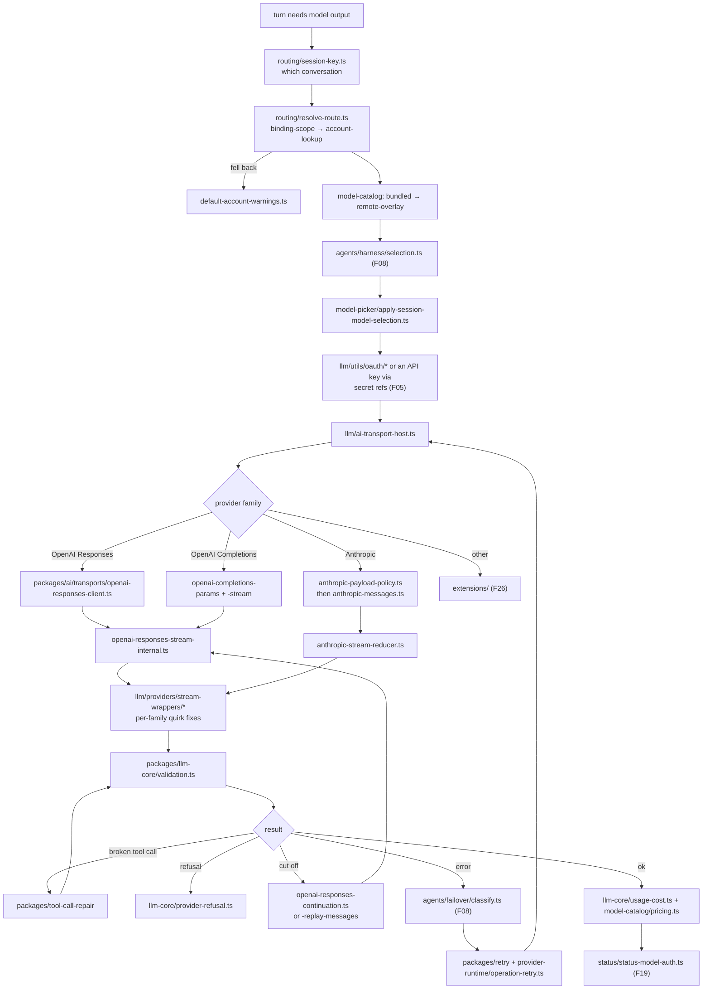

# F20 — model routing and the LLM transport layer

| | |
|---|---|
| describes | openclaw `v2026.10.3` @ `59cb44796b0f1f0daa0e37af8b1495abb45d9bc1` |
| paths | `src/llm/`, `src/routing/`, `src/model-catalog/`, `src/model-picker/`, `src/provider-runtime/`, `packages/ai/`, `packages/llm-core/`, plus `packages/{normalization-core,tool-call-repair,retry,model-catalog-core}` |
| size | 584 tracked files · ~126,000 LOC |

## What it is, in plain English

Everything between "we want model output" and "bytes on a wire to a provider". The surprise is where the weight sits:

| path | non-test files | role |
|---|---|---|
| **`packages/ai/`** | **193** | **the actual transports** — this is the real implementation |
| `src/llm/` | 29 | per-family stream wrappers and OAuth. Thin. |
| `src/routing/` | 12 | which account and session a message belongs to |
| `src/model-catalog/` | 10 | what models exist and what they cost |
| `packages/llm-core/` | 11 | the shared types and contracts |
| `src/model-picker/` | 2 | applying a chosen model to a session |
| `src/provider-runtime/` | 1 | `operation-retry.ts` |

**`src/llm` is not the LLM layer.** A reasonable search starts there, finds 29 thin files, and concludes the provider integration is shallow. It is not — it is in `packages/ai`, six times the size.

## 1. `packages/ai/` — the transports

```
providers/openai-chatgpt-responses.ts              56 KB  ← largest in the chunk
providers/mistral.ts                               33 KB
transports/openai-responses-stream-internal.ts     30 KB
transports/openai-responses-client.ts              30 KB
transports/openai-completions-stream.ts            28 KB
transports/openai-responses-websocket.ts           25 KB
transports/anthropic-payload-policy.ts             25 KB
transports/anthropic-stream-reducer.ts             25 KB
transports/openai-responses-continuation.ts        25 KB
transports/openai-responses-replay-messages-internal.ts 24 KB
transports/anthropic-messages.ts                   22 KB
transports/openai-completions-params.ts            21 KB
```

Two observations that matter:

**The OpenAI Responses API takes seven modules.** Client, stream, websocket, params, **continuation**, **replay-messages**, plus the 56 KB provider. `continuation` and `replay-messages` are the tell: a response can be cut off and resumed, and messages can need replaying. That is not a thin HTTP client, it is a protocol with recovery.

**Anthropic gets a payload *policy* and a stream *reducer*.** `anthropic-payload-policy.ts` (25 KB) decides what a payload may contain — cache semantics, tool payload shape, thinking blocks — and `anthropic-stream-reducer.ts` (25 KB) folds a streamed event sequence into a message. Both are the size of a small library because streaming assistant messages with tool calls, cache control and interleaved reasoning is genuinely hard to get right.

## 2. `src/llm/` — per-family compatibility

```
providers/stream-wrappers/openai.ts                              27 KB
providers/stream-wrappers/anthropic-family-tool-payload-compat.ts 15 KB
providers/stream-wrappers/proxy.ts                                8.4 KB
providers/stream-wrappers/google-thinking-payload.ts              8.2 KB
providers/stream-wrappers/moonshot-thinking.ts                    7.5 KB
providers/stream-wrappers/anthropic-family-cache-semantics.ts     4.0 KB
providers/stream-wrappers/minimax.ts                              3.2 KB
utils/oauth/anthropic.ts                                         11 KB
utils/oauth/openai-chatgpt.ts                                     4.6 KB
utils/oauth/index.ts
stream.ts · types.ts · model-runtime · model-registry · ai-transport-host.ts
```

This is the **compatibility shim layer**: where a provider claims to speak a standard protocol but does not quite. Three files are about *thinking* / reasoning payloads alone (Google, Moonshot, and the Anthropic family's tool payload compat), because reasoning blocks are the least standardised part of every API.

`anthropic-family-cache-semantics.ts` is worth knowing exists: prompt-cache behaviour differs between Anthropic-compatible providers, and getting it wrong costs money rather than failing.

`utils/oauth/` is small but load-bearing — the OAuth flows for Anthropic and ChatGPT sign-in, as opposed to API keys.

## 3. `src/routing/` — 12 files, the quiet one

```
resolve-route.ts            17 KB
session-key.ts              11 KB
route-binding-index.ts      8.0 KB
account-lookup.ts           5.7 KB
bound-account-read.ts       4.0 KB
binding-scope.ts            3.9 KB
channel-route-targets.ts    3.7 KB
bindings.ts · account-id.ts · conversation-ref.ts ·
default-account-warnings.ts · peer-kind-match.ts
```

Twelve small files with **40 distinct dependents** — one of the highest fan-in-to-size ratios in the repo. `session-key.ts` computes the key that identifies a conversation, and almost everything else keys off it. `binding-scope.ts` plus `route-binding-index.ts` resolve which account and which agent a given message belongs to.

`default-account-warnings.ts` exists because falling back to a default account silently is how messages end up answered by the wrong identity.

**If a message is handled by the wrong agent or account, this is the module.** It is small enough to read entirely.

## 4. `src/model-catalog/` — bundled plus remote overlay

```
pricing.ts                 15 KB
manifest-planner.ts        12 KB
remote-overlay.ts          8.6 KB
remote-refresh.ts          7.5 KB
remote-store.ts            5.5 KB (+ .worker.ts)
remote-bundle.ts           4.0 KB
bundled-catalog-stamp.ts · remote-config.ts · index.ts
```

A **bundled** catalogue shipped in the build, **overlaid** by a remote one that is refreshed and stored. `bundled-catalog-stamp.ts` records which bundled version you have. `pricing.ts` carries cost data, feeding `packages/llm-core/src/usage-cost.ts`.

So "what models exist" has three possible answers: bundled, remote-overlaid, and what a live probe finds (`src/commands/models/list.probe.ts`, F12). The probe is the only one tied to actual credentials.

## 5. `packages/llm-core/` — the contracts

```
src/types.ts                     37 KB  ← the shared vocabulary
src/validation.ts                13 KB
src/model-contracts/anthropic.ts 11 KB
src/utils/event-stream.ts        9.2 KB
src/usage-cost.ts                4.2 KB
src/model-data.ts                2.8 KB
src/utils/diagnostics.ts         2.1 KB
src/utils/provider-refusal.ts    1.2 KB
```

`types.ts` at 37 KB is the single source of truth for message, tool call, stream event and usage shapes. `provider-refusal.ts` being its own module is a small, good decision: a provider refusing is a distinct outcome from an error.

## 6. The supporting packages

`packages/normalization-core` is the most imported package in the repo (~700 edges from `src/infra` alone): record, string, number, error and JSON coercion plus UTF-16 slicing. `packages/tool-call-repair` repairs malformed tool calls — a whole package, because models emit broken JSON. `packages/retry` and `src/provider-runtime/operation-retry.ts` carry retry policy.

## Process flow — one model call



## Dependencies

**Out** — `core/agents` (66), `core/config` (54), `core/plugins` (33), `core/infra` (21). Remarkably light.

**In** — `core/routing` has **40** distinct dependents; `pkg/ai` has 13; `core/llm` is imported mostly by `agents` and the provider extensions.

The pattern is right for this layer: near-zero outbound coupling, high inbound.

## Risks and traps

1. **`src/llm` is not where provider integration lives.** `packages/ai` is. Reading `src/llm` and stopping gives a badly incomplete picture, cleanly.
2. **"Which models are available" has three answers.** Bundled catalogue, remote overlay, live probe. Only the probe reflects credentials.
3. **Cache semantics differ between Anthropic-compatible providers.** `anthropic-family-cache-semantics.ts`. Getting it wrong raises cost without raising an error.
4. **Reasoning payloads are the least standard part of every API.** Three dedicated compat modules. A new provider claiming OpenAI compatibility will probably differ here first.
5. **A response can be cut off and resumed.** `openai-responses-continuation.ts` and `-replay-messages-internal.ts`. Code assuming one request produces one complete response is wrong for this transport.
6. **Routing is small and high-stakes.** 12 files, 40 dependents. A wrong-agent or wrong-account bug is almost always here, and `default-account-warnings.ts` is the first thing to check.
7. **A refusal is not an error.** `provider-refusal.ts`. Treating it as one triggers pointless retries and failover.
8. **Tool calls arrive malformed often enough to warrant a package.** Use `tool-call-repair` rather than hand-parsing.

## Verdict

The layer that does the most unglamorous work in the repo, and the clearest example of its naming problem: the honest LLM implementation is a 193-file package called `ai`, while the directory called `llm` holds 29 files of per-provider quirk fixes.

What is there is good. Payload policy and stream reduction as separate concerns, continuation and replay for truncated responses, refusal as a distinct outcome from error, tool-call repair as its own package, a bundled catalogue overlaid by a remote one, and a twelve-file routing module with forty dependents that is small enough to read in one sitting — which is exactly what you want from the module that decides who answers.
