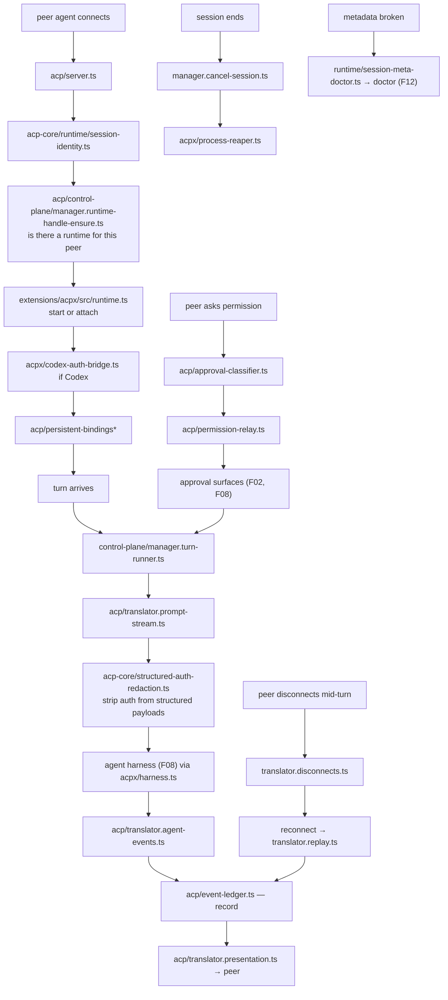
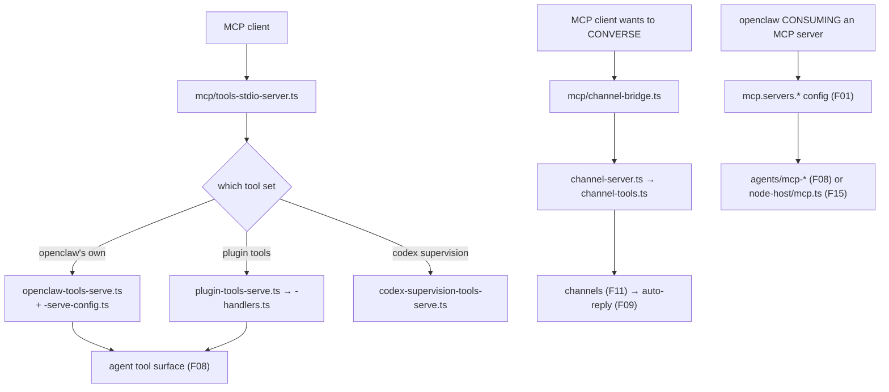

# F21 — MCP and ACP

| | |
|---|---|
| describes | openclaw `v2026.10.3` @ `59cb44796b0f1f0daa0e37af8b1495abb45d9bc1` |
| paths | `src/mcp/`, `src/acp/`, `packages/acp-core/`, `extensions/acpx/`, `extensions/a2a/`, `extensions/agentsapi/`, `extensions/admin-http-rpc/` |
| size | 397 tracked files · ~76,000 LOC |

## What it is, in plain English

How openclaw talks to *other agents and tools* — four protocols, very unevenly sized:

| protocol | where | non-test files |
|---|---|---|
| **MCP** (Model Context Protocol) | `src/mcp/` | 12 |
| **ACP** (Agent Client Protocol) | `src/acp/` + `packages/acp-core/` + `extensions/acpx/` | 145 |
| **A2A** (agent-to-agent) | `extensions/a2a/` | 27 |
| **Agents API** | `extensions/agentsapi/` | 31 |

ACP is twelve times the size of MCP. That is the opposite of what the ecosystem's attention suggests, and it is because ACP is how openclaw hosts and is hosted by *other coding agents*, which is a much harder problem than exposing tools.

## 1. `src/mcp/` — 12 files, and mostly the server side

```
channel-bridge.ts                  23 KB   ← MCP as a CHANNEL
tools-stdio-server.ts              7.5 KB
channel-shared.ts                  6.6 KB
openclaw-tools-serve-config.ts     6.4 KB
channel-tools.ts                   6.2 KB
plugin-tools-serve.ts              5.1 KB
codex-supervision-tools-serve.ts   4.8 KB
plugin-tools-handlers.ts           4.6 KB
openclaw-tools-serve.ts            4.1 KB
channel-server-runtime.ts / channel-server.ts / agent-session-env.ts
```

Note what this is **not**: it is not an MCP client. Consuming MCP servers is configured through `mcp.servers.*` (F01) and driven from the agent's tool surface (F08) and the node host (`node-host/mcp.ts`, F15). This directory is about openclaw **serving** MCP:

- `openclaw-tools-serve.ts` — expose openclaw's own tools as an MCP server
- `plugin-tools-serve.ts` — expose plugin tools the same way
- `tools-stdio-server.ts` — over stdio, the usual MCP transport
- `codex-supervision-tools-serve.ts` — a narrowed tool set for supervising Codex

**`channel-bridge.ts` (23 KB) is the interesting one: MCP as a channel.** An MCP client becomes a conversation surface, the same abstraction as Discord or Slack (F11). So another agent can hold a conversation with openclaw through MCP rather than only calling tools.

## 2. `src/acp/` — 85 non-test files, the real weight

```
control-plane/  27
runtime/        27
translator.*    ~10
```

Largest:

```
translator.prompt-stream.ts              26 KB
control-plane/manager.core.ts            24 KB
control-plane/manager.turn-runner.ts     23 KB
event-ledger.ts                          18 KB
server.ts                                16 KB
runtime/session-meta-write.ts            15 KB
control-plane/manager.cancel-session.ts  15 KB
control-plane/runtime-options.ts         15 KB
translator.session-lifecycle.ts          15 KB
control-plane/manager.runtime-handle-ensure.ts 14 KB
runtime/session-meta-doctor.ts           14 KB
translator.agent-events.ts               11 KB
plus: permission-relay.ts, approval-classifier.ts, policy.ts,
      persistent-bindings (3), event-mapper.ts, session-mapper.ts,
      conversation-id.ts, tool-status.ts, secret-file.ts,
      translator.{replay,presentation,disconnects,agent,session}.ts
```

Three distinct layers, and the names are accurate:

**The control plane** (27 files) manages agent runtime handles: `manager.runtime-handle-ensure.ts` makes sure a runtime exists, `manager.turn-runner.ts` runs a turn on it, `manager.cancel-session.ts` cancels. This is lifecycle management of *another agent's* process.

**The translator** (~10 files) converts between openclaw's world and ACP's: `translator.prompt-stream.ts` is the largest file in the chunk, with separate modules for session lifecycle, agent events, presentation, **replay** and **disconnects**. `translator.disconnects.ts` existing as its own module says a peer agent dropping mid-turn is a case that had to be handled explicitly.

**The event ledger** (`event-ledger.ts`, 18 KB). Events are recorded in a ledger, which is what makes `translator.replay.ts` possible — a reconnecting peer can be caught up rather than losing the turn.

And two safety modules worth naming:

```
permission-relay.ts      relaying a permission request from a peer agent
approval-classifier.ts   classifying what kind of approval is being asked for
policy.ts
```

When a hosted agent asks for permission, the request is **classified** and **relayed** rather than auto-answered. That is the correct shape, and it matches the route classification in `infra/approval-types.ts` (F02).

`runtime/session-meta-doctor.ts` means ACP session metadata is diagnosable through `doctor` (F12).

## 3. `packages/acp-core/` — 14 files, one standout

```
structured-auth-redaction.ts   14 KB   ← largest
runtime/types.ts               9.7 KB
runtime/session-identity.ts    8.0 KB
error-format.ts                7.4 KB
session.ts                     6.5 KB
runtime/errors.ts              5.3 KB
runtime/session-identifiers.ts 3.8 KB
session-lineage-meta.ts        3.1 KB
types.ts / meta.ts / runtime/error-text.ts / session-interaction-mode.ts
```

**`structured-auth-redaction.ts` being the biggest file in the package is the right priority.** Bridging two agent systems means passing structured payloads that contain auth material, and redacting *structured* data is harder than redacting text — you have to know the shape. It complements the pattern-based text redaction in `src/logging/redact.ts` (F04).

`session-lineage-meta.ts` tracks where a session came from when it crosses a protocol boundary.

## 4. `extensions/acpx/` — 46 non-test files

```
src/runtime.ts                   49 KB   ← largest file in the chunk
src/codex-auth-bridge.ts         31 KB
src/session-owner-migration.ts   21 KB
src/pi-session-store.ts          18 KB
src/service.ts                   16 KB
src/harness-attempt.ts           16 KB
src/process-reaper.ts            15 KB
src/runtime-session-store.ts     14 KB
src/pi-session-catalog{,-runtime}.ts
register.runtime.ts · harness.ts · doctor-contract · setup-api · AGENTS.md
```

The concrete ACP integration. `codex-auth-bridge.ts` (31 KB) bridges auth to Codex; `process-reaper.ts` (15 KB) cleans up peer agent processes that outlive their session — a real operational problem when you host someone else's runtime. `session-owner-migration.ts` moves session ownership.

It registers as an **agent harness** (`harness.ts`, `harness-attempt.ts`), so an ACP peer can be the brain for a turn, matching the `agent-harness-registration` SDK subpath (F10).

## 5. `extensions/a2a/` and `extensions/agentsapi/`

**`a2a`** (27 files) — a small, clean agent-to-agent implementation: `http.ts`, `protocol.ts`, `task-store.ts`, `inbound.ts`, `outbound.ts`, and a `channel-base.ts`/`channel.ts` pair, so A2A is **also exposed as a channel**. Same move as MCP's channel bridge.

**`agentsapi`** (31 files) — a complete alternative agent surface: session, attempt, tools, messages, client, prompt, transcript, reasoning, usage, files, bindings, harness, MCP, isolated completion, plus `agentsapi-native-tool-projection.ts` (19 KB). It is a full parallel API, not a shim.

**`admin-http-rpc`** (9 files) — tiny: an HTTP RPC surface for administration (`handler.ts`, `methods.ts`). Worth knowing it exists before exposing anything.

## Process flow — openclaw hosting a peer agent over ACP



## Process flow — openclaw serving MCP



## Dependencies

**Out** — `core/config` (154), `core/state` (72), `core/agents` (62), `core/infra` (55), `core/gateway` (44), `core/shared` (24).

**In** — `core/gateway`, `core/agents`, `core/cli` (`mcp-cli.ts` is 51 KB). `core/acp` has 15 distinct dependents, `core/mcp` 5.

## Risks and traps

1. **`src/mcp` is the server side only.** Looking there for MCP *client* behaviour finds twelve files and the wrong conclusion. The client path is config plus the agent tool surface plus the node host.
2. **MCP and A2A are also channels.** `mcp/channel-bridge.ts` and `a2a/src/channel.ts`. A peer can hold a conversation, not just call tools — which means `message-injection-authority.ts` (F09) and the admission evidence layer (F11) apply to protocol peers too.
3. **Structured redaction is separate from text redaction.** `acp-core/structured-auth-redaction.ts` versus `logging/redact.ts`. A new protocol bridge needs the structured one; the text redactor does not know payload shapes.
4. **Hosting a peer agent means owning its processes.** `process-reaper.ts` exists because they leak. Any new peer runtime needs a reaper.
5. **Permission requests from peers must be classified, not forwarded raw.** `approval-classifier.ts` then `permission-relay.ts`. A peer agent's request for permission is the peer's request, not the user's.
6. **Disconnects and replay are first-class.** `translator.disconnects.ts` plus `event-ledger.ts` plus `translator.replay.ts`. Code that assumes a peer stays connected for a whole turn is wrong.
7. **`agentsapi` is a full parallel surface** (31 files, its own session, attempt, tools and transcript). A behaviour change in the main path may need mirroring there.
8. **`admin-http-rpc` is an administrative HTTP surface.** Small, and worth auditing specifically before any exposure decision — `security/audit-gateway-config.ts` (F05) is the tool.

## Verdict

The chunk where openclaw stops being an agent and becomes agent *infrastructure*. ACP is the serious investment: a control plane that manages other agents' runtimes, a translator with dedicated handling for disconnects and replay, an event ledger that makes replay possible, a process reaper for peers that outlive their sessions, classified-and-relayed permission requests, and structured auth redaction at the boundary.

MCP is small by comparison and almost entirely about being a server — including the unexpected and rather elegant move of exposing MCP as a conversational channel, which A2A copies. The trap is the one the sizes set up: the protocol everyone talks about is twelve files here, and the one nobody mentions is a hundred and forty-five.
