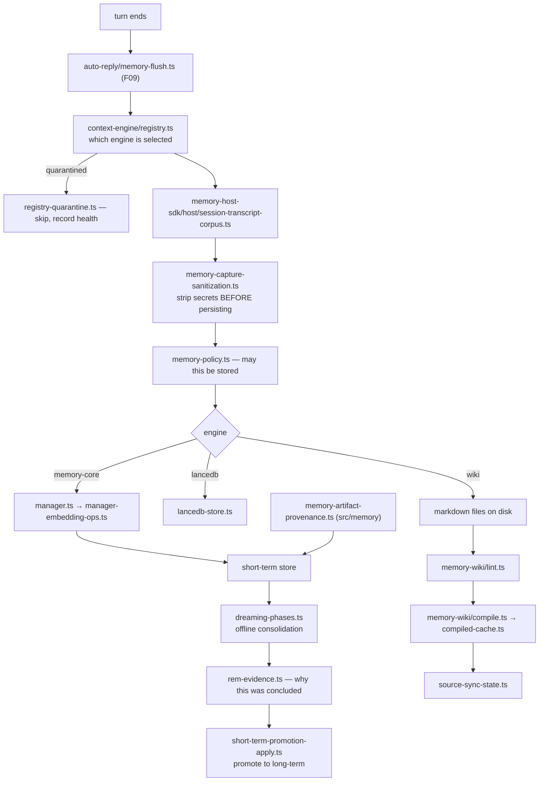
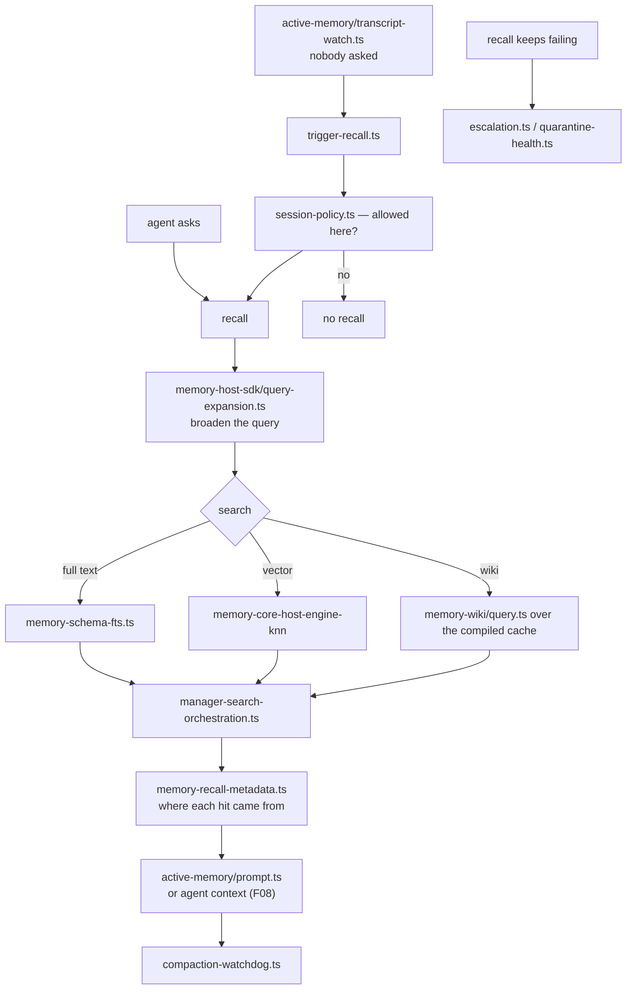

# F22 — memory and context

| | |
|---|---|
| describes | openclaw `v2026.10.3` @ `59cb44796b0f1f0daa0e37af8b1495abb45d9bc1` |
| paths | `src/memory/`, `src/context-engine/`, `packages/memory-host-sdk/`, `extensions/memory-core/`, `extensions/memory-wiki/`, `extensions/active-memory/`, `extensions/memory-lancedb/` |
| size | 741 tracked files · ~180,000 LOC |

## What it is, in plain English

Memory in openclaw is **almost entirely in extensions**, and there are four competing implementations, not one.

| path | non-test files | what it is |
|---|---|---|
| `src/memory/` | **2** | just provenance and root files |
| `src/context-engine/` | 16 | the registry that selects a memory engine |
| `packages/memory-host-sdk/` | 86 | the host-side contract and storage |
| `extensions/memory-core/` | **202** | the flagship engine — consolidation, embeddings, search |
| `extensions/memory-wiki/` | 54 | a markdown wiki that compiles |
| `extensions/active-memory/` | 20 | proactive recall during a conversation |
| `extensions/memory-lancedb/` | 24 | a LanceDB vector store |

`src/memory/` containing two files (`memory-artifact-provenance.ts`, `root-memory-files.ts`) is the whole of memory in core. **Searching `src/memory` for how memory works returns a clean, almost empty, and completely misleading answer.**

## 1. `src/context-engine/` — the selector, with a quarantine

```
registry.ts               28 KB
types.ts                  20 KB
registry.resources.ts     11 KB
delegate.ts               8.0 KB
host-compat.ts            4.4 KB
registry-quarantine.ts    4.0 KB   ←
runtime-settings.ts       3.7 KB
quarantine-health.ts      3.4 KB   ←
registry-adoption.ts      2.5 KB
registry-contract.ts      2.1 KB
registry-selection.ts · legacy{,.registration}.ts · init.ts
context-engine-abort.ts · compaction-watchdog.ts   ←
```

Three modules worth naming:

**`registry-quarantine.ts` + `quarantine-health.ts`.** A context engine that misbehaves is **quarantined** rather than left to keep failing. There is a health signal for whether quarantine is in effect. That is a far better answer than retrying a broken memory engine on every turn.

**`compaction-watchdog.ts`.** Compaction is the known failure surface (eleven modules in F08); here a watchdog guards it from the memory side.

**`registry-adoption.ts`.** The same adoption pattern as `claws` (F18) and `decisions` (F18) — something pre-existing is taken under management rather than ignored.

## 2. `extensions/memory-core/` — 202 files, and a sleep model

```
src/dreaming-phases.ts                    49 KB   ← largest file in the chunk
src/memory/manager-embedding-ops.ts       36 KB
src/rem-evidence.ts                       33 KB   ←
src/memory/manager.ts                     29 KB
src/memory/manager-search-orchestration.ts 28 KB
src/short-term-promotion-apply.ts         28 KB   ←
src/migration/doctor-memory-sidecar.ts    27 KB
src/memory/manager-provider-lifecycle.ts  27 KB
src/cli-index-search.runtime.ts           26 KB
src/memory/manager-search.ts              26 KB
src/migration/doctor-host-events.ts       25 KB
src/memory/manager-sync-ops.ts            25 KB
```

**The architecture is explicitly modelled on sleep consolidation.** `dreaming-phases.ts`, `rem-evidence.ts`, `short-term-promotion-apply.ts`. Short-term memories are **promoted** to long-term during offline "dreaming" phases, and `rem-evidence.ts` carries the evidence for what a phase concluded — the same evidence-carrying instinct as F04's decision receipts and F11's admission evidence.

Whether the biological framing is load-bearing or decorative is not something file names can settle. What the names do establish is a real two-tier design with an offline consolidation pass and recorded justification, rather than "write everything to a vector store".

The rest is a conventional and substantial engine: `manager-embedding-ops.ts`, `manager-search.ts`, `manager-search-orchestration.ts`, `manager-sync-ops.ts`, `manager-provider-lifecycle.ts`, plus a CLI with index search. `migration/doctor-memory-sidecar.ts` and `migration/doctor-host-events.ts` hook it into `doctor` (F12).

## 3. `extensions/memory-wiki/` — markdown in, compiled index out

```
src/compile.ts             49 KB   ←
src/query.ts               37 KB
src/chatgpt-import.ts      36 KB
src/cli.ts                 31 KB
src/compiled-cache.ts      22 KB
src/markdown.ts            21 KB
src/okf.ts                 20 KB
src/lint.ts                17 KB   ←
src/source-sync-state.ts   16 KB
src/import-runs-state.ts   14 KB
src/gateway.ts             14 KB
src/import-insights.ts     13 KB
```

The design: **markdown files are the source of truth**, and they are *compiled* into a queryable form with a cache, kept in sync (`source-sync-state.ts`), and **linted** (`lint.ts`). Plus an importer for ChatGPT history (`chatgpt-import.ts`, 36 KB) with its own run state and insight extraction.

This is the markdown-first option: human-readable, diffable, editable files as the authority, with the index as a derived artefact that can be rebuilt. The lint step means the source can be held to a shape rather than drifting.

`okf.ts` appears to be an interchange format for the compiled knowledge.

## 4. `extensions/active-memory/` — recall without being asked

```
index.ts              26 KB
recall.ts             17 KB
trigger-recall.ts     15 KB
prompt.ts             14 KB
recall-run.ts         14 KB
session-policy.ts     11 KB
config.ts             10 KB
recall-state.ts       9.3 KB
session.ts            9.3 KB
transcript-result.ts  8.9 KB
transcript.ts         8.6 KB
types.ts · query.ts · escalation.ts · transcript-watch.ts · doctor-contract
```

It **watches the live transcript** (`transcript-watch.ts`) and decides when a recall is worth running (`trigger-recall.ts`), under a session policy, with its own state machine and an `escalation.ts` path. So memory is not only queried on demand; it volunteers.

`session-policy.ts` at 11 KB is the control: when proactive recall is allowed. Without a policy this is the feature that makes an assistant feel like it is rummaging.

## 5. `extensions/memory-lancedb/` — the vector store option

```
index.ts                          24 KB
embeddings.ts                     20 KB
memory-capture-sanitization.ts    17 KB   ←
doctor-contract-api.ts            11 KB
memory-policy.ts                  11 KB
memory-cli.ts · lancedb-store.ts · lancedb-schema.ts · lancedb-runtime.ts
auto-recall.ts · memory-stats.ts · recall-service.ts · config.ts
```

**`memory-capture-sanitization.ts` (17 KB) is the one to notice.** Before anything is captured into long-term memory it is sanitised. Memory is the one store that is *meant* to persist, so a secret written there persists too — and this is the module that stops it. Together with `memory-policy.ts`, it is the privacy boundary of the whole subsystem.

## 6. `packages/memory-host-sdk/` — 86 files of host contract

```
host/session-files.ts                      32 KB
host/session-transcript-corpus.ts          19 KB
host/memory-schema-storage-migration.ts    19 KB
host/memory-schema.ts                      15 KB
host/types.ts                              15 KB
host/internal.ts                           14 KB
host/memory-schema-fts.ts                  13 KB   ← full-text search
host/query-expansion.ts                    12 KB   ←
host/memory-recall-metadata.ts             8.9 KB
host/markdown-chunks.ts                    7.9 KB
host/batch-runner.ts                       7.7 KB
host/openclaw-runtime-session.ts           7.0 KB
```

The host provides **both** full-text search (`memory-schema-fts.ts`) and embeddings, plus **query expansion** — a query is broadened before searching, which is usually what separates a recall system that works from one that misses. `markdown-chunks.ts` chunks markdown for indexing (cf. `render-aware-chunking.ts` in F13 — two different chunking problems, both solved deliberately). `session-transcript-corpus.ts` turns transcripts into a searchable corpus.

These 23 `memory-core-host-*` SDK subpaths (F10) are how an engine plugs in: foundation, embeddings, indexing, knn, schema, storage, sessions, fs, curated.

## Process flow — capture and consolidate



## Process flow — recall



## Dependencies

**Out** — `core/plugins` (65), `core/config` (57), `core/agents` (30), `core/infra` (19), `core/shared` (17), `core/state` (16), `core/plugin-state` (12).

**In** — `core/agents`, `core/auto-reply` (the memory flush), `core/gateway`. Very light, which follows from memory living in extensions behind a registry.

## Risks and traps

1. **`src/memory` is two files.** Memory is in `extensions/` and `packages/memory-host-sdk`. This is the single most misleading directory name in the repo.
2. **Four engines, one registry.** `memory-core`, `memory-wiki`, `memory-lancedb` and the host SDK's own storage are different designs. A statement about "how openclaw remembers" is only true of the selected engine.
3. **Sanitisation is the privacy boundary and it is engine-specific.** `memory-capture-sanitization.ts` lives in `memory-lancedb`. An engine without an equivalent will persist whatever it is given — and memory is the store designed to outlive everything else.
4. **Proactive recall needs a policy.** `active-memory/session-policy.ts`. Enabled without one, it will surface old context where it is unwanted.
5. **Quarantine means memory may be silently absent.** `registry-quarantine.ts` plus `quarantine-health.ts`. "The agent forgot" may be a quarantined engine, not a storage failure. Check the health signal.
6. **The wiki's compiled cache can be stale.** `source-sync-state.ts` tracks it; a query against a stale cache returns old answers rather than erroring.
7. **Query expansion changes results.** `query-expansion.ts` means the query that ran is not the query that was asked — relevant when recall returns something surprising.
8. **`dreaming-phases.ts` is offline work.** Consolidation happens outside a turn, so a memory written now may not be recallable in the shape expected until a phase has run.

## Verdict

The most ambitious chunk in the repo, and the most fragmented. Four engines behind one registry, with the registry able to quarantine a failing one — which is the right engineering answer to a subsystem that must never take the agent down with it.

Two designs stand out. `memory-core`'s two-tier consolidation with an offline promotion pass and recorded evidence is a real attempt at the problem rather than a vector-store wrapper. And `memory-wiki`'s markdown-source-of-truth with a compile step, a cache and a **linter** is the option to pick when the memory needs to stay human-readable and reviewable — the index is derived and rebuildable, the files are the authority.

The gap is that the privacy control is not uniform. Capture sanitisation exists in one engine. Memory is the one store designed to persist indefinitely, so that control belongs in the host contract, not in whichever extension happened to implement it.
