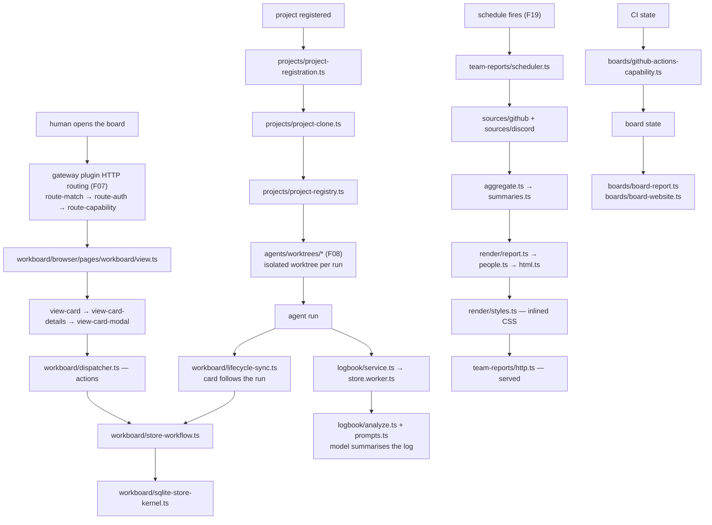

# F23 — boards, projects, workboard, logbook, team reports

| | |
|---|---|
| describes | openclaw `v2026.10.3` @ `59cb44796b0f1f0daa0e37af8b1495abb45d9bc1` |
| paths | `src/boards/`, `src/projects/`, `extensions/workboard/`, `extensions/logbook/`, `extensions/team-reports/` |
| size | 346 tracked files · ~80,000 LOC |

## What it is, in plain English

Work tracking. The core provides a small board primitive and a project registry; the extensions build a kanban board with its own web UI, a logbook, and a team report generator.

| path | non-test files | what it is |
|---|---|---|
| `src/boards/` | 14 | a board primitive on SQLite |
| `src/projects/` | 11 | a registry of code projects, with clone and checkout |
| `extensions/workboard/` | 139 | a full kanban board **with its own web UI** |
| `extensions/logbook/` | 19 | a log of work, with analysis |
| `extensions/team-reports/` | 49 | generated team reports from GitHub and Discord |

## 1. `src/boards/` — the primitive

```
sqlite-board-codec.ts        19 KB
sqlite-board-store.ts        19 KB
sqlite-board-store.kernel.ts 18 KB
board-store.ts               15 KB
board-layout.ts              11 KB
sqlite-board-store.worker.ts 3.8 KB
github-actions-capability.ts 4.3 KB
board-capabilities.ts        4.0 KB
board-report.ts · board-notices.ts · board-website.ts ·
sqlite-board-read-queries.ts
```

The usual openclaw storage shape — codec, store, kernel, worker — matching F03's lease pattern. `board-capabilities.ts` and `github-actions-capability.ts` mean a board declares capabilities, and one of them is GitHub Actions: a board can reflect CI state. `board-website.ts` publishes a board as a page.

## 2. `src/projects/` — 11 files, more interesting than its size

```
project-clone-runtime.ts    14 KB
project-clone.ts            13 KB
project-registry.ts         11 KB
project-registry.kernel.ts  6.2 KB
project-registration.ts     3.2 KB
project-registry.worker.ts  2.9 KB
project-checkout.ts         2.7 KB
project-git-url.ts          2.1 KB (+ .runtime.ts)
project-registry.types.ts · .worker-contract.ts
```

**openclaw can clone and check out repositories as a first-class operation.** `project-clone.ts` + `project-clone-runtime.ts` (27 KB together) and `project-checkout.ts`, with a registry of what has been cloned. Combined with `src/agents/worktrees/` (65 files, F08), the shape is clear: a project is registered, cloned once, and agent runs get isolated git worktrees from it.

`project-git-url.ts` parses and normalises git URLs — small, and the kind of thing that is wrong everywhere it is reimplemented.

## 3. `extensions/workboard/` — 139 non-test files, and its own web UI

```
browser/   78   ← a web UI shipped inside the plugin
src/       52
```

```
src/store-normalizers.ts                   40 KB
src/store-core.ts                          37 KB
src/sqlite-store-kernel.ts                 28 KB
browser/pages/workboard/view-card.ts       28 KB
browser/pages/workboard/view.ts            27 KB
browser/pages/workboard/view-card-details.ts 26 KB
src/store.ts                               24 KB
src/store-card-helpers.ts                  23 KB
src/store-workflow.ts                      22 KB
browser/pages/workboard/view-card-modal.ts 21 KB
src/dispatcher.ts                          21 KB
src/lifecycle-sync.ts                      19 KB
```

**This is the proof that an extension can ship a complete web application.** 78 browser files served through the gateway's plugin HTTP routing (`server/plugins-http/route-match.ts`, `route-auth.ts`, `route-capability.ts`, F07). Anyone wanting a custom screen inside openclaw should read workboard rather than inventing a hosting approach — it is the worked example, and it already handles auth and capability on its routes.

On the data side, `store-normalizers.ts` (40 KB) being larger than `store-core.ts` says most of the difficulty is reconciling card shapes rather than storing them. `store-workflow.ts` holds the state machine; `lifecycle-sync.ts` keeps the board in step with agent run lifecycle, so cards move as work actually progresses. `dispatcher.ts` is the action surface.

It also matches a protocol schema (`board` in F06) and a `workboard-contract` package, so the board is addressable remotely, not only through its own UI.

## 4. `extensions/logbook/` — 19 files

```
src/service.ts        25 KB
src/store.worker.ts   24 KB
src/analyze.ts        14 KB   ←
index.ts              9.0 KB
src/prompts.ts        8.0 KB
src/store.ts / store-schema.ts / store-contract.ts /
store-frame-queries.ts · node-host.ts · config.ts · types.ts
```

A record of work that is **analysed**, not just stored: `analyze.ts` plus `prompts.ts` means the logbook is summarised by a model. `store-frame-queries.ts` suggests entries are frame-addressed (time windows). `node-host.ts` means a node can contribute entries.

## 5. `extensions/team-reports/` — 49 files

```
src/render/styles.ts        70 KB   ← largest file in the chunk
src/store.worker.ts         22 KB
src/render/people.ts        18 KB
src/sources/github/index.ts 18 KB
src/aggregate.ts            17 KB
src/render/report.ts        17 KB
src/summaries.ts            16 KB
src/http.ts                 13 KB
src/scheduler.ts            12 KB
src/render/html.ts          10 KB
src/sources/discord/index.ts 9.2 KB
src/render/page.ts          9.2 KB
```

Pulls from **sources** (GitHub, Discord), aggregates, summarises with a model, renders HTML, serves it over HTTP, on a schedule. `render/styles.ts` at 70 KB is inlined CSS — a self-contained page with no external dependencies, which is the right call for something emailed or shared.

`render/people.ts` (18 KB) is the per-person view, which is the part of any team report that needs the most care.

## Process flow — work tracked from a run to a report



## Dependencies

**Out** — `core/state` (73), `core/infra` (30), `core/config` (19), `pkg/gateway-protocol` (16), `core/agents` (10), `core/sessions` (7).

**In** — `core/gateway`, `ui`. `core/boards` has 8 distinct dependents, `core/projects` fewer.

Very light. These are leaf features, which is why they can live mostly in extensions.

## Risks and traps

1. **`extensions/workboard/browser/` is a real web app inside a plugin.** Read it before building any custom screen; the hosting, auth and capability questions are already answered there.
2. **`store-normalizers.ts` is bigger than the store.** Card shape reconciliation is the hard part. Changing a card shape means changing the normalizers, not just the schema.
3. **`lifecycle-sync.ts` couples the board to run lifecycle.** A board that looks wrong may be a lifecycle sync problem rather than a data problem.
4. **`project-clone` writes to disk.** openclaw cloning repositories is a real side effect with real disk and credential implications, and the registry is the record of what it did.
5. **Team reports summarise with a model and serve over HTTP.** Two things to check before sharing: that the summary is accurate, and that `src/http.ts` is not exposed further than intended.
6. **Boards, workboard and the `board` protocol schema are three surfaces on the same idea.** A change in one does not propagate to the others.
7. **70 KB of inlined CSS** is deliberate (self-contained output) and also means a visual change is a code change.

## Verdict

The most ordinary chunk functionally and the most useful as a reference. `extensions/workboard` is the answer to "can a plugin ship its own screen" — 139 files, 78 of them browser code, served through the gateway's existing authenticated plugin routes. Anything that needs a custom UI inside openclaw should start by reading it rather than designing a hosting story.

`src/projects` is the quiet one: openclaw registers, clones and checks out repositories, and hands agent runs isolated worktrees from them. That is infrastructure for autonomous code work, sitting in eleven files nobody would think to look at.
