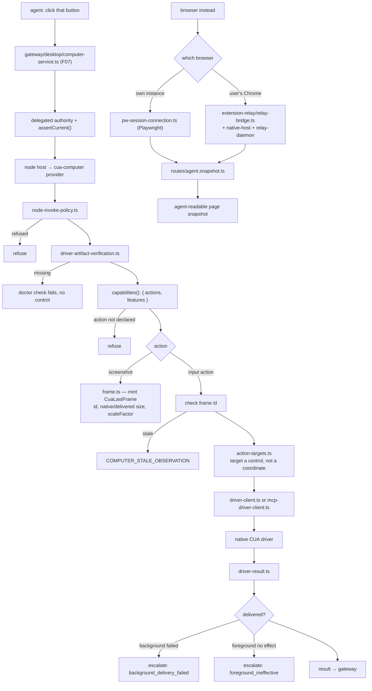

# F24 — canvas, browser, computer use

| | |
|---|---|
| describes | openclaw `v2026.10.3` @ `59cb44796b0f1f0daa0e37af8b1495abb45d9bc1` |
| paths | `src/canvas/`, `src/proxy-capture/`, `extensions/canvas/`, `extensions/browser/`, `extensions/cua-computer/`, `extensions/openshell/` |
| size | 883 tracked files · ~194,000 LOC |

## Headline finding: a shipped computer-use provider already exists

`extensions/cua-computer` is a working implementation of the contract documented in F10, for macOS, Windows and Linux. Its entry point:

```ts
import { registerComputerUseProvider } from "openclaw/plugin-sdk/computer-use";

export default definePluginEntry({
  id: "cua-computer",
  name: "CUA Computer",
  description: "Experimental CUA Driver computer control for macOS, Windows, and Linux node hosts.",
  configSchema,
  register(api) {
    api.registerNodeInvokePolicy(createCuaComputerNodeInvokePolicy());
    // Remote policy must not enable local native control. macOS retains its
    // app-gated default; Windows/Linux nodes still require plugin enablement.
    if (process.platform !== "darwin" &&
        normalizePluginsConfig(api.config.plugins).entries[api.id]?.enabled !== true) {
      return;
    }
    registerCuaDriverDoctorChecks();
    const artifactVerification = verifyInstalledCuaDriverArtifacts();
    ...
    registerComputerUseProvider(api, createCuaComputerProvider());
  },
});
```

Five things this settles:

1. **On macOS the provider registers by default**, gated by the app's own permissions. On Windows and Linux it requires explicit plugin enablement. The comment is explicit that remote policy must not be able to turn on local native control.
2. **It needs a verified driver artifact.** `verifyInstalledCuaDriverArtifacts()` plus `src/driver-artifact-verification.ts` (8.2 KB). No driver, no control — and the check is a doctor check (`registerCuaDriverDoctorChecks()`), so a missing driver is diagnosable rather than mysterious.
3. **It installs a node invoke policy.** `api.registerNodeInvokePolicy(...)` — a separate gate on what may be invoked on the node, beyond the provider itself.
4. **Partial action sets are a tested configuration.** From its own tests:
   ```
   expect(provider.capabilities().actions).toContain("get_window_state");
   expect(provider.capabilities().actions).not.toContain("left_mouse_down");
   expect(provider.capabilities().features).toEqual({ ... });
   ```
   So `capabilities()` returns `{ actions, features }`, and shipping observation without input is a supported, asserted state — precisely the staged-rollout mechanism F10 inferred.
5. **It uses the wire subset, not the full list.** `CUA_WIRE_ACTION_NAMES = COMPUTER_USE_V2_ACTION_NAMES.slice(1, 14)` — the same slice as `COMPUTER_ACT_V1_ACTION_NAMES`.

### Frame identity is how stale observations are caught

`src/frame.ts`:

```ts
import { createHash, randomUUID } from "node:crypto";

export type CuaDesktopGeometry = {
  platform; display; screenWidth; screenHeight; scaleFactor;
  screenshotWidth; screenshotHeight;
};
export type CuaLastFrame = {
  id; referenceWidth; nativeWidth; nativeHeight;
  deliveredWidth; deliveredHeight; ...
};
```

Every screenshot is a **frame with an identity** (UUID plus a hash) carrying native size, delivered size, reference width and scale factor. That gives two things at once: coordinates can be translated correctly across Retina scaling and multiple displays, and an action naming an old frame id can be refused as `COMPUTER_STALE_OBSERVATION`. This is the implementation of the guard F10 flagged as depending entirely on the provider.

The rest of the module:

```
src/driver-result.ts                 22 KB
src/commands.ts                      22 KB   createCuaComputerProvider()
src/driver-client.ts                 15 KB
src/window-actions.ts                14 KB
src/mcp-driver-client.ts             14 KB   ← the driver can be reached over MCP
src/frame.ts                         11 KB
src/browser-actions.ts               8.5 KB
src/driver-artifact-verification.ts  8.2 KB
src/recording-actions.ts             7.5 KB   ← screen recording
src/execution-resources.ts           7.2 KB
src/actions.ts · src/action-targets.ts · src/node-invoke-policy.ts
```

`action-targets.ts` means an action can target a control rather than a coordinate. `recording-actions.ts` adds screen recording. `mcp-driver-client.ts` means the native driver can be spoken to over MCP as well as directly.

**Practical conclusion:** desktop control on a macOS node is closer to "enable, install the driver artifact, and narrow `capabilities()`" than to "write a provider". The provider is marked experimental, so the work is verification and narrowing rather than construction — and if a bespoke provider is still wanted, this is the template, with the frame-identity and node-invoke-policy problems already solved.

## 2. `extensions/browser/` — 360 non-test files, the largest extension here

```
src/              297
chrome-extension/  37
```

```
src/browser/chrome.ts                        51 KB
src/browser/extension-relay/relay-bridge.ts  44 KB
src/browser/routes/agent.snapshot.ts         29 KB
src/browser/session-tab-store.ts             26 KB
src/browser-dashboard.ts                     26 KB
src/browser/server-context.availability.ts   25 KB
src/cli/browser-cli-manage.ts                25 KB
src/browser/extension-install-registration.ts 24 KB
src/browser/pw-session-actions.ts            24 KB
src/browser/pw-session-connection.ts         23 KB
scripts/bench-lightweight.ts                 24 KB
plus: relay-daemon, native-host, browser-profiles, browser-maintenance,
      browser-doctor, browser-control, bridge-api, benchmark-api
```

Two distinct routes to a browser, which is the thing to understand before using it:

- **Playwright** (`pw-session-*.ts`) — openclaw drives its own browser instance.
- **A Chrome extension with a relay** (`chrome-extension/` 37 files, `extension-relay/relay-bridge.ts` 44 KB, `relay-daemon.ts`, `native-host.ts`) — openclaw drives the user's *existing* Chrome through an installed extension and a native messaging host.

`routes/agent.snapshot.ts` (29 KB) is how a page becomes an agent-readable snapshot. `session-tab-store.ts` tracks tabs per session. `browser-doctor.ts` makes browser problems diagnosable. There is a benchmark suite (`scripts/bench-lightweight.ts`, `benchmark-api.ts`), which implies page-reading performance has been measured rather than assumed.

## 3. `src/proxy-capture/` — 23 non-test files, a second MITM proxy

```
runtime-owner.ts          25 KB
store.kernel.ts           22 KB
runtime.ts                20 KB
proxy-server.ts           17 KB
store.sqlite.ts           13 KB
store-readonly.ts         12 KB
ca.ts                     9.1 KB   ← its own CA
runtime-response-body.ts  6.7 KB
coverage.ts               5.9 KB
store.async.ts · env.ts · paths.ts · header-redaction.ts ·
runtime-fetch-patch.ts · runtime-deferral.ts · runtime-cleanup.ts ·
store-lifecycle.ts · store.worker.ts (×2) · types.ts
```

**This is the second CA-minting proxy in the repo**, after the secret egress proxy (F05). Different purpose: this one *captures* traffic into a SQLite store for inspection, with `header-redaction.ts` so captured headers do not retain credentials, `coverage.ts` tracking what has been captured, and `runtime-fetch-patch.ts` patching `fetch` so traffic is routed through it.

`runtime-owner.ts` being the largest file follows the repo-wide ownership pattern: capture has an owner.

Two proxies, two CAs, both loopback — worth knowing when debugging a TLS failure, and worth auditing together.

## 4. `src/canvas/` and `extensions/canvas/` — widgets

```
src/canvas/widget-tool.ts           28 KB
src/canvas/wrap.ts                  22 KB
src/canvas/documents.ts             8.0 KB
src/canvas/widget-script-syntax.ts  7.6 KB
src/canvas/serve.runtime.ts · constants.ts · config.ts

extensions/canvas/src/cli.ts            8.9 KB
extensions/canvas/src/host/a2ui.ts      3.6 KB
extensions/canvas/src/a2ui-jsonl.ts     3.2 KB
extensions/canvas/src/widget-presenter.ts 3.4 KB
extensions/canvas/src/board-widget.ts · host/a2ui-route.ts ·
host/file-resolver.ts · node-eligibility.ts · tool.ts · config-migration.ts
```

The agent can produce an interactive **widget**. `widget-script-syntax.ts` defines a constrained scripting syntax rather than arbitrary JavaScript, and `wrap.ts` (22 KB) wraps it for serving. `a2ui` / `a2ui-jsonl` is an agent-to-UI protocol carried as JSONL. `node-eligibility.ts` decides whether a given node can present a widget.

A constrained syntax instead of free-form script is the right call: a widget is model-generated code being shown to a user.

## 5. `extensions/openshell/` — 15 non-test files

```
src/backend.ts        47 KB
src/fs-bridge.ts      18 KB
src/config.ts         5.7 KB
src/mirror.ts         4.5 KB
src/workspace-roots.ts · src/cli.ts · backend.types.ts
```

A remote shell backend with its own filesystem bridge and `workspace-roots.ts` bounding where it may reach — the same shape as the sandbox backends in F08, offered as a plugin.

## Process flow — one desktop action, end to end



## Dependencies

**Out** — `core/state` (42), `core/infra` (41), `core/plugins` (21), `core/shared` (14), `core/logging` (10), `core/agents` (7), `core/gateway` (6).

**In** — `core/gateway` (the desktop subsystem), `core/secrets` (5 edges into `proxy-capture`). Light, as expected for plugin-hosted capability.

## Risks and traps

1. **The computer-use provider is marked experimental.** It exists and is tested, but "experimental" plus "native input control" means verification before trust, not after.
2. **macOS registers by default; the gate is the app's permissions.** Anyone reasoning about whether desktop control is active on a Mac must check the app permission state, not only the plugin config.
3. **Stale-frame detection only works if the frame id is passed through.** `frame.ts` provides the identity; a caller that drops it loses the guard and will click where the button used to be.
4. **Two browser routes, two trust models.** Playwright drives openclaw's own browser; the Chrome extension relay drives the **user's** browser with their sessions and cookies. These are very different exposures and should not be configured interchangeably.
5. **Two CA-minting proxies.** Secret egress (F05) and proxy capture (this chunk). A TLS failure may be either, and both should be in scope for any network audit.
6. **Captured traffic is stored in SQLite.** `header-redaction.ts` protects headers; a body may still contain secrets. Capture is a debugging tool, not something to leave running.
7. **Widgets are model-generated code shown to a human.** `widget-script-syntax.ts` constrains it deliberately; widening that syntax widens an injection surface.
8. **`openshell` is a shell as a plugin.** `workspace-roots.ts` is the only bound on where it reaches.

## Verdict

The chunk with the biggest gap between what the documentation suggests and what the tree contains. Desktop control is not a future feature: there is a shipped cross-platform provider with frame identity for coordinate translation and stale-observation detection, a node invoke policy, a driver artifact check wired into `doctor`, screen recording, control-level action targeting, and tests that assert a partial action set — the staged rollout already works.

Alongside it, two complete browser-automation routes (one of which drives the user's own Chrome), a traffic-capture proxy with its own CA and header redaction, and a constrained widget syntax so model-generated UI is not arbitrary script.

The risk profile matches the capability. This is the chunk that can click, type, read the user's browser sessions and record the screen. Every one of those has a declared gate; the work is verifying each gate can actually go red.
