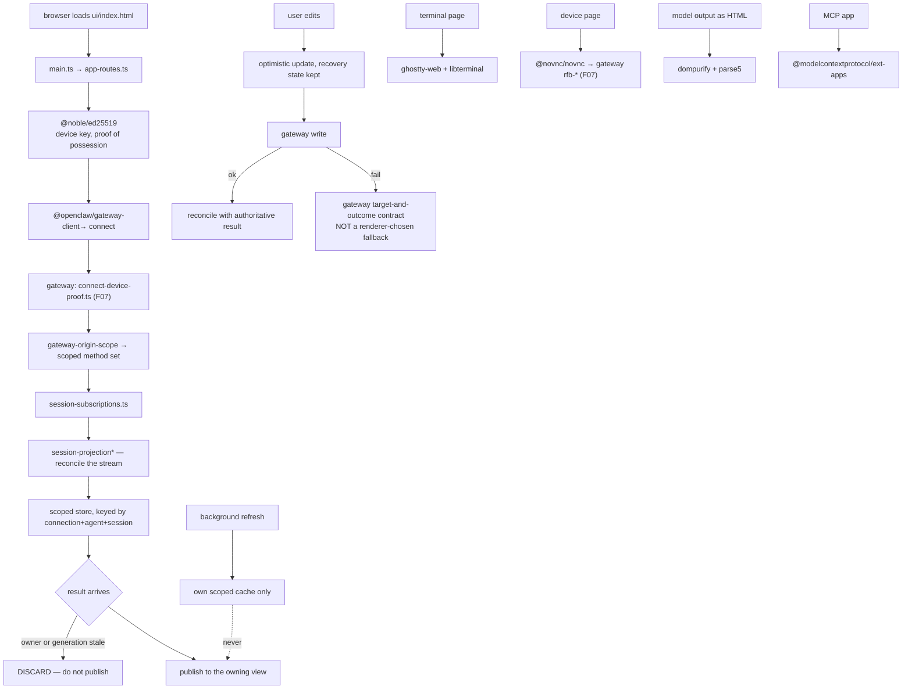

# F25 — the Control UI

| | |
|---|---|
| describes | openclaw `v2026.10.3` @ `59cb44796b0f1f0daa0e37af8b1495abb45d9bc1` |
| paths | `ui/` |
| size | 5,135 tracked files · 2,496 non-test · ~1,277,000 LOC — third largest feature |
| distinct dependents | 9 (it depends on much; little depends on it) |

## What it is, in plain English

A single-page web application — the Control UI — built on **Lit**, with 41 pages, 18 translated locales, and a browser-side terminal and VNC viewer. It is a peer client of the gateway, exactly like the TUI and the CLI, speaking the same protocol (F06).

```
ui/src/     2,233 non-test files
ui/public/    239
ui/config/      8
```

## The 41 pages — the honest feature list of the product

```
about          activity       agents         agents-home    approval
approvals      apps           channels       chat           cloud-workers
config         connection     cron           custodian      dashboards
debug          device         devices        gateway-source-replacement
labs           lobsterdex     logs           meetings       memory-import
model-providers model-setup   new-session    plugin         plugins
portals        profile        question       route-provenance search
secrets        sessions       skill-workshop skills         systems
terminal       usage          workboard      worktrees
```

This is the clearest single inventory of what openclaw does. Several are capabilities not obvious from the documentation: `cloud-workers`, `portals`, `worktrees`, `skill-workshop`, `custodian`, `memory-import`, `dashboards`, `labs`, `lobsterdex`.

Largest page code:

```
pages/cron/view.ts                  61 KB
pages/sessions/sessions-page.ts     56 KB
pages/agents/memory/view.ts         52 KB
pages/config/config-page.ts         50 KB
pages/sessions/view.ts              43 KB
pages/agents/agents-page.ts         42 KB
pages/chat/composer-persistence.ts  37 KB
lib/cron/index.ts                   36 KB
pages/chat/chat-pane-render.ts      33 KB
pages/usage/view.ts                 32 KB
```

`pages/chat/composer-persistence.ts` at 37 KB is a reminder of how much work "don't lose what the user was typing" actually is.

## Internationalisation at real scale

```
ui/src/i18n/locales/en.ts            189 KB   ← largest single file in the repo
ui/src/i18n/locales/en-settings.ts    79 KB

18 languages: ar de en es fa fr hi id it ja-JP ko nl pl pt-BR ru th tr uk vi zh-CN zh-TW

plus ~50 English namespace files: en-activity, en-agents, en-apps,
en-board-website, en-browser, en-chat-camera, en-chat-ci, en-chat-goals,
en-chat-message-metadata, en-chat-provider-review, en-code-blocks,
en-command-palette, en-cron, en-debug, en-desktop, en-devices,
en-dreaming, en-file-preview, en-github, en-labs, en-link-reader,
en-login, en-mcp, en-mcp-app, en-meetings, en-memory-import,
en-model-accounts, en-model-controls, en-model-setup,
en-new-session-setup, en-personal-instructions, en-plugin-consent,
en-plugin-management, en-portals, en-profile, en-session-people,
en-session-placement, en-settings, en-sidebar-attention,
en-skill-library, en-skill-workshop, en-skills-browser, en-systems,
en-tool-diagnostics, en-transcripts, en-update-actions, en-usage
```

Note `en-dreaming.ts` — the memory consolidation phases from F22 have their own user-facing vocabulary, so that framing is surfaced to users, not just internal naming.

## What the dependency list reveals

```json
"@awesome.me/webawesome"            component library
"lit", "@lit/context", "@lit/task"  web components, no framework
"@codemirror/*" (6 packages)        a real code editor in the browser
"ghostty-web", "@openclaw/libterminal"  ← a REAL terminal emulator
"@novnc/novnc"                      ← a VNC client
"@noble/ed25519", "@noble/hashes"   ← client-side device-proof crypto
"@modelcontextprotocol/client"      ← the UI is an MCP client
"@modelcontextprotocol/ext-apps"    ← MCP apps hosted in the UI
"@openclaw/mermaid-renderer"        diagrams
"@panzoom/panzoom"                  pan and zoom
"@tanstack/lit-virtual"             virtualised lists
"dompurify", "parse5"               sanitising untrusted HTML
"markdown-it" + cjk-friendly + emoji
"@openclaw/gateway-client", "gateway-protocol", "net-policy",
"session-url-contract", "workboard-contract", "model-catalog-core",
"media-core", "normalization-core", "uirouter"
```

Four of these change the picture:

- **`ghostty-web`** — a genuine terminal emulator in the browser, which is what the `terminal` page and the `terminal` protocol schema (F06) are for.
- **`@novnc/novnc`** — the client half of the RFB path found in `src/gateway/desktop/rfb-*.ts` (F07). Remote desktop viewing, with the view-only filter on the server side.
- **`@noble/ed25519`** — the browser holds a key and proves possession, matching `connect-device-proof.ts` (F07) and `pairing-store-keys.ts` (F15). Device pairing is cryptographic in the browser too, not a bearer token.
- **`@modelcontextprotocol/ext-apps`** — the UI can host MCP apps. Combined with `mcp/channel-bridge.ts` (F21), MCP is a two-way surface.

`dompurify` + `parse5` are the correct precaution: model output rendered as HTML is untrusted.

No React, no Vue. Lit plus web components plus an in-house router (`@openclaw/uirouter`).

## `ui/AGENTS.md` — a written state-ownership doctrine

This is the most valuable prose in the repo and it is worth quoting its substance:

- **The gateway owns shared state.** Renderer copies are *caches*. The UI must not re-implement session, configuration or authorization decisions that the gateway already owns.
- **Scope every cache and in-flight request** to the connection, agent and session it concerns. Before publishing a result, check that its **owner and request generation are still current**. *"A late result from a prior context must not replace newer intent or populate the newly selected context."*
- **Optimistic updates** retain enough state for visible recovery, then reconcile with the authoritative result. *"An old request must not roll back a newer edit."*
- **Failed writes follow the gateway's target-and-outcome contract**, not a fallback account the renderer picked.
- **Background updates** may refresh their own scoped cache but must never replace the foreground selection.
- **Session rosters** apply nested gateway row snapshots through a shared reconciler, and the document enumerates exactly which event kinds may avoid a list read — lifecycle, participants, placement, patch/send/steer, run events, title — and under what invariants (membership, lineage, pin/owner/archive unchanged, recency not moving backwards).

That is the specification for "a UI over a live distributed system". Every rule names a specific bug that has happened: a stale response overwriting a newer edit, a background refresh clobbering the user's selection, a failed write silently retargeting to another account.

It also pairs with the client-side projection modules in `gateway-client` (F06) — `session-projection-final-identity`, `-duplicate-final`, `-terminal-reconciliation`. Both halves exist because the event stream is not clean.

## Process flow — the UI connecting and staying correct



## Dependencies

**Out** — `support/test` (705), `pkg/gateway-protocol` (545), `core/shared` (241), `core/gateway` (211), `core/infra` (72), `core/config` (62), `core/agents` (56).

**In** — only 9 distinct dependents (`ext/qa-lab` has 8 edges into `ui`, `support/*` the rest).

This is the right shape for a client: it consumes the protocol and almost nothing consumes it. The 211 edges into `core/gateway` are the exception worth noting — a pure client would have none, and would reach the gateway only through `gateway-protocol`.

## Risks and traps

1. **Read `ui/AGENTS.md` before changing anything here.** Every rule in it encodes a real bug. The most important: check owner and request generation before publishing a result.
2. **Never re-decide authorization, session or config semantics in the UI.** The gateway owns them; the renderer caches. Duplicating a decision creates two answers that will diverge.
3. **189 KB English locale plus 18 languages plus ~50 namespace files.** A user-facing string change is a translation change across 18 files, or a visible inconsistency.
4. **`novnc` and `ghostty-web` mean the UI can view a desktop and run a terminal.** Anyone auditing exposure should treat the Control UI as a remote-access surface, not a dashboard. `src/security/audit-gateway-config.ts` (F05) covers origins and ingress.
5. **Model output is rendered as HTML.** `dompurify` is the control. Any new render path that bypasses it is an XSS surface fed by a model.
6. **The UI holds a private key.** `@noble/ed25519` in the browser means browser storage security matters for pairing, not just for convenience.
7. **41 pages against 190 protocol schemas.** A protocol change may need a UI change in a page nobody remembers exists — `labs`, `lobsterdex`, `custodian`, `portals`.

## Verdict

A large, serious client application — Lit and web components rather than a framework, 41 pages, a code editor, a real terminal, a VNC viewer, MCP app hosting and cryptographic device pairing, translated into 18 languages.

Its best artefact is not code. `ui/AGENTS.md` is a written doctrine for building a UI over live distributed state: the server owns state, the client caches, every cache is scoped to an owner and a request generation, late results are discarded rather than published, optimistic updates reconcile instead of rolling back newer edits, and failed writes follow the server's outcome contract rather than a client-chosen fallback. That document is more reusable than anything in the directory it governs.
