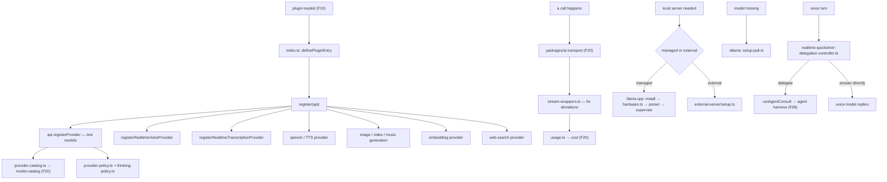

# F26 — model provider extensions

| | |
|---|---|
| describes | openclaw `v2026.10.3` @ `59cb44796b0f1f0daa0e37af8b1495abb45d9bc1` |
| paths | ~71 directories under `extensions/` that are model providers |
| size | 1,947 tracked files · ~306,000 LOC |
| depth of read | five representative providers read in detail (`anthropic`, `openai`, `ollama`, `llama-cpp`, `openrouter`); the remaining ~66 surveyed by size and name |

## What it is, in plain English

About seventy provider plugins, all against the same contract (the 44 `provider-*` SDK subpaths from F10). Most are small — under 25 KB of logic — because the host owns transport (`packages/ai`, F20), normalisation, retry and failover. A provider plugin's real job is: declare the models, declare the capabilities, declare how to authenticate, and patch the places the provider deviates from its claimed protocol.

Four of them are much bigger than the rest, and each is big for a different and informative reason.

## 1. `extensions/openai` — 88 non-test files, and the voice reference

```
openai-provider.ts                            37 KB
image-generation-provider.ts                  32 KB
realtime-quicksilver-session.ts               28 KB
provider-policy-api.ts                        26 KB
realtime-quicksilver-bridge.ts                24 KB
realtime-quicksilver-gateway-bridge.ts        23 KB
realtime-voice-bridge.ts                      23 KB
realtime-transcription-provider-factory.ts    21 KB
realtime-quicksilver-wire.ts                  20 KB
realtime-quicksilver-delegation-controller.ts 20 KB   ←
realtime-voice-provider-factory.ts            20 KB   ←
openai-chatgpt-provider.ts                    20 KB

clusters: realtime-quicksilver (24 files) · openai-chatgpt (8) ·
          realtime-voice (6) · token-sharing (3) ·
          realtime-transcription (2) · realtime-live (2) · native-web (2)
          plus realtime-{session,sdp,provider,host,auth}, speech-provider,
          tts, thinking-policy, transport-policy, replay-policy, usage
```

**This is the worked example for every voice contract in F16.** Both factories are here side by side:

- `realtime-voice-provider-factory.ts` — a `realtimeVoiceProviders` implementation
- `realtime-transcription-provider-factory.ts` — a `realtimeTranscriptionProviders` implementation
- `speech-provider.ts` + `tts.ts` — the TTS side

So all three voice contracts are implemented in one extension. Anyone writing a local voice provider should read these three files before anything else; they are smaller and more directly on-contract than the 80 KB telephony handler in `extensions/voice-call`.

**`realtime-quicksilver-delegation-controller.ts` is the find.** A 24-file realtime engine with an explicit *delegation controller* — the production implementation of F16's `RealtimeVoiceAgentConsultRunner`, deciding when a voice turn is delegated to the agent rather than answered by the voice model. Paired with `realtime-quicksilver-gateway-bridge.ts`, that is the whole "voice shell in front of a separate brain" pattern, already built.

`realtime-sdp.ts` means WebRTC; `transport-policy.ts` and `replay-policy.ts` mirror the continuation/replay machinery in `packages/ai` (F20).

## 2. `extensions/anthropic` — 59 non-test files, and it is mostly not about the API

```
register.runtime.ts              26 KB
session-catalog-discovery.ts     20 KB
session-catalog-listing.ts       19 KB
cli.runtime.ts                   19 KB
cli-shared.ts                    16 KB
session-catalog-scan.ts          14 KB
session-catalog.ts               13 KB
claude-desktop-groups.ts         12 KB
stream-wrappers.ts               12 KB
cli-backend.ts                   12 KB
usage.ts                         11 KB

clusters: session-catalog (21 files!) · cli-* (12 files) · cli-auth (2)
```

**Twenty-one files are a session catalogue.** The plugin's description is "Anthropic models, Claude CLI, and native Claude session catalog" — so most of its weight is *discovering and listing existing local Claude sessions* (`session-catalog-scan`, `-discovery`, `-listing`, plus `claude-desktop-groups.ts`), not calling the API. The API part is `stream-wrappers.ts`, 12 KB.

Twelve `cli-*` files make the Claude CLI usable as an agent backend — the `cli-backend-dispatch` path from F08. `fast-mode.ts` and `provider-policy.ts` are the behavioural knobs.

## 3. `extensions/ollama` — 49 non-test files, and it manages the server

```
src/stream.runtime.ts               42 KB
index.ts                            38 KB
src/setup.runtime.ts                23 KB
src/provider-models.ts              20 KB
src/node-inference.ts               18 KB   ← inference ON A NODE
src/embedding-provider.runtime.ts   17 KB
src/web-search-provider.runtime.ts  12 KB   ← Ollama web search
src/discovery-shared.ts             11 KB
src/stream-compat.ts                9.6 KB
src/setup-model-selection.ts        8.3 KB
src/tool-name-aliases.ts            7.5 KB   ←
src/setup-pull.ts                   7.3 KB   ← pulls models
```

It has its own `AGENTS.md` and `CLAUDE.md`. Three things worth noting:

- **`node-inference.ts`** — Ollama inference can run on a paired node, not only the gateway host. A local model on one machine, served to the fleet.
- **`setup-pull.ts`** — the plugin pulls models during setup.
- **`tool-name-aliases.ts`** — local models rename or mangle tool names; this maps them back. The kind of fix that only exists after real use.

`stream.runtime.ts` at 42 KB plus `stream-compat.ts` says local model streaming deviates from the standard enough to need its own layer.

## 4. `extensions/llama-cpp` — 29 non-test files, and it installs the server

```
src/managed-server.ts            22 KB   ← openclaw runs llama-server itself
src/llama-server-install.ts      22 KB   ← and installs it
src/setup.ts                     19 KB
src/external-server/setup.ts     18 KB   ← or attaches to yours
src/model-catalog.ts             10 KB
src/llama-server-assets.ts       10 KB
src/llama-server-preset.ts       8.2 KB   ← presets
src/hardware.ts                  8.0 KB   ← hardware detection
src/embedding-provider.ts        7.4 KB
src/defaults.ts                  6.8 KB
src/llama-server-vc-runtime.ts   6.2 KB
src/managed-provider.ts          5.9 KB
```

**Two modes, both supported: managed and external.** openclaw can download, install, configure and supervise its own `llama-server` with hardware-aware presets — or attach to one you already run (`external-server/setup.ts`).

`hardware.ts` plus `llama-server-preset.ts` means the preset is chosen from detected hardware rather than guessed. For anyone choosing a local serving stack, this is a materially more finished integration than a generic OpenAI-compatible endpoint: it owns install, presets and lifecycle, and it also provides embeddings.

## 5. `extensions/openrouter` — 29 non-test files, and it is every modality

```
video-generation-provider.ts   16 KB
index.ts                       16 KB
music-generation-provider.ts   14 KB
oauth.ts                       13 KB
image-generation-provider.ts   11 KB
video-model-catalog.ts         9.9 KB
provider-catalog.ts            9.2 KB
usage.ts                       8.4 KB
stream.ts                      8.1 KB
tool-schemas.ts                4.8 KB
media-understanding-provider.ts 4.3 KB
provider-routing.ts            2.7 KB
plus speech-provider, capability-catalog, thinking-policy,
     generation-request, provider-defaults, onboard
```

The **capability breadth** example: one plugin registering text, image, video, music, speech and media-understanding providers, with OAuth and its own catalogue. It is the template for an aggregator, and it demonstrates that a single plugin can fill many capability keys at once.

## The common anatomy

Every provider plugin, large or small, has the same spine:

```
openclaw.plugin.json       the manifest
index.ts                   definePluginEntry + register(api)
provider-contract.ts       what this provider is
provider-policy.ts         behavioural rules
provider-defaults.ts       defaults
models.ts / provider-catalog.ts    the model list
stream.ts / stream-wrappers.ts     deviations from the protocol
usage.ts                   usage and cost reporting
oauth.ts or auth-*.ts      authentication
thinking-policy.ts         reasoning-block handling
assets/                    icon + activity svg
```

`thinking-policy.ts` recurring across providers confirms F20's finding: reasoning blocks are the least standardised part of every API.

## Process flow — what a provider plugin contributes



## Dependencies

**Out** — essentially nothing into `src/`. The heaviest outbound edge from the whole provider set is `ext/test-support` (42). Everything else goes through the `openclaw/plugin-sdk/*` surface.

This is the strongest evidence for F10's central claim: **the SDK surface is the architecture.** Seventy plugins, 306,000 LOC, and almost no coupling to the source tree.

## Risks and traps

1. **Read `extensions/openai`'s three voice factories before writing a voice provider.** They are the on-contract reference; the telephony handler in `voice-call` is bigger but shaped by 8 kHz phone constraints.
2. **`realtime-quicksilver-delegation-controller.ts` is the delegation pattern in production.** Do not design "when does the voice layer defer to the brain" from scratch.
3. **A big provider plugin is usually big for a non-API reason.** `anthropic` is mostly a session catalogue; `ollama` is mostly server management; `llama-cpp` is mostly install and presets. Size does not indicate API complexity.
4. **`llama-cpp` managed mode installs and supervises a server.** That is a real system change with disk and process implications — but also a far more complete integration than pointing at a generic endpoint.
5. **`tool-name-aliases.ts` exists because local models mangle tool names.** Expect this class of problem with any local model, and look for an existing alias map before debugging the tool layer.
6. **`thinking-policy.ts` is per-provider for a reason.** A new provider claiming compatibility will deviate on reasoning blocks first.
7. **Capability keys are independent.** One plugin can register text, voice, image and search providers. "Is provider X supported" needs qualifying by capability.

## Verdict

Seventy plugins with almost zero coupling to the core is the clearest vindication of openclaw's plugin boundary. The contract does enough that most providers are a manifest, a model list, an auth flow and a handful of compatibility patches.

The two most useful things found here are references rather than features: `extensions/openai` holds on-contract implementations of all three voice contracts plus a working delegation controller for sending a voice turn to a separate brain, and `extensions/llama-cpp` shows that a local serving stack can be installed, hardware-tuned and supervised by openclaw itself rather than run alongside it.
