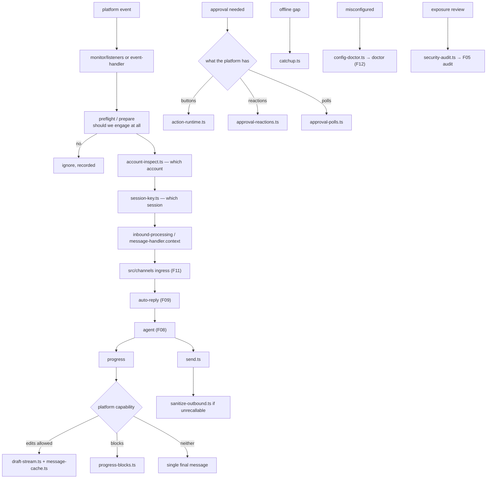

# F27 — messaging channel extensions

| | |
|---|---|
| describes | openclaw `v2026.10.3` @ `59cb44796b0f1f0daa0e37af8b1495abb45d9bc1` |
| paths | ~31 channel directories under `extensions/` |
| size | 4,727 tracked files · ~988,000 LOC — **the heaviest part of `extensions/`** |
| depth of read | five read in detail (`discord`, `telegram`, `slack`, `imessage`, `signal`); the rest surveyed by size and name |

## What it is, in plain English

The platform adapters: Discord, Telegram, Slack, Matrix, WhatsApp, iMessage, Signal, MS Teams, Feishu, Line, Google Chat, Mattermost, SMS, IRC, Twitch, Nostr, Tlon, Zalo, Synology Chat, IMAP and more.

And they are **enormous**: 988,000 LOC, larger than the gateway. That is the honest cost of "works on every platform" — the abstraction in `src/channels` (F11) is clean, and all the mess lives out here.

The five biggest:

| channel | non-test files | largest file |
|---|---|---|
| discord | 427 | `monitor/message-handler.preflight.ts` 35 KB |
| telegram | 310 | `channel.ts` 40 KB |
| slack | 248 | `monitor/message-handler/prepare.ts` **59 KB** |
| imessage | 117 | `monitor/monitor-provider.ts` **59 KB** |
| signal | 86 | `monitor/event-handler.ts` 49 KB |

## The common anatomy

Every channel plugin has the same contracts, which is why 31 of them can exist:

```
channel-plugin.ts / channel.ts / channel-entry.ts
channel-config.ts + config-api.ts + config-doctor.ts
secret-contract.ts                  ← what credentials it needs
security-contract.ts / security-audit.ts
doctor-contract.ts                  ← diagnosable by doctor (F12)
directory-contract.ts               ← user/channel directory
contract-api.ts / runtime-api.ts / test-api.ts
account-inspect.ts                  ← multi-account support
setup-plugin.ts / setup-entry.ts    ← the setup wizard steps
session-key.ts                      ← how a conversation maps to a session
action-runtime.ts                   ← buttons, reactions, interactions
monitor/                            ← inbound
send.ts                             ← outbound
```

Four of these are the interesting ones:

- **`secret-contract.ts`** — credentials are declared, not read ad hoc, feeding the secret-ref system (F05).
- **`security-audit.ts`** — each channel contributes to the security audit (F05). Exposure is reviewable per channel.
- **`doctor-contract.ts`** — each channel is diagnosable. This is why `openclaw doctor` can tell you a specific channel is misconfigured.
- **`account-inspect.ts`** — multi-account is a first-class concept, matching the account resolution in `src/routing` (F20).

## 1. Discord — 427 files, and a full voice stack

```
src/monitor/message-handler.preflight.ts      35 KB
src/voice/voice-runtime.ts                    29 KB   ←
src/channel.ts                                29 KB
src/voice/realtime-consults.ts                28 KB   ←
src/voice/realtime-speaker-session.ts         27 KB   ←
src/voice/realtime-playback.ts                27 KB   ←
src/monitor/model-picker.view.ts              26 KB
src/monitor/message-handler.context.ts        25 KB
src/monitor/listeners.ts                      25 KB
src/monitor/native-command-model-picker-interaction.ts 25 KB
src/monitor/native-command.ts                 24 KB
src/voice/voice-receive.ts                    24 KB   ←
```

**`src/voice/` is a complete realtime voice implementation** — receive, speaker session, playback, and its own `realtime-consults.ts`. Discord voice channels are multi-party, so this is the only voice implementation in the tree that handles **several speakers at once** (`realtime-speaker-session.ts`). Anyone building group voice should read it; anyone building one-to-one voice should prefer the simpler factories in `extensions/openai` (F26).

`message-handler.preflight.ts` (35 KB) is a preflight pass before handling — the pattern of deciding whether to engage before doing work, matching admission in F09/F11.

## 2. Telegram — 310 files, and streaming done properly

```
src/channel.ts                       40 KB
src/bot-message-context.session.ts   35 KB
src/bot/delivery.replies.ts          34 KB
src/draft-stream.ts                  34 KB   ←
src/action-runtime.ts                34 KB
src/message-cache.ts                 33 KB   ←
src/fetch.ts                         29 KB
src/bot-message-dispatch-delivery.ts 27 KB
src/bot-message-dispatch-reply.ts    25 KB
src/bot-handlers.callback-router.ts  24 KB
src/bot-native-command-menu.ts       24 KB
```

`draft-stream.ts` (34 KB) is the Telegram end of the progress-draft compositor (F11): Telegram allows message edits, so a reply can stream by repeated edit — and edits are rate-limited, hence `message-cache.ts` (33 KB). It also has its own `AGENTS.md` and a `miniapp-api.ts`.

## 3. Slack — 248 files, and 59 KB of "prepare"

```
src/monitor/message-handler/prepare.ts            59 KB   ← largest in the chunk
src/send.ts                                       46 KB
src/monitor/slash.ts                              46 KB
src/action-runtime.ts                             37 KB
src/monitor/events/interactions.block-actions.ts  36 KB
src/monitor/provider.ts                           31 KB
src/channel.ts                                    30 KB
src/monitor/message-handler/dispatch-progress.ts  29 KB
src/progress-blocks.ts                            23 KB
plus http-routes.ts, 6 skills/
```

`prepare.ts` at 59 KB is all the work of turning a Slack event into something answerable — threads, channels, DMs, mentions, bot loops, app_mention vs message, subtypes. `progress-blocks.ts` + `dispatch-progress.ts` render progress as Block Kit. It ships **six skills** of its own and its own HTTP routes.

## 4. iMessage — 117 files, and approvals as reactions and polls

```
src/monitor/monitor-provider.ts    59 KB
src/monitor/inbound-processing.ts  39 KB
src/send.ts                        37 KB
src/actions.ts                     31 KB
src/monitor/sanitize-outbound.ts   25 KB   ←
src/approval-handler.runtime.ts    24 KB   ←
src/approval-reactions.ts          21 KB   ←
src/approval-polls.ts              21 KB   ←
src/monitor/catchup.ts             16 KB
src/monitor-reply-cache.ts         16 KB
```

**Three approval modules.** iMessage has no buttons, so approvals are implemented as **reactions** and **polls** — 66 KB of making "approve this" work on a platform with no UI affordance for it. This is the fourth approval surface after channel buttons, native client and terminal, and the most constrained.

`sanitize-outbound.ts` (25 KB) matters on a platform where a message cannot be edited or recalled. `catchup.ts` handles messages that arrived while offline.

## 5. Signal — 86 files, and it installs its own CLI

```
src/monitor/event-handler.ts   49 KB
src/client-container.ts        26 KB   ← runs signal-cli in a container
src/config-compat.ts           26 KB
src/channel.ts                 22 KB
src/approval-reactions.ts      18 KB
src/setup-core.ts              16 KB
src/install-signal-cli.ts      12 KB   ← installs it
src/setup-transport.ts         12 KB
```

Signal has no bot API, so the plugin **installs and containerises `signal-cli`** — the same managed-dependency pattern as `llama-cpp` (F26) and `cua-computer`'s driver (F24). `config-compat.ts` at 26 KB is backward compatibility for its own config shape.

## Process flow — one platform message, generically



## Dependencies

**Out** — `ext/test-support` (44), `support/test` (5), `support/scripts` (3). **That is all.** Nearly a million lines of code with essentially no coupling into `src/`.

Everything goes through the 39 `channel-*` SDK subpaths (F10). This is the single most striking measurement in the whole pass: the channel abstraction holds completely.

## Risks and traps

1. **A fix in one channel is a fix in one channel.** 31 adapters, 988,000 LOC. Platform behaviour is not shared.
2. **Streaming depends on platform capability.** Edits (Telegram), blocks (Slack), nothing (iMessage). The capability matrix in F01 decides, and testing on one channel proves nothing about another.
3. **Approval affordances vary enormously.** Buttons, reactions, polls. Any new approval flow must degrade to reactions, because some platforms have nothing else.
4. **Unrecallable platforms need outbound sanitisation.** iMessage's 25 KB `sanitize-outbound.ts` exists because a sent message cannot be taken back.
5. **Some channels install external software.** Signal containerises `signal-cli`. That is a system change, with its own update and trust surface.
6. **Discord's voice stack is multi-party.** Do not copy it for one-to-one voice; it solves a harder problem than needed.
7. **Each channel has a `security-audit.ts` contribution.** Before judging exposure, run the audit rather than reading config.
8. **Multi-account is per channel.** `account-inspect.ts` plus `src/routing` (F20). A message answered by the wrong identity is a routing-plus-account question, not a channel bug.

## Verdict

The clearest demonstration of what a good abstraction buys. Nearly a million lines of platform-specific code sits behind 39 SDK subpaths with **no** relative imports into the core. Thirty-one platforms, each declaring its credentials, its security audit contribution, its doctor checks, its setup wizard steps and its multi-account story.

The cost is unavoidable and worth seeing plainly: 59 KB just to prepare a Slack event, 66 KB to make approvals work on a platform without buttons, 34 KB to stream a reply by editing a Telegram message without being rate-limited. The abstraction is clean because this is where all the reality went.
