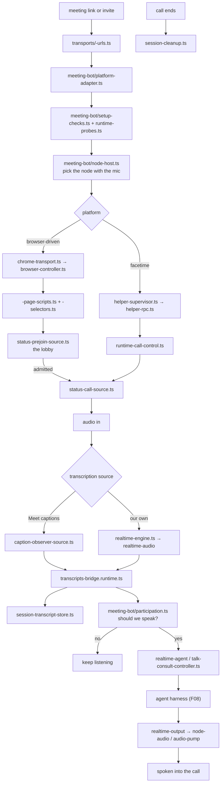

# F28 — meetings and realtime rooms

| | |
|---|---|
| describes | openclaw `v2026.10.3` @ `59cb44796b0f1f0daa0e37af8b1495abb45d9bc1` |
| paths | `src/meeting-bot/`, `extensions/google-meet/`, `extensions/zoom-meetings/`, `extensions/teams-meetings/`, `extensions/facetime/`, `extensions/slack-huddles/`, `extensions/nextcloud-talk/` |
| size | 440 tracked files · ~79,000 LOC |

## What it is, in plain English

openclaw can **join a meeting**. `src/meeting-bot/` is the host-side engine; the extensions are per-platform adapters, and all but one of them work by **driving a browser page**.

| path | non-test files | approach |
|---|---|---|
| `src/meeting-bot/` | 69 | the engine |
| `extensions/google-meet/` | 52 | browser page scripts + Meet API |
| `extensions/facetime/` | 60 | **a native macOS helper process** |
| `extensions/zoom-meetings/` | 16 | browser page scripts |
| `extensions/slack-huddles/` | 16 | browser page scripts |

## 1. `src/meeting-bot/` — the engine

```
status-call-source.ts            30 KB
session-runtime.ts               27 KB
node-host.ts                     24 KB   ← a meeting runs on a NODE
chrome-transport.ts              23 KB
realtime-engine.ts               22 KB
runtime-facade.ts                20 KB
browser-controller.ts            18 KB
transcripts-bridge.runtime.ts    18 KB
participation.ts                 18 KB   ←
platform-adapter.ts              16 KB
plugin-entry.ts                  15 KB
session-transcript-store.ts      15 KB
plus: realtime-{audio,output,node,local,browser,agent,tool},
      node-audio, sox-audio, voice-call, session-{types,factory,durable,
      cleanup,speech,transcript}, status-{prejoin,call},
      runtime-{setup,probes}, setup-checks, transcripts-bridge
```

Four things worth naming:

**`participation.ts` (18 KB).** Deciding when the bot should actually speak in a meeting. That is the genuinely hard problem of a meeting bot, and it is a named module rather than an afterthought.

**`node-host.ts` (24 KB).** A meeting is hosted on a **node** (F15) — the machine with the microphone, speakers and browser — not on the gateway. `node-audio.ts` and `sox-audio.ts` are the audio paths there.

**Five realtime surfaces**: `realtime-local`, `realtime-node`, `realtime-browser`, `realtime-agent`, `realtime-output`. Audio can be captured and played in several places, and the engine abstracts over which.

**`status-prejoin-*` and `status-call-*`.** Prejoin (the lobby, the "ask to join" screen) is modelled separately from being in the call. Every browser-driven platform implements both, because the lobby is where joining actually fails.

`transcripts-bridge.runtime.ts` feeds meeting speech into the transcript system (F04).

## 2. The browser-driven adapters

They share an identical five-module shape, which is how a new platform gets added cheaply:

```
transports/<platform>-urls.ts               recognise a meeting link
transports/<platform>-selectors.ts          DOM selectors
transports/<platform>-page-scripts.ts       scripts injected into the page
transports/<platform>-platform-adapter.ts   wire it to the engine
transports/<platform>-status-prejoin-source.ts
transports/<platform>-status-call-source.ts
```

**Google Meet** (52 files) is the most developed: `src/runtime.ts` (26 KB), `transports/google-meet-page-scripts.ts` (20 KB), `src/meet-api.ts` (15 KB) — so it uses both the official API and page automation — plus `google-meet-caption-observer-source.ts` (12 KB), which reads **Meet's own live captions** instead of transcribing audio. That is a clever shortcut: let the platform do the ASR.

It also has `cli-space-commands.ts` and `cli-export.ts`, so meetings are manageable and exportable from the CLI.

**Zoom** (16 files) and **Slack Huddles** (16 files) are the minimal version of the same shape — selectors, URLs, page scripts, prejoin and call status. Both are small because the engine does the work. `slack-huddles-status-prejoin-source.ts` at 15 KB is the largest file in either, which again says the lobby is the hard part.

## 3. `extensions/facetime` — the outlier, and the interesting one

```
src/runtime.ts                  27 KB
src/talk-driver.ts              23 KB   ←
src/helper-rpc.ts               21 KB   ←
src/setup.ts                    20 KB
src/audio-pump.ts               16 KB   ←
src/runtime-call-control.ts     15 KB
src/runtime-call-events.ts      14 KB
src/talk-consult-controller.ts  12 KB   ←
src/helper-supervisor.ts        11 KB   ←
src/call-events.ts              9.9 KB
src/preflight.ts                9.5 KB
plus 16 scripts/, 2 skills/, docs/, LICENSE, THIRD_PARTY_NOTICES
```

FaceTime has no browser page and no API, so this plugin **drives the native macOS app through its own helper process**:

- `helper-rpc.ts` + `helper-supervisor.ts` — a supervised out-of-process helper, spoken to over RPC
- `audio-pump.ts` — moving audio between the call and openclaw
- `talk-driver.ts` — the voice session on top of that
- `talk-consult-controller.ts` — when to consult the agent mid-call
- `preflight.ts` — check it can work before trying

**This is the closest existing precedent in the tree for giving an agent a spoken conversation through a local native application on macOS.** It ships its own LICENSE and THIRD_PARTY_NOTICES, which means the helper embeds third-party code — worth reading before copying.

The pairing of `talk-driver.ts` with `talk-consult-controller.ts` is the same split as `realtime-quicksilver-delegation-controller.ts` in `extensions/openai` (F26): the voice layer and the decision to defer to the brain are separate concerns, every time.

## Process flow — joining and participating in a meeting



## Dependencies

**Out** — `core/plugins` (39), `core/talk` (34), `core/transcripts` (17), `core/shared` (15), `core/infra` (13), `core/config` (12), `core/plugin-sdk` (11), `core/plugin-state` (8).

The 34 edges into `core/talk` are the notable ones: meetings reuse the voice contracts from F16 rather than inventing their own.

**In** — little. These are leaf features.

## Risks and traps

1. **Browser-driven adapters depend on DOM selectors.** `<platform>-selectors.ts` breaks whenever the platform redesigns. That is a maintenance commitment, not a bug.
2. **The lobby is where joining fails.** Prejoin is modelled separately for a reason; test the lobby, not just the call.
3. **A meeting runs on a node.** `node-host.ts`. The gateway does not have the microphone. Debugging audio means debugging the node (F15).
4. **Five realtime surfaces means five audio paths.** Local, node, browser, agent, output. A fix in one is not a fix in all.
5. **`participation.ts` is the module that decides whether the bot talks.** Any complaint that the bot interrupted, or never spoke, is here first.
6. **FaceTime runs a supervised native helper with embedded third-party code.** Read its LICENSE and THIRD_PARTY_NOTICES before reusing any of it.
7. **Using platform captions outsources ASR to the platform.** Cheaper and often better, but it means transcript quality and availability are not under openclaw's control.
8. **Meetings record speech.** Transcripts flow into the transcript store. Consent and retention are a policy question this code does not answer.

## Verdict

A well-factored engine with cheap per-platform adapters: five small modules and a new meeting platform is supported, because selectors, prejoin status, call status and page scripts are the only things that differ. Reusing the platform's own live captions instead of transcribing is the kind of pragmatism that keeps a feature like this affordable.

`extensions/facetime` is the one to read for a different reason. It is the proof that openclaw can drive a native macOS application through a supervised helper process, with an audio pump and a consult controller — a working precedent for a spoken conversation routed through a local app rather than a web page.
