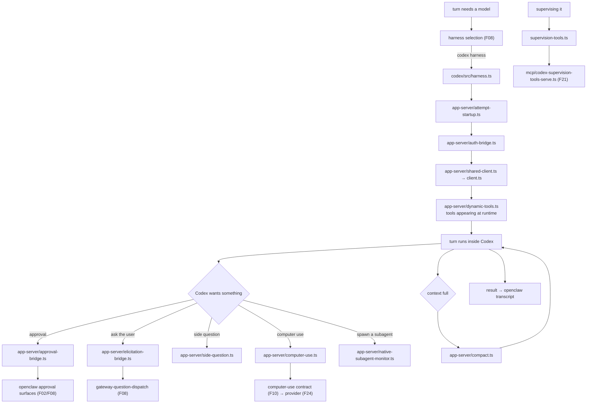

# F29 — coding agent extensions

| | |
|---|---|
| describes | openclaw `v2026.10.3` @ `59cb44796b0f1f0daa0e37af8b1495abb45d9bc1` |
| paths | `extensions/{codex,copilot,github-copilot,copilot-proxy,opencode,opencode-go,kimi-coding,clawrouter,code-mode-quickjs,diffs,diffs-language-pack,typesafe,github}/` |
| size | 1,347 tracked files · ~388,000 LOC |

## What it is, in plain English

openclaw hosting *other coding agents* as its brain, plus the tooling around code review. `extensions/codex` alone is 523 non-test files — **the largest single extension in the repo**.

## 1. `extensions/codex` — 523 non-test files, almost all bridges

```
src/app-server/native-subagent-monitor.ts   79 KB   ← largest extension file in the repo
src/app-server/shared-client.ts             54 KB
src/app-server/auth-bridge.ts               49 KB
src/app-server/side-question.ts             44 KB
src/app-server/approval-bridge.ts           44 KB
src/supervision-tools.ts                    37 KB
src/app-server/dynamic-tools.ts             35 KB
src/app-server/computer-use.ts              35 KB   ←
src/app-server/attempt-startup.ts           34 KB
src/app-server/elicitation-bridge.ts        34 KB
src/app-server/client.ts                    34 KB
src/app-server/compact.ts                   33 KB
```

**The pattern is one bridge per concern**, and the list is the honest cost of hosting a foreign agent:

| bridge | what it reconciles |
|---|---|
| `auth-bridge.ts` | two auth models |
| `approval-bridge.ts` | Codex's approval prompts → openclaw's approval surfaces |
| `elicitation-bridge.ts` | Codex asking the user something |
| `event-bridge` / `client.ts` | two event streams |
| `dynamic-tools.ts` | tools that appear at runtime |
| `computer-use.ts` | Codex's computer use → openclaw's contract (F10/F24) |
| `compact.ts` | two notions of context compaction |
| `side-question.ts` | a question asked outside the main turn |

`native-subagent-monitor.ts` at 79 KB is the biggest file in any extension: watching subagents that a hosted agent spawns. When you host an agent that spawns its own agents, somebody has to account for them.

`supervision-tools.ts` (37 KB) pairs with `src/mcp/codex-supervision-tools-serve.ts` (F21) — a narrowed tool set specifically for supervising Codex, served over MCP.

**The lesson is reusable:** hosting a foreign agent is not an adapter, it is roughly eight bridges, and the ones people forget are approval, elicitation and subagent accounting.

## 2. `extensions/copilot` — 41 non-test files

```
harness.ts                        42 KB   ← registers as an agent harness
src/event-bridge.ts               29 KB
src/tool-bridge.ts                25 KB
src/attempt-transcript-journal.ts 24 KB   ←
src/attempt-execution.ts          23 KB
src/attempt-config.ts             16 KB
src/byok-proxy.ts                 11 KB   ← bring your own key
src/isolated-completion.ts        11 KB
src/provider-bridge.ts            10 KB
src/runtime.ts                    9.8 KB
src/event-bridge-transcript.ts    9.7 KB
```

Same shape, smaller: event bridge, tool bridge, provider bridge, registered through `agent-harness-registration` (F10). `attempt-transcript-journal.ts` journals each attempt — the attempt model from F08 carried through. `byok-proxy.ts` proxies a user's own key into Copilot.

## 3. `extensions/opencode` — 17 non-test files, and it is a catalogue

```
session-catalog.ts              20 KB
session-upstream-activity.ts    15 KB
session-catalog-plugin.ts       13 KB
stream.ts                       9.0 KB
index.ts                        7.0 KB
provider-catalog.ts             4.2 KB
```

Like `extensions/anthropic` (F26), most of it is **discovering existing local sessions** rather than running anything — three `session-catalog*` modules plus `session-upstream-activity.ts`. openclaw repeatedly invests in *finding* the coding sessions already on your machine.

## 4. `extensions/clawrouter` — 11 non-test files

```
provider-catalog.ts  14 KB
index.ts             10 KB
usage.ts             6.4 KB
stream.ts            5.7 KB
tool-schemas.ts      4.1 KB
```

A thin router/aggregator provider — catalogue, stream, usage, tool schemas. The minimal provider shape from F26.

## 5. `extensions/diffs` — 23 non-test files, a diff viewer with its own web UI

```
src/viewer-client.ts            19 KB
src/render.ts                   19 KB
src/browser.runtime.ts          18 KB
src/store.ts                    15 KB
src/tool.ts                     14 KB
src/config.ts                   11 KB
src/http.ts                     8.4 KB
src/language-hints.ts           4.5 KB
src/shiki-curated-languages.ts  3.8 KB   ← a curated language set
src/viewer-assets.ts · src/plugin.ts · src/types.ts
plus skills/ and extensions/diffs-language-pack
```

A diff viewer served over HTTP with Shiki syntax highlighting, a **curated** language list (not all of Shiki — a deliberate bundle-size decision), a separate language pack extension, and a skill. The second example after `workboard` (F23) of an extension shipping a browser UI.

## 6. `extensions/github` — 18 non-test files

```
src/github-api.ts       20 KB
src/detail.ts           19 KB
src/preview.ts          15 KB
src/detail-checks.ts    7.1 KB   ← CI checks
src/targets.ts          4.2 KB
src/handlers.ts         3.7 KB
src/image.ts            2.6 KB
src/view-model.ts · src/preview-contract.ts · src/upgrade.ts
```

Link *understanding* for GitHub: a pasted PR or issue URL becomes a rendered preview with detail and CI check status, including an image. It complements `src/link-understanding` (F17) and `boards/github-actions-capability.ts` (F23).

## Process flow — hosting Codex as the brain



## Dependencies

**Out** — `ext/openai` (1), `support/scripts` (1), `ext/test-support` (1). Essentially nothing.

The largest extension in the repo, 388,000 LOC across this chunk, with three outbound relative imports in total. Everything else is the SDK surface.

## Risks and traps

1. **Hosting a foreign agent costs about eight bridges.** Auth, approval, elicitation, events, tools, computer use, compaction, subagents. Any plan to "just plug in agent X" should budget for all of them — and the ones most often forgotten are approval, elicitation and subagent accounting.
2. **A hosted agent's approval prompts must be bridged, not bypassed.** `approval-bridge.ts` is 44 KB because a foreign agent's idea of "ask the user" has to become openclaw's. A bridge that auto-answers is a silent privilege escalation.
3. **Hosted agents spawn subagents.** 79 KB of monitoring exists for this. Resource accounting and cancellation have to reach them.
4. **Two compaction models can fight.** `compact.ts` reconciles Codex's with openclaw's; getting this wrong loses context silently.
5. **A hosted agent may have its own computer use.** `app-server/computer-use.ts` routes it through openclaw's contract. If it did not, there would be a second, ungated path to the desktop.
6. **`byok-proxy.ts` proxies the user's key.** A credential passing through a bridge is a credential to audit — see F05's sentinel/egress option.
7. **Session catalogues read local state.** `opencode` and `anthropic` scan for existing sessions on disk. Useful, and worth knowing they read outside openclaw's own directories.

## Verdict

The chunk that shows what interoperability actually costs. `extensions/codex` is bigger than the TUI, bigger than `src/secrets`, bigger than every channel except Discord and Telegram — and it is almost entirely bridges, because hosting someone else's agent means reconciling their auth, approvals, elicitation, events, tools, compaction, computer use and subagents with yours.

The encouraging part is that it is all done through the plugin SDK, with three relative imports into the core across the whole chunk. The discouraging part is the number: if hosting one foreign agent costs 523 files, "support every agent" is not a roadmap item.
