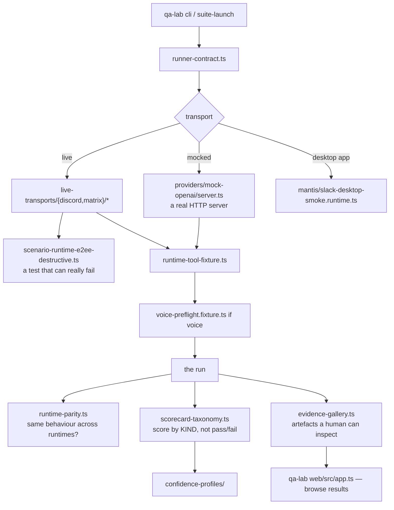
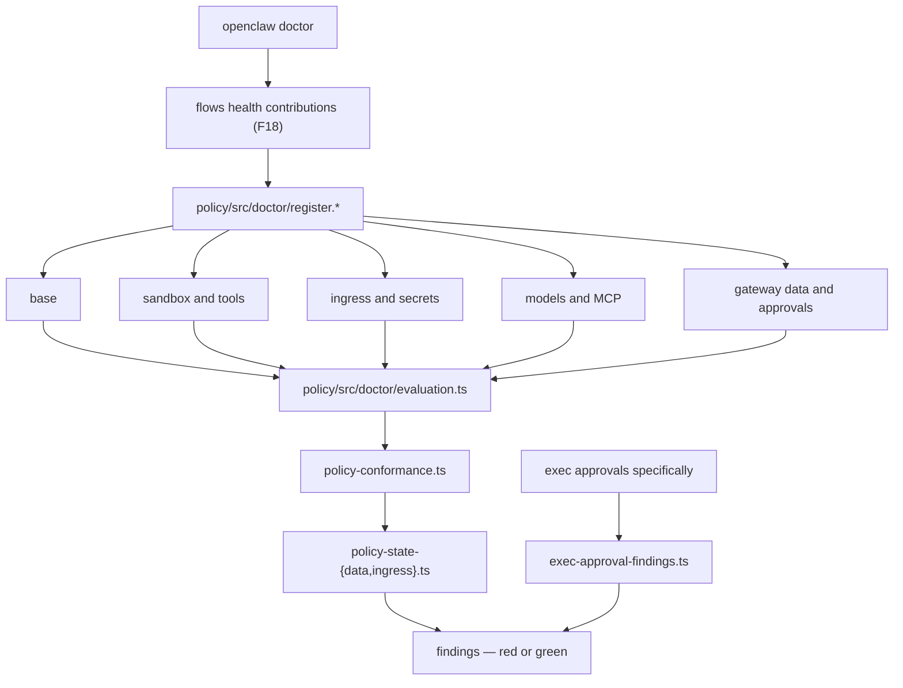

# F30 — QA lab, policy, diagnostics, access

| | |
|---|---|
| describes | openclaw `v2026.10.3` @ `59cb44796b0f1f0daa0e37af8b1495abb45d9bc1` |
| paths | `extensions/{qa-lab,qa-channel,policy,reef,diagnostics-otel,diagnostics-prometheus,radius,visitor-access}/` |
| size | 1,126 tracked files · ~288,000 LOC |

## What it is, in plain English

How openclaw tests itself, proves it conforms to policy, exports telemetry, and controls who may reach it.

## 1. `extensions/qa-lab` — 439 non-test files of test *infrastructure*

```
src/providers/mock-openai/server.ts                    97 KB   ← a mock OpenAI server
src/voice-preflight.fixture.ts                         73 KB   ←
src/cli.runtime.ts                                     60 KB
src/suite-launch.runtime.ts                            59 KB
web/src/app.ts                                         55 KB   ← its own web UI
src/scorecard-taxonomy.ts                              48 KB   ←
src/mantis/slack-desktop-smoke.runtime.ts              47 KB
src/runtime-parity.ts                                  46 KB   ←
src/live-transports/matrix/scenarios/
    scenario-runtime-e2ee-destructive.ts               44 KB   ←
src/live-transports/discord/discord-live.runtime.ts    34 KB
src/evidence-gallery.ts                                34 KB   ←
src/runtime-tool-fixture.ts                            34 KB
plus: web/ (30 files), confidence-profiles/, shared/,
      runner-contract.ts, model-selection.ts, bus-api.ts, gateway-entry.ts
```

Six things here are worth more than most production code:

**A 97 KB mock OpenAI server.** Tests run against a real HTTP server that behaves like OpenAI, including streaming. That is how you test transport behaviour — continuations, replays, truncation (F20) — without a live account or flaky network.

**A 73 KB voice preflight fixture.** The voice path has the largest single fixture in the suite, which tracks: voice is the hardest thing here to test, and it has been invested in rather than skipped.

**`scorecard-taxonomy.ts` (48 KB).** Results are scored against a taxonomy, not reduced to pass/fail. A taxonomy means a regression can be described by *kind*.

**`runtime-parity.ts` (46 KB).** Parity between runtimes is asserted. Given the repo's platform branches — three service managers, four sandbox backends, two node hosts, Windows and Bun paths — a parity suite is the only honest way to claim cross-platform support.

**`evidence-gallery.ts` (34 KB).** Runs produce *evidence* — artefacts a human can look at — collected into a gallery. Same instinct as decision receipts (F04), admission evidence (F11) and REM evidence (F22): record why, not just what.

**Live destructive scenarios.** `live-transports/matrix/scenarios/scenario-runtime-e2ee-destructive.ts` (44 KB) and `discord-live.runtime.ts` (34 KB) run against real services, including a destructive end-to-end-encryption scenario. These are the red controls — tests that can genuinely fail against reality rather than against a mock.

`confidence-profiles/` suggests results carry a confidence level. `mantis/slack-desktop-smoke.runtime.ts` drives the actual Slack desktop app.

## 2. `extensions/policy` — 68 non-test files: conformance as doctor checks

```
src/doctor/register.base.test-utils.ts                    59 KB
src/doctor/register.sandbox-and-tools.test-utils.ts       54 KB
src/doctor/register.ingress-and-secrets.test-utils.ts     51 KB
src/doctor/register.models-and-mcp.test-utils.ts          43 KB
src/doctor/register.gateway-data-and-approvals.test-utils.ts 37 KB
src/policy-conformance.ts                                 16 KB
src/cli.ts                                                16 KB
src/policy-state-data.ts                                  15 KB
src/doctor/metadata.ts                                    15 KB
src/doctor/evaluation.ts                                  14 KB
src/doctor/exec-approval-findings.ts                      14 KB
src/policy-state-ingress.ts                               14 KB
```

**Five policy domains, each registered as doctor checks** (the contribution framework from F18):

1. **base** — general posture
2. **sandbox and tools** — what code may run
3. **ingress and secrets** — what reaches in, what credentials exist
4. **models and MCP** — which models and tool servers are permitted
5. **gateway data and approvals** — what the gateway stores and how approvals work

`policy-conformance.ts` is the evaluator; `exec-approval-findings.ts` reports specifically on exec approvals; `policy-state-ingress.ts` and `policy-state-data.ts` hold the assessed state.

**This is the right place for any organisational rule to live.** A standing rule — "the gateway is never public", "credentials never sit in config", "nothing runs as root" — expressed here becomes a check that shows up in `openclaw doctor` and can go red, rather than a sentence in a document. The five domains already cover most of what such rules are about.

The `.test-utils.ts` naming on 244 KB of registration code is odd and worth noting: these read as the registration surface, not as tests.

## 3. `extensions/diagnostics-otel` — 30 non-test files, OpenTelemetry

```
src/service.ts                        27 KB
src/service-recorders-tools.ts        15 KB
src/service-recorders-operations.ts   15 KB
src/service-traces.ts                 14 KB
src/service-recorders-usage.ts        13 KB
src/service-genai-content.ts          13 KB   ←
src/service-metrics.ts                10 KB
src/service-recorders-harness.ts      9.3 KB
src/service-genai-attributes.ts       8.0 KB   ←
src/service-attributes.ts · service-exporter.ts · service-logs.ts
```

Traces, metrics and logs, with **GenAI semantic conventions** (`service-genai-attributes.ts`, `service-genai-content.ts`) — the OpenTelemetry standard for model calls, so prompts, completions, token counts and model names land on the conventional attributes rather than ad hoc ones.

`service-genai-content.ts` is the one to think about before enabling: exporting GenAI *content* means prompts and completions leave the process. That belongs behind the same consideration as the redaction rules in F04.

There is also `diagnostics-prometheus` for a metrics-only deployment.

## 4. `extensions/reef` — 53 non-test files, a channel with a trust store

```
src/transport.ts             28 KB
src/doctor-durable-state.ts  27 KB
src/trust-store.ts           23 KB   ←
doctor-contract-api.ts       23 KB
src/cli.ts                   22 KB
src/channel.ts               20 KB
src/owner-notice.ts          16 KB
src/state.ts                 16 KB
src/audit-state.ts           15 KB
src/flow.ts                  15 KB
src/replay-store.ts          14 KB   ←
src/setup.ts                 14 KB
plus protocol/ (12 files)
```

Its own `protocol/` directory, a **trust store**, a **replay store**, audit state, durable state with a doctor, and an owner notice. The shape of a federated or peer-to-peer channel: you must decide who to trust, keep an audit, and survive replay. More machinery devoted to trust and audit than to transport.

## 5. `extensions/visitor-access` — 17 non-test files

```
src/visitors.ts     28 KB
src/cloudflare.ts   10 KB   ← Cloudflare Access
src/access.ts       6.1 KB
src/tools.ts        5.3 KB
src/roles.ts        2.1 KB   ←
src/tool-results.ts · src/config.ts · src/runtime.ts · src/errors.ts
```

Visitors with **roles**, integrated with Cloudflare Access. This is how someone who is not the owner gets scoped access — the counterpart to `gateway-origin-scope.ts` (F07) and the `visitor-access` schema. `radius/` is the other access-control extension.

## Process flow — a QA run



## Process flow — policy conformance



## Dependencies

**Out** — `ui` (8), `support/scripts` (5), `support/test` (4), `pkg/ai` (2), `pkg/gateway-protocol` (1), `ext/test-support` (1).

Almost nothing, again. 288,000 LOC with under 25 relative imports into the rest of the tree.

## Risks and traps

1. **Express organisational rules as policy checks, not documents.** `extensions/policy` already covers sandbox/tools, ingress/secrets, models/MCP and gateway data/approvals. A rule that lives only in prose cannot go red.
2. **Mock tests and live tests prove different things.** The mock OpenAI server proves transport handling; the live destructive scenarios prove reality. Both are needed and neither substitutes.
3. **`service-genai-content.ts` exports prompts and completions.** Enabling GenAI content export sends conversation content to a telemetry backend. Treat it like any other egress decision.
4. **`runtime-parity.ts` is the only guard on cross-platform claims.** Given three service managers and four sandbox backends, a feature not covered by parity is a feature verified on one platform.
5. **Scorecards and confidence profiles mean results are graded.** "The suite passed" is less informative than the scorecard; read the taxonomy.
6. **`reef` carries a trust store and a replay store.** Any federated channel needs both. Enabling it is a trust decision, not a connectivity one.
7. **`visitor-access` grants non-owners scoped access.** Roles plus Cloudflare Access. Worth auditing alongside gateway origin scope before anyone outside is let in.
8. **244 KB of policy registration is named `.test-utils.ts`.** Do not assume files with that suffix here are test-only.

## Verdict

The quality infrastructure is better than most products ship: a real mock provider server, live destructive scenarios against Matrix and Discord, desktop-app smoke tests, runtime parity assertions, scorecards with a taxonomy and confidence profiles, an evidence gallery with its own browser UI, and the largest fixture in the suite devoted to voice.

And `extensions/policy` is the piece most worth adopting deliberately. It turns policy into doctor checks across five domains that already map onto the questions any operator actually has — what can run, what reaches in, what credentials exist, which models are allowed, what the gateway keeps and how approvals work. A rule written there can fail. A rule written in a document cannot.
