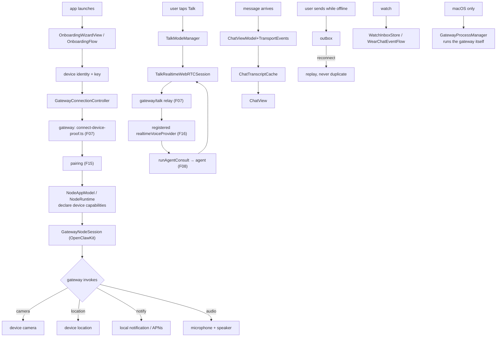

# F31 — native apps

| | |
|---|---|
| describes | openclaw `v2026.10.3` @ `59cb44796b0f1f0daa0e37af8b1495abb45d9bc1` |
| paths | `apps/macos/`, `apps/ios/`, `apps/android/`, `apps/linux/`, `apps/shared/`, `apps/swabble/`, `apps/macos-mlx-tts/` |
| size | 2,991 tracked files · 1,527 Swift · 609 Kotlin · plus Rust |

## What it is, in plain English

Four native clients and a shared Swift package. These are **not** thin wrappers around the web UI — each is a substantial application, and each can act as a **node** (F15) offering its device's capabilities to the gateway.

| app | files | platform |
|---|---|---|
| `apps/android/` | 930 | Kotlin · phone + **Wear OS** |
| `apps/macos/` | 756 | Swift · 442 sources, 294 tests |
| `apps/ios/` | 633 | Swift · iPhone + **watchOS** + widget + share extension |
| `apps/shared/` | 507 | Swift · `OpenClawKit`, shared by macOS and iOS |
| `apps/linux/` | 128 | **Rust + Tauri** |

## Headline finding: Talk Mode already exists on the clients

```
apps/ios/Sources/Voice/TalkModeManager.swift            204 KB
apps/ios/Sources/Voice/TalkRealtimeWebRTCSession.swift   63 KB
apps/android/.../voice/TalkModeManager.kt                125 KB
apps/android/.../voice/TalkModeManagerTest.kt            166 KB
apps/shared/OpenClawWatchRTC/                            (watch RTC)
apps/macos-mlx-tts/                                      (on-device MLX TTS)
```

**204 KB of Talk Mode on iOS, with a WebRTC realtime session.** The client half of conversational voice is built, tested (166 KB of Android Talk Mode tests alone) and shipped. It speaks the `webrtc` transport from the `talk.realtime.*` schema (F01) and the realtime voice contract (F16).

The consequence for anyone wanting conversational voice with a local model: **the work is a gateway-side realtime voice provider, not an app change.** The app will drive whatever provider is registered. `apps/macos-mlx-tts` further shows an on-device MLX TTS path already exists as its own component.

## 1. `apps/shared/OpenClawKit` — the real shared library

```
Sources/OpenClawChatUI/ChatViewModel.swift            74 KB
Sources/OpenClawKit/GatewayNodeSession.swift          70 KB
Sources/OpenClawKit/GatewayChannel.swift              69 KB
Sources/OpenClawChatUI/ChatTranscriptCache.swift      67 KB
Sources/OpenClawChatUI/ChatView.swift                 63 KB
Sources/OpenClawChatUI/ChatViewModel+TransportEvents.swift 63 KB
Sources/OpenClawChatUI/ChatComposer.swift             62 KB

Tests/ChatViewModelTests.swift                       629 KB   ← largest file in the repo
Tests/GatewayNodeSessionTests.swift                  170 KB
Tests/ChatTranscriptCacheStoreTests.swift            128 KB
Tests/ChatViewModelOutboxTests.swift                 123 KB
Tests/ChatViewModelSessionActionTests.swift           65 KB
```

**`ChatViewModelTests.swift` at 629 KB is the single largest file in the entire repository** — larger than any source file, larger than the 189 KB English locale. The chat view model has more test code than most modules have code.

That is not excess. `ChatViewModel+TransportEvents.swift` and `ChatViewModelOutboxTests.swift` name the reason: a mobile chat client has to reconcile an unreliable event stream while offline, retry from an outbox, and never show the user a wrong or duplicated message. It is the same problem the web client solves with session projections (F06) and the same doctrine `ui/AGENTS.md` writes down (F25) — solved a third time, in Swift.

`GatewayNodeSession.swift` (70 KB) is the node side: an iPhone or Mac offering camera, location, notifications and audio to the gateway.

## 2. `apps/macos` — 756 files, and it manages the gateway

```
Sources/OpenClaw/DashboardManager.swift          78 KB
Sources/OpenClaw/OnboardingAISetup.swift         77 KB
Sources/OpenClaw/GatewayProcessManager.swift     74 KB   ←
Sources/OpenClaw/GatewayConnection.swift         74 KB
Sources/OpenClaw/AppState.swift                  69 KB
Sources/OpenClaw/DashboardWindowController.swift 68 KB

Tests/OnboardingAISetupTests.swift              299 KB
Tests/GatewayProcessManagerTests.swift          184 KB
Tests/MacNodeCodexThreadCatalogTests.swift       84 KB
Tests/BundledGatewayPreparationTests.swift       79 KB
Tests/GatewayConnectionControlTests.swift        78 KB
```

The macOS app **runs and supervises the gateway process itself** (`GatewayProcessManager.swift`, plus `BundledGatewayPreparationTests` — it ships a bundled gateway). So on a Mac the app is not a client of a separately-installed daemon; it can be the thing that installs, prepares, starts and supervises it.

That is also why F24's finding matters: computer-use control on macOS is **app-gated**. The app owns the process and the permissions, which is why remote config deliberately cannot switch native control on.

`OnboardingAISetupTests.swift` at 299 KB says onboarding is where users get stuck, and it has been tested accordingly. `MacNodeCodexThreadCatalog` connects to the Codex session catalogue work in F29.

It has its own `AGENTS.md` and a `.periphery.yml` (dead-code detection).

## 3. `apps/ios` — 633 files across five targets

```
Sources/Model/NodeAppModel.swift           451 KB   ← largest source file in the repo
Tests/NodeAppModelInvokeTests.swift        421 KB
Sources/Voice/TalkModeManager.swift        204 KB
Tests/GatewayConnectionControllerTests.swift 141 KB
UITests/OpenClawSnapshotUITests.swift      108 KB
Sources/Gateway/GatewayConnectionController.swift 72 KB
Tests/GatewayConnectionSecurityTests.swift  68 KB
WatchApp/Sources/WatchInboxStore.swift      65 KB
Sources/Voice/TalkRealtimeWebRTCSession.swift 63 KB
Sources/Onboarding/OnboardingWizardView.swift 63 KB

targets: Sources (244) · WatchApp (80) · ShareExtension (29) ·
         ActivityWidget (25) · UITests (10) · WatchTests (4)
also: fastlane/ (24), DESIGN, CHANGELOG, APP-REVIEW-NOTES-APPLE,
      AGENTS.md, .swiftlint.yml, .periphery.yml, Signing.xcconfig
```

**`NodeAppModel.swift` at 451 KB is the largest source file in the repository**, with a 421 KB test file beside it. It is the phone acting as a node — every capability the device can offer and every invocation it can serve. `GatewayConnectionSecurityTests.swift` (68 KB) tests the security of the connection specifically.

A watch app with its own inbox store, an activity widget (Live Activities), a share extension, snapshot UI tests and a fastlane pipeline. This is a shipping consumer app, with `APP-REVIEW-NOTES-APPLE` to prove it.

## 4. `apps/android` — 930 files, Kotlin, phone and Wear

```
app/.../NodeRuntime.kt                     396 KB   ← the Android node
app/.../chat/ChatController.kt             391 KB
app/.../ui/chat/ChatScreen.kt              196 KB
app/.../ui/OnboardingFlow.kt               133 KB
app/.../ui/SettingsScreens.kt              130 KB
app/.../voice/TalkModeManager.kt           125 KB

tests: ChatComposerLayoutTest.kt 316 KB · TalkModeManagerTest.kt 166 KB ·
       WearChatEventFlowTest.kt 135 KB · GatewayBootstrapAuthTest.kt 127 KB ·
       NodeForegroundServiceTest.kt 126 KB · ChatControllerOutboxTest.kt 118 KB

also: wear/ (87) · wear-shared/ (8) · benchmark/ (3) ·
      THIRD_PARTY_LICENSES/ (96 files) · GATEWAY_AUTH_POLICY · AGENTS.md
```

Full parity with iOS including Wear OS. `NodeForegroundServiceTest.kt` is the Android-specific problem: staying alive as a node requires a foreground service. `ChatControllerOutboxTest.kt` is the same outbox pattern as Swift and the web — **three independent implementations of "never lose or duplicate a message"**.

`GATEWAY_AUTH_POLICY` as a top-level document, and 96 third-party licence files.

## 5. `apps/linux` — 128 files, Rust and Tauri

```
src-tauri/src/gateway_windows.rs       192 KB
src-tauri/src/gateway_ws.rs            170 KB
src-tauri/src/main.rs                  143 KB
src-tauri/src/quickchat.rs              91 KB   ←
src-tauri/src/remote_gateway.rs         86 KB
src-tauri/src/native_browser_platform.rs 85 KB
src-tauri/src/quickchat_widgets.rs      44 KB
src-tauri/src/updater.rs                40 KB
src-tauri/src/native_browser.rs         33 KB
src-tauri/src/gateway_profiles.rs       32 KB
src-tauri/src/gateway_device_identity.rs 32 KB
src-tauri/src/gateway_sleep.rs          29 KB
plus ui/ (16), omarchy/ (9), tests/ (13)
```

Tauri rather than Electron, so Rust plus a web view. `quickchat.rs` + `quickchat_widgets.rs` (135 KB) is a quick-chat overlay with widgets. `gateway_device_identity.rs` is the device-key side of pairing (F15). `gateway_sleep.rs` handles suspend/resume — the reconnect problem from the Rust node host (F15), again.

`gateway_windows.rs` being the largest file in a directory called `linux` is worth a second look; `native_browser_platform.rs` suggests per-platform browser integration lives there too.

## Process flow — a phone as a node, with Talk Mode



## Dependencies

**Out** — `support/scripts` (2). These are separate builds (SwiftPM, Gradle, Cargo) that speak the gateway protocol over the wire; they do not import the TypeScript tree at all.

## Risks and traps

1. **Talk Mode is client-side and already built.** Do not plan an app change for conversational voice; plan a gateway-side provider. The app drives whichever provider is registered.
2. **Three independent outbox implementations** — Swift, Kotlin, TypeScript. A message-delivery bug may be fixed in one and present in two.
3. **The macOS app can own the gateway process.** On a Mac, "restart the gateway" may mean the app, not a daemon. And native computer-use control is app-gated by design (F24).
4. **Four clients, four release pipelines.** fastlane for iOS and Android, Tauri's updater for Linux, Sparkle appcasts at the repo root for macOS. A protocol change is four releases.
5. **Test files dwarf sources.** 629 KB for one view model's tests, 421 KB for the iOS node model's. Changing those components means engaging with that suite.
6. **Staying alive differs per platform.** Android needs a foreground service; iOS has background limits; Linux needs sleep handling. "The node went away" is a platform question.
7. **Watch targets are real code.** iOS WatchApp (80 files) and Android wear (87). A feature touching notifications or inbox may need both.
8. **96 third-party licence files on Android.** Any dependency change there has a compliance step.

## Verdict

Four serious native clients, not wrappers. The shared Swift package carries chat, transport reconciliation and a transcript cache for both Apple platforms; each phone is a full node offering camera, location, notifications and audio; both mobile apps ship watch companions; and the macOS app can install, prepare and supervise the gateway itself.

The finding that matters most is the quietest: 204 KB of Talk Mode and a WebRTC realtime session already sit in the iOS app, with 166 KB of tests on the Android equivalent. The client side of conversational voice is done. Whatever answers on the other end of that WebRTC session is a gateway-side choice.
