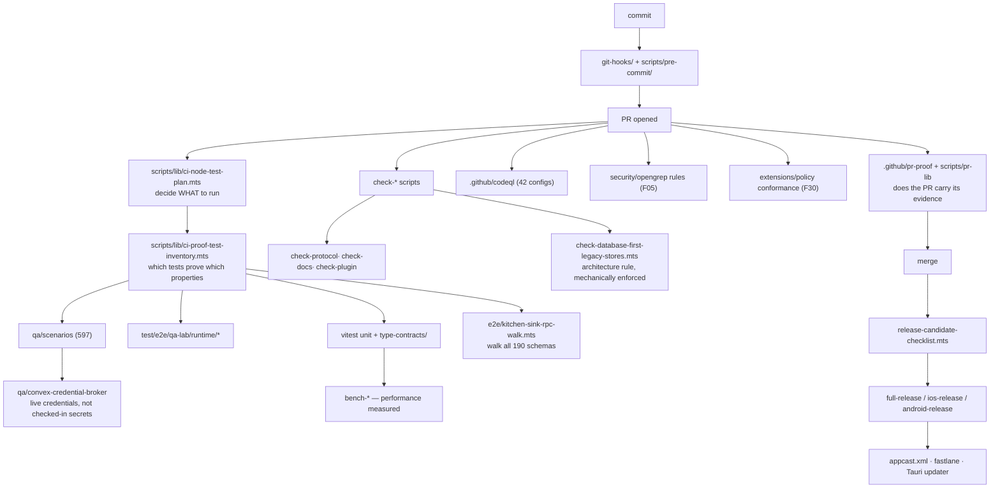

# F32 — docs and support infrastructure

| | |
|---|---|
| describes | openclaw `v2026.10.3` @ `59cb44796b0f1f0daa0e37af8b1495abb45d9bc1` |
| paths | `docs/`, `test/`, `qa/`, `scripts/`, `tools/`, `.github/`, `examples/`, `patches/`, `git-hooks/`, `deploy/` |
| size | 6,228 tracked files · ~1,188,000 LOC |

## 1. `docs/` — 1,408 files, which corrects an earlier assumption

```
plugins/    337
gateway/    160
tools/      117
channels/   109
cli/        102
providers/   89
concepts/    79
reference/   71
install/     43
help/        38
releases/    36
.i18n/       34
plus: docs_map.md, prose.md, network.md, logging.md, ci.md,
      date-time.md, auth-credential.md, agent-runtime.md,
      openclaw-agent.md, vps.md, AGENTS.md
```

Earlier chunks in this pass noted repeatedly that a capability "is not in the documentation". With 1,408 doc files and 337 of them on plugins, that framing needs correcting: **the documentation is extensive. The problem is discoverability, not absence.**

The specific capabilities this pass found undocumented-in-practice — the secret egress proxy (F05), `computer.act` (F07/F10), the delegation controller (F26), the doctor repair subsystem (F12) — may well be described in here somewhere. What is missing is a map from "I want to do X" to the right file. `docs_map.md` and `docs/reference/` are the attempts at it.

`docs/.i18n/` means the docs are translated too, on top of the 18 UI locales and 3 wizard locales.

**Practical note for anyone doing this kind of survey:** check `docs/plugins/` and `docs/reference/` *before* concluding something is undocumented. The source tree is authoritative for behaviour; the docs are better than their reputation for intent.

## 2. `test/` — 651 non-test support files for the test suite itself

```
vitest/          227
fixtures/        144
helpers/         101
e2e/              98
scripts/          37
type-contracts/   16   ←
mocks/ types/ tsconfig/
```

```
helpers/sqlite-sessions-transcripts-flip-proof.ts        89 KB   ←
helpers/openclaw-test-instance.ts                        48 KB
helpers/agents/happy-path-prompt-snapshots.ts            42 KB
e2e/qa-lab/runtime/gateway-codex-heartbeat-compaction.ts  49 KB
e2e/qa-lab/runtime/qa-otel-smoke-runtime.ts               41 KB
e2e/qa-lab/runtime/subagent-lineage-inspection.ts         35 KB
e2e/qa-lab/runtime/gateway-config-hot-reload-runtime.ts   35 KB
e2e/qa-lab/runtime/media-talk-gateway.ts                  32 KB
e2e/qa-lab/runtime/worker-inference-generation-reload.ts  32 KB
e2e/qa-lab/runtime/gateway-tls-pinning.ts                 30 KB
e2e/qa-lab/plugins/plugin-lifecycle-probe-runtime.ts      30 KB
```

Three things worth naming:

**`type-contracts/` (16 files).** Type-level contracts are asserted as tests — a compile-time contract that fails loudly rather than drifting.

**`sqlite-sessions-transcripts-flip-proof.ts` (89 KB).** A *proof* that flipping the session transcript store works. The word "proof" recurs across this repo's tooling, and it means something specific: not a test that passes, but evidence that a property holds.

**The e2e list is a reading list of what is hard.** Heartbeat compaction, config hot reload, subagent lineage, worker inference reload, TLS pinning, plugin lifecycle, media talk. Each is an end-to-end runtime test because each is a place where unit tests are not enough. `gateway-config-hot-reload-runtime.ts` is the test behind the hot-reload behaviour described in F01.

## 3. `qa/` — 611 files, including a credential broker

```
scenarios/                   597 files
convex-credential-broker/     10 files
maturity-scores.* · frontier-harness.* · scenarios.*
```

**`qa/convex-credential-broker/`** is the interesting one:

```
convex/credentials.ts          24 KB
convex/payload_validation.ts   15 KB
convex/http.ts                 15 KB
convex/schema.ts               2.3 KB
convex/crons.ts                0.4 KB
```

A hosted credential broker for QA, with payload validation and scheduled cleanup. So live tests obtain credentials from a broker rather than from checked-in secrets or environment variables sprayed across CI. That is the correct answer to "how do live tests authenticate without storing credentials", and it pairs with F05's secret-reference design.

`maturity-scores` and `frontier-harness` suggest scenarios are graded for maturity, matching the scorecard taxonomy in F30.

## 4. `scripts/` — 1,740 files, and the CI brain

```
lib/           506
e2e/           357
docs-i18n/      50
pr-lib/         38
mantis/         25
github/         21
docker/         18
dev/            12
cloudflare/     10
k8s/             7
pre-commit/      5
```

The largest scripts in the repo are not build steps — they are CI planning:

```
lib/ci-proof-test-inventory.mts          317 KB   ← largest script in the repo
lib/ci-node-test-plan.mts                220 KB
crabbox-wrapper.mts                      150 KB
check-database-first-legacy-stores.mts   148 KB   ←
control-ui-mock-dev.ts                   130 KB
bench-gateway-concurrency.ts             121 KB
e2e/kitchen-sink-rpc-walk.mts            116 KB   ←
release-candidate-checklist.mts           97 KB
lib/ci-ui-e2e-owner-inventory.mts         90 KB
test-docker-all.mts                       88 KB
generate-npm-package-lock.mts             82 KB
lib/ci-policy-test-watch.mts              78 KB
```

Four patterns here are worth taking:

**A proof-test inventory.** 317 KB that knows which tests prove which properties, and a 220 KB plan that decides what to run. At this repo's size you cannot run everything on every change, so what to run is computed rather than guessed — and the inventory is what makes "we proved X" checkable.

**`check-*` scripts enforce architecture mechanically.** `check-no*` (10 scripts), `check-protocol*` (5), `check-docs*` (5), `check-plugin*` (6), and `check-database-first-legacy-stores.mts` (148 KB). The last one enforces a specific architectural rule — that stores are database-first and legacy stores are gone. **An architecture rule that is checked is an architecture rule; one that is written down is a preference.** This is the same lesson as `extensions/policy` (F30) and `security/opengrep` (F05), a third time.

**`e2e/kitchen-sink-rpc-walk.mts` (116 KB)** walks the whole RPC surface. With 190 protocol schemas (F06), that walk is the only thing that can notice a method quietly breaking.

**Benchmarks are committed.** `bench-gateway-concurrency`, `bench-session*`, `bench-agent*`. Performance is measured in CI, not asserted in a README.

Also: `k8s/`, `docker/`, `cloudflare/`, and `release-candidate-checklist.mts` (97 KB) — a release is a checked procedure. 15 `full-release*` scripts, 11 `ios-release*`, 4 `android-release*`.

## 5. `.github/` — 225 files

```
workflows/   111
codeql/       42   ←
actions/      37
pr-proof/      8   ←
codex/         6   ←
release/       4
ISSUE_TEMPLATE/ 4
crabbox/       2
instructions/  1
```

**111 workflows** and **42 CodeQL configurations** — static security analysis at scale, on top of the opengrep rules in F05.

**`pr-proof/` (8 files)** is the pull-request side of the proof idea: a PR must carry evidence. Combined with `scripts/pr-lib/` (38 files), there is real machinery around what a change must demonstrate before merging.

**`.github/codex/` (6 files)** — the repo configures an agent to work on itself.

## Process flow — a change reaching main



## Dependencies

**Out** — `core/infra` (421), `core/agents` (347), `core/gateway` (345), `core/config` (314), `core/plugins` (306), `core/state` (185), `ext/qa-lab` (168), `ui` (130).

The test tree reaches into everything, which is what a test tree should do, and it is why `support/test` shows up as a top-five dependency in almost every other chunk.

## Risks and traps

1. **Do not claim something is undocumented without checking `docs/`.** 1,408 files. The real complaint is that there is no reliable path from a question to the answering file.
2. **The test plan is computed.** `ci-node-test-plan.mts` decides what runs. A change in an area the plan does not associate with your edit may not be tested on your PR.
3. **`check-*` scripts will reject architecturally wrong changes** even when the code compiles and tests pass. Read `check-database-first-legacy-stores.mts` before adding a store.
4. **Live tests need the credential broker.** They will not run against checked-in secrets, by design.
5. **The RPC walk is the protocol safety net.** A new method not reachable by `kitchen-sink-rpc-walk.mts` is a method nothing end-to-end covers.
6. **111 workflows and 42 CodeQL configs** mean CI is a system of its own. A failure may be in the plan, not the code.
7. **Translated docs** mean a doc change has an i18n tail (`scripts/docs-i18n/`, 50 files).
8. **`patches/` exists at the repo root.** Patched dependencies are a maintenance obligation that survives upgrades.

## Verdict

The support infrastructure is the strongest argument that this codebase is maintained rather than merely large. Four ideas in it are worth copying outright:

**Proof over passing.** A 317 KB inventory of which tests prove which properties, `*-flip-proof.ts` helpers, and `pr-proof/` checks that a change carries its evidence. The claim is not "tests are green", it is "this property is proved".

**Architecture rules as scripts.** `check-database-first-legacy-stores.mts`, `check-protocol`, `check-no*`. A rule that CI enforces is a rule; a rule in a document is a hope.

**A credential broker for live tests.** No secrets in the repo, no secrets sprayed through CI environments — a broker with payload validation and scheduled cleanup.

**A computed test plan.** At 52,546 files you cannot run everything. Deciding what to run, from an inventory of what each test proves, is how a repo this size stays testable at all.
