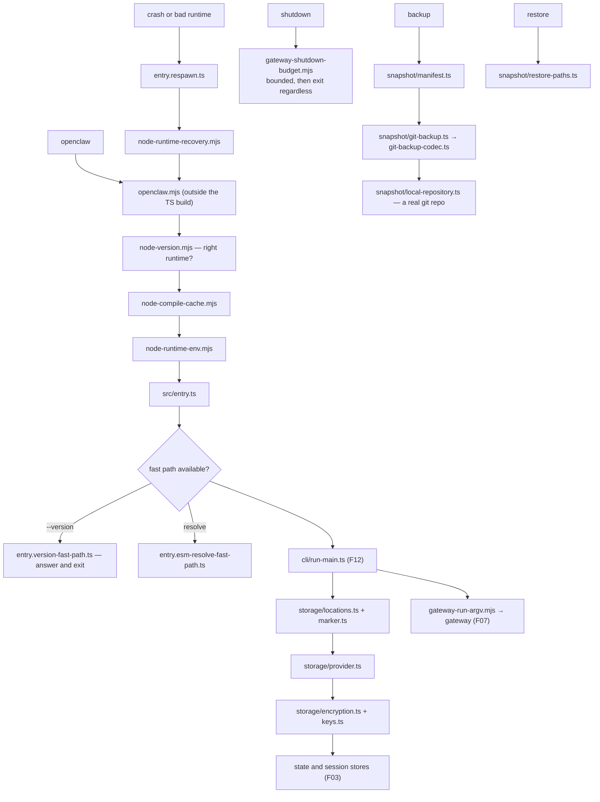

# F33 — the remainder

| | |
|---|---|
| describes | openclaw `v2026.10.3` @ `59cb44796b0f1f0daa0e37af8b1495abb45d9bc1` |
| paths | the repo root, `src/` loose files, `src/{storage,snapshot,memory,web,types,compat}`, and ~17 remaining extensions |
| size | 661 tracked files · ~51,000 LOC |
| purpose | the sweep that makes the pass complete — everything not claimed by F01–F32 |

## 1. The repo root — the process entry point

```
openclaw.mjs                    the binary
node-host-launcher.mjs          launches a node host
docker-entrypoint.mjs
cli-root-options.mjs            root CLI options, precompiled
gateway-run-argv.mjs
gateway-shutdown-budget.mjs     ← shutdown is budgeted
node-compile-cache.mjs          ← compile cache for cold start
node-runtime-env.mjs
node-runtime-recovery.mjs       ←
node-runtime-update.mjs
node-sqlite.mjs
node-version.mjs
```

All `.mjs` with hand-written `.d.mts` beside them — **deliberately outside the TypeScript build**, so they run before anything is compiled or resolved. That is the cold-start path.

`gateway-shutdown-budget.mjs` is the small detail worth noticing: shutdown has a **budget**. A gateway that cannot shut down cleanly in bounded time must still exit, and that decision is made here rather than left to a hang.

`node-runtime-recovery.mjs` plus `node-runtime-update.mjs` mean the runtime can repair and update itself from outside the compiled tree — which is necessary, because a broken compiled tree is exactly when you need recovery.

Also at root: six `tsconfig.*.json` (core, extensions, extensions.projects, scripts, ui, base) confirming the five-way build split; `taxonomy.yaml`; `appcast*.xml` ×3 for Sparkle; `fly.toml`, `render.yaml`, `docker-compose.yml`, `Dockerfile`; `.oxlintrc.json` and `.oxfmtrc.jsonc` (oxlint/oxfmt, not ESLint/Prettier); `.semgrepignore`; `.crabbox.yaml`; `AGENTS.md`, `VISION.md`, `SECURITY.md`, `THIRD_PARTY_NOTICES.md`.

## 2. `src/` loose files — entry and fast paths

```
entry.ts
entry.compile-cache.ts
entry.esm-resolve-fast-path.ts      ←
entry.version-fast-path.ts          ←
entry.respawn.ts                    ←
index.ts · index.entrypoint.ts
library.ts                          ← openclaw as a library
runtime.ts · global-state.ts · globals.ts
logger.ts · logging.ts
polls.ts · poll-params.ts · param-key.ts · utils.ts · version.ts
browser-lifecycle-cleanup.ts
docker-healthcheck.ts
```

Three fast paths — ESM resolve, version, compile cache — plus `entry.respawn.ts` with a dedicated respawn-diagnostics test. The theme matches the no-barrel-files rule found everywhere else: **cold start is treated as a feature.** `openclaw --version` should not pay for resolving the whole program, and it does not.

`library.ts` is worth knowing exists: openclaw is importable as a library, not only runnable as a CLI.

## 3. `src/storage/` — seven files, one of them encryption

```
encryption.ts
filesystem.ts
keys.ts
locations.ts
marker.ts
provider.ts
types.ts
```

A pluggable storage provider with **encryption** and a key module. `marker.ts` is the usual trick of writing a marker file to identify and version a storage directory. Small, and the layer under the SQLite stores in F03.

## 4. `src/snapshot/` — backups are a git repository

```
local-repository.ts                     41 KB
git-backup-codec.ts                     25 KB
git-backup.ts
local-repository-directory-policy.ts
manifest.ts
restore-paths.ts
snapshot-provider.ts
openclaw-snapshot-copy.ts
plus 5 test-support files, including git-backup-streaming
```

Confirming F03: a snapshot is a **real git repository**, with a codec, a manifest, restore paths and a directory policy. `git-backup-streaming.test-support.ts` means large backups stream rather than buffer.

The benefit is that a backup can be inspected with ordinary git. The cost is that git's locking applies — a stale `.lock` under a snapshot repo will make snapshot operations fail with `File exists` rather than anything descriptive.

## 5. The rest of core

```
src/memory/       2 files   memory-artifact-provenance.ts, root-memory-files.ts
src/web/          1 file    provider-runtime-shared.ts
src/types/        3 .d.ts   agent-sessions, node-runtime-globals, qrcode
src/compat/       1 file    legacy-names.ts
src/docs/         (empty of non-test files)
```

`src/compat/legacy-names.ts` being a single file is a good sign: the compatibility shim for renamed things is one place, not scattered.

## 6. The long tail of extensions

**Niche channels — more substantial than expected:**

```
tlon              54 files    Urbit/Tlon
nostr             44          Nostr protocol
irc               42          IRC
twitch            35          Twitch
mxc               23
raft              16
vydra             15
lobster           10
```

**Web search and fetch providers — all thin, as F17 predicted:**

```
firecrawl 19 · tavily 16 · brave 13 · duckduckgo 12 · perplexity 12
exa 11 · searxng 11 · web-readability 7
```

Eight search providers averaging ~13 files each. The provider contract carries them.

**Utility extensions:**

```
file-transfer     65 files   ← the largest in this group
oc-path           37
migrate-hermes    26         migrating from another assistant
onnx              21         local ONNX inference
logbook           20         (also covered in F23)
visitor-access    18         (also covered in F30)
typesafe          15
migrate-claude    15
code-mode-quickjs 13         ← sandboxed JS execution via QuickJS
geolocation       12
document-extract  11
session-share     10
bonjour            9         local network discovery
radius             9
```

Three worth a second look:

- **`code-mode-quickjs` (13 files)** — QuickJS, so model-generated JavaScript can run in a real sandbox rather than the host runtime. The safer answer to "let the model write code and run it", and it pairs with the constrained widget syntax in F24.
- **`file-transfer` (65 files)** — the largest utility extension. Moving files between a user, the gateway and nodes has more cases than it sounds.
- **`migrate-claude` and `migrate-hermes` (41 files together)** — importing history from other assistants, alongside `memory-wiki/chatgpt-import.ts` (F22). Migration in is treated as a product feature.

`bonjour` means openclaw can discover peers on a local network — worth knowing before judging network exposure.

## Process flow — cold start to serving



## Dependencies

**Out** — `core/cli` (54), `core/infra` (41), `support/scripts` (33), `core/config` (16), `core/logging` (15).

**In** — `core/_root` has 49 distinct dependents, which is the entry point and `utils.ts` being imported everywhere.

## Risks and traps

1. **The root `.mjs` files are outside the TypeScript build on purpose.** Changing them does not get type checking from the main `tsconfig`, and they run before anything else. Treat them as the bootloader.
2. **Fast paths can diverge.** `entry.version-fast-path.ts` answers `--version` without the full program. If version reporting changes elsewhere, the fast path must change too.
3. **Snapshots are git repositories, so git's failure modes apply.** A stale lock file produces `File exists`, not a snapshot error.
4. **`src/storage/encryption.ts` is small and load-bearing.** Anything new that persists should go through the storage provider, not straight to the filesystem.
5. **`bonjour` advertises on the local network.** Relevant to any exposure review.
6. **`code-mode-quickjs` is the sanctioned way to run model-written code.** Executing it in the host runtime instead is the unsafe shortcut.
7. **Eight search providers behave differently** despite a shared contract — ranking, snippets and redirect behaviour vary, and `web-search-citation-redirect.ts` (F08) exists because of it.
8. **`oxlint` and `oxfmt`, not ESLint and Prettier.** Local tooling expectations will be wrong.

## Verdict

A remainder worth sweeping rather than skipping. It holds the bootloader — deliberately uncompiled, with three fast paths, a compile cache, respawn diagnostics, runtime recovery and a budgeted shutdown — which is the clearest statement anywhere in the repo that cold start and the ability to recover from a broken install are treated as features.

It also holds the encrypted storage provider under every SQLite store, the git-backed snapshot system, the QuickJS sandbox that is the right place to run model-written code, and a long tail of channels and search providers that are individually small because the contracts above them do the work.

**With this chunk, pass 2 is complete: all 33 chunks of openclaw v2026.10.3 are documented.**
